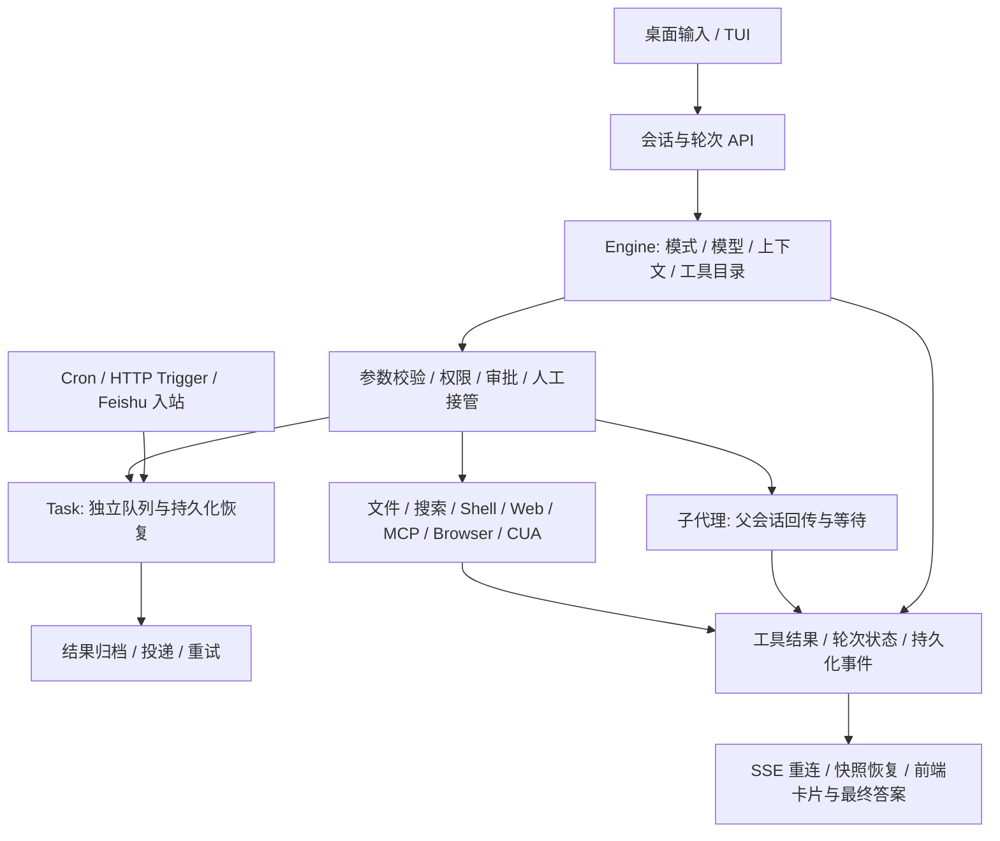

# Agent 全流程审核与修复记录

> 最新增量：参见 [运行时升级决策与验证](docs/upgrade-plan-and-validation-2026-11-11.md)，包含轮询、退出码、恢复、MCP、投递凭据、字节快照及无人值守策略。下文是历轮审核记录。

**后续独立复核更正：** Claude 指出的多项组合场景已在本机复现；此前全量通过不代表这些问题不存在。当前问题判定、触发条件与建议以 [独立复核](docs/review-validation-2026-11-11.md) 为准，本记录保留历史修复和测试事实。

本轮按用户输入到任务结束的执行链审核，覆盖桌面前端、终端、HTTP/SSE、模型与上下文、工具、审批、子代理、后台任务、自动化和恢复。保留公开接口和旧数据读取能力。ask 的含义经用户确认：只读问答，允许查阅，禁止修改和执行命令。

这份记录区分已复现并修复的问题、需要产品决策的问题，以及尚未实机验证的部分。测试通过不代表所有平台、模型、外部服务和 UI 分支都已验证。工作区已有大量其他改动；本轮没有清理或回退它们，也不把整个 Git diff 归为本轮产出。前两轮的依赖、路径、存储、端点修复详见 [前两轮记录](/Users/fjw/Desktop/deepseek-tui-py-main/docs/project-audit-2026-11-11.md)。

**最新状态：** 以下保留历轮发现和验证记录，避免丢失问题来源；当前修复、待审核项和测试结果以文末“继续全流程审核”章节为准。

## 实际执行链



关键边界：子代理和 detached task 的结果归属不同；文件写入、工具执行完成、模型声称完成、外部投递成功也不是同一状态。审核时分别核对了这些边界，没有仅凭“模型返回了一段回答”判断任务成功。

## 已复现并修复

| 编号 | 触发场景与原行为 | 修复与证据 |
|---|---|---|
| F1 | 首页首次发送，创建会话还在等待时切到另一会话。旧请求成功会抢回页面，失败会把当前页面回滚为空；失败的首页草稿还可能丢失。 | 在设置读取、空会话查找、创建返回及异常处核对选择版本。取消尚未提交的过期发送，不动新页面的 SSE；失败草稿按面板保留，回首页恢复。创建成功/失败两个 store 用例和真实 React 输入框按 Enter 的草稿恢复用例均先失败后通过。已经提交到 runtime 的发送仍使用既有后台完成逻辑。 |
| F2 | TUI 提供 ask，但 AppMode 没有 ask；提示词回退为 agent，写文件、Shell、任务等仍暴露。 | 增加 ask 提示、只读工具目录、执行时阻断、只读沙箱；禁用 ask 的 CUA 初始化和指引。真实文件测试确认可读、不可覆盖，旧 agent 请求的写入也不能在切到 ask 后执行。 |
| F3 | TUI、HTTP、Goal 入口直接赋值 mode，跳过工具目录/沙箱更新；进入 YOLO 后离开，自动审批处理器不恢复。 | 共用同步模式配置，异步事件入口复用同一逻辑；退出 YOLO 恢复原处理器。验证 ask→agent 能恢复真实写文件，YOLO→ask→agent 恢复原审批桥。 |
| F4 | 自定义工具名称包含点、冒号、中文、连字符或类似转义序列。注册时编码，流式响应解码，但目录校验仍比较编码名，误拒绝合法工具。 | 目录名单先按传输协议解码一次，再归一化别名。5 种名称通过真实文件读取；空目录仍拒绝该调用，未放宽目录权限。 |
| F5 | fetch_url 的直接读取/HTTP 回退遇到网络超时。底层将 TimeoutException 包装成 ToolError，上层无法统计超时或提示换来源。 | 保留超时类型给上层处理。本机真实 TCP/HTTP 服务接收请求但不返回响应，两次超时后计数为 2 且出现换镜像/来源提示。测试仅豁免该临时回环地址的私网拦截，未修改生产网络限制。 |
| F6 | 通用工具声明一个“任意键→整数”的字典参数。兼容处理删除全部 additionalProperties，字符串值也通过校验，执行器才发生 TypeError。 | 仅放宽 additionalProperties=false，保留 schema 形式的字典值约束。无效值在执行前返回参数错误，合法值可执行，额外旧别名参数继续接受。 |

主要修改入口：

- [前端会话发送](/Users/fjw/Desktop/deepseek-tui-py-main/packages/workbench/src/renderer/src/store/chat-store.ts)、[输入框草稿恢复](/Users/fjw/Desktop/deepseek-tui-py-main/packages/workbench/src/renderer/src/components/chat/FloatingComposer.tsx)
- [工具执行与模式切换](/Users/fjw/Desktop/deepseek-tui-py-main/src/deepseek_tui/engine/orchestrator/tooling.py)、[HTTP 会话入口](/Users/fjw/Desktop/deepseek-tui-py-main/src/deepseek_tui/server/threads/manager.py)、[TUI 命令](/Users/fjw/Desktop/deepseek-tui-py-main/src/deepseek_tui/tui/commands.py)
- [工具注册和参数校验](/Users/fjw/Desktop/deepseek-tui-py-main/src/deepseek_tui/tools/registry.py)、[Web 读取](/Users/fjw/Desktop/deepseek-tui-py-main/src/deepseek_tui/tools/web.py)

## 工具逐项覆盖

原审核从启用 Shell、Web、MCP、task、subagent、automation 的注册表实际枚举到 31 个工具；后续新增资源模板发现后为 32 个。以下逐项核对注册、参数、权限/模式、执行入口与返回去向；并不表示每个工具都调用过真实第三方服务。动态 MCP 和 CUA 另列。agent/yolo 使用行动工具面，plan 有规划专用例外，ask 只保留检查工具。

| 工具 | 核对重点 / 结果 |
|---|---|
| read_file | 分页/大小限制、敏感路径、授权、文件变更戳；真实磁盘回归。 |
| write_file | 新建/覆盖、并发修改拒绝、原子写和撤销元数据；ask 明确禁止。 |
| edit_file | 唯一匹配、空匹配拒绝、CRLF、过期读取与撤销；真实文件测试。 |
| grep_files | 遍历预算、gitignore、敏感文件、符号链接、结果截断。 |
| file_search | 与 grep 的路径边界一致；超大目录要求收窄路径。 |
| exec_shell | 命令/交互两种入口、审批、进程输出溢出、超时和子进程回收；实际子进程停止测试。 |
| web_search | 多供应商路由、密钥错误、结果合并、响应大小限制；非付费回归，未重跑商业搜索服务。 |
| fetch_url | 直连/抽取/回退、重定向逐跳检查、大小限制；修复 F5。 |
| list_mcp_resources | 服务器过滤与客户端分页；真实 stdio MCP 测试。缺资源模板入口见 R5。 |
| read_mcp_resource | server/uri 参数和资源返回；无资源能力服务器明确报错。 |
| browser_use | 35 个 action 的 schema、逐动作审批、上传、观察版本、共享页面与人工接管；原生真实登录/支付未执行。 |
| browser_skill | 7 个 action，保存/运行/增加站点与只读动作区分；禁止并行操纵同一浏览器。 |
| checklist | 查询/更新动作与单个 in_progress 规则、task 元数据转发；不在 ask 中暴露。 |
| update_plan | 文件存储、结构化步骤、计划状态；plan 的内部写入例外，ask 禁用。 |
| note | 第四轮已接入用户 notes_path，支持显式读取最近 64 KiB；保留旧追加接口，ask/plan 仅可读，不自动注入新会话。见 docs/review-fixes-2026-11-11.md。 |
| load_skill | 第四轮按名加载后授予该 skill 目录只读访问，清单含子目录；敏感文件、越界符号链接及写入仍受限制。原路径查找和插件挂载能力保留。 |
| request_user_input | 同批独占、回答桥、无人值守 assistance、过期回答归属。 |
| enter_plan_mode | 用户批准后切模式；ask 不提供模型触发的模式切换。 |
| exit_plan_mode | 接受/修改/离开分支与计划文件；进入 agent/yolo 时使用共同配置逻辑。 |
| agent | spawn/send_input/wait 及 resume；层级上限、父取消、mailbox、结构化最终输出。plan 仅允许 wait、不允许 resume；ask 用 task_list/output 检查既有工作。 |
| task_create | 新任务/恢复互斥、继承权限、禁止模型自提权、嵌套限制、落盘后入队。 |
| task_list | task/subagent/process 汇总、活动/时间/工作区过滤。 |
| task_output | 三种 ID 分流，结果成功状态、artifact、阻塞参数；不同实体语义见 R3。 |
| task_stop | 三种实体停止与清理；真实 Shell 后代退出后才返回的测试通过。 |
| cron_create | 调度参数、时区、工作目录、delivery、run_now 与任务类型。 |
| cron_list | 只读查看；ask 可用，plan 目前整体排除 cron 家族，见 R2。 |
| cron_update | 调度/暂停/恢复更新及权限；ask 禁用。 |
| cron_delete | 停用/删除边界和已有运行记录；ask 禁用。 |
| CreateGoal | 显式目标、预算、用户/模型 actor、当前轮次归属；ask 禁用。 |
| GetGoal | 只读快照；ask 可用。 |
| UpdateGoal | 状态转换、真实完成条件；虽声明 READ_ONLY，实际改变目标状态，见 R8。ask 禁用。 |
| 动态 MCP | 名称路由、能力声明、审批、超时、真实 stdio 服务；默认串行及只读模式接入见 R2。 |
| structured_output | 子代理注入的终止工具，原始 schema 再校验，不等同普通最终文本。 |
| 动态 CUA | 按运行时能力注入；启动/回合结束/人工接管边界、ask/plan 排除；真实操作系统应用操作未全部执行。 |

## 流程核对与验证边界

| 流程 | 核对点 | 本轮证据 / 限制 |
|---|---|---|
| 输入→创建会话→发送 | 乐观气泡、异步创建、切会话、队列、自动标题、草稿 | 修复 F1；React DOM 交互与 store 测试。未把 happy-dom 说成 Electron 人工点验。 |
| API→轮次→模型 | provider/model 路由、活动轮次互斥、模式、审批桥 | lifecycle/approval/user_input 合约测试；模式入口定向测试。 |
| 上下文→模型请求 | system/tool/message 合成、压缩比例、工具结果截断、用户需求保留、重复调用 | 全量 engine 回归；反循环策略的动态结果问题见 R1。 |
| 工具选择→执行 | 当次目录、别名、参数、权限、审批、人工接管、结果成功标记 | F2/F4/F6 及现有审批、计划模式、旧工具名回归。 |
| 子代理 | 类型/模型/工具范围、父上下文、嵌套、取消、wait、mailbox、完成回传 | manager/loop/completion 测试；模型协作质量不能由这些测试保证。 |
| detached task | 入队/排队/执行/取消/超时/终态、进程重启、权限恢复 | 真文件记录与真实进程测试；恢复已执行的外部副作用仍非 exactly-once，见 R4。 |
| 自动化 pipeline | cron/trigger/入站分支、摘要预取、triage、执行、归档、投递与重试 | automation manager/pipeline 测试；未发送真实邮件、飞书或企业微信消息。 |
| 结果→SSE→界面 | 工具卡片、审批回执、序号、重连、resync、快照恢复、会话隔离 | 前端全量测试及后端事件/持久化合约测试。 |
| 文件/Git/撤销/发布 | 路径授权、快照、worktree、冲突、rewind 与数据存储 | 非 live 全量套件包含真实临时文件/Git；未向远端 push 或发布用户项目。 |
| 打包与跨平台 | 类型、依赖导出、运行时路径、平台边界 | 继承前两轮验证；未进行 Windows/Linux 安装包实机验收、macOS 签名发布、Cloudflare D1/R2 分享服务部署。 |

## 初次审核发现（历史记录，最新结论见文末）

以下保留原始审核编号；2026-11-11 后续升级状态见文末。R1、R5 已修复，R4 已按用户确认落实到主投递路径，R2/R7/R9/R12 部分处理。其余仍需确定产品语义或迁移策略。优先级表示建议处理顺序，不代表已证明存在可利用漏洞。

| 编号 | 具体场景 / 证据 | 建议与需要确认的取舍 |
|---|---|---|
| R1 · 高 | [tool_dedup.py](/Users/fjw/Desktop/deepseek-tui-py-main/src/deepseek_tui/engine/tool_dedup.py) 只按连续调用名和参数累计，不比较新输出。实际最小复现：同一 task_output 每次返回递增进度，第 10 次仍被 block，并被要求结束回答。 | 等待/进度工具改为基于状态是否变化和时间预算；普通稳定读取继续防循环。需决定最长等待和无进展阈值，避免解除限制后刷 token。 |
| R2 · 中 | [dispatch.py](/Users/fjw/Desktop/deepseek-tui-py-main/src/deepseek_tui/engine/dispatch.py) 只有资源 helper 被认定为 MCP 并行只读；普通 MCP 搜索也串行。plan/ask 排除任意外部 MCP 工具；plan 连原生 cron_list 也排除。 | 建立明确的工具能力/动作策略。是否信任外部 readOnlyHint、是否允许只读 MCP 在 ask/plan 使用，需要用户决定；不能把“服务自称只读”直接当授权。 |
| R3 · 中 | [task/tools.py](/Users/fjw/Desktop/deepseek-tui-py-main/src/deepseek_tui/tools/task/tools.py) 中 task_output(block=true) 对 agent/process 等待，对 durable task 明确忽略；同一工具不同 ID 的等待行为不同。task_create 说明又强调 detached 结果不回到当前回复。 | 可以保留 detached 设计并在 schema/前端更明确展示，也可增加显式 task wait/订阅。不要仅改成阻塞，否则会改变任务生命周期和用户预算。 |
| R4 · 高 | [automation/pipeline.py](/Users/fjw/Desktop/deepseek-tui-py-main/src/deepseek_tui/automation/pipeline.py) 投递成功后才标记 delivery_done；若远端已接受而本地在落盘前退出，重启可能重复投递。无 automation_manager 时另有单次 poller：没有同等持久化重试，且没有整次 sink 的 30 秒外层时限。具体网络通道自身有超时，因此不等于一定永久卡死。 | 统一为持久化 outbox，按 run/attempt 设幂等标识；明确“不丢”和“不重复”的优先级及不支持幂等的通道行为。先不宣称 exactly-once。 |
| R5 · 中 | [mcp/client.py](/Users/fjw/Desktop/deepseek-tui-py-main/src/deepseek_tui/mcp/client.py) 已处理 resources/list 分页，但项目没有 resources/templates/list 的工具或桥接入口。只提供参数化资源模板的服务，Agent 无法通过现有资源目录发现模板。 | 如需通用 MCP 资源接入，增加模板发现及参数说明；若只支持当前已接服务，可明确支持范围。没有为尚未使用的服务增加猜测性实现。 |
| R6 · 中 | [prompts.py](/Users/fjw/Desktop/deepseek-tui-py-main/src/deepseek_tui/engine/prompts.py) 用文本前缀 `[cron:` / `[Scheduled automation request]` 推断工具 profile。普通用户粘贴这类文本开头时也可能被收窄目录；cron 固定工具面没有子代理、browser/CUA、checklist 等。 | profile 改由可信调用元数据传入，保留旧前缀的读取兼容。是否让 cron 执行浏览器/子代理工作及对应人工审批策略，需要明确。 |
| R7 · 中 | [dispatch.py](/Users/fjw/Desktop/deepseek-tui-py-main/src/deepseek_tui/engine/dispatch.py) 的 quick-plan 强制路径依赖固定英文词组；相同中文需求不会进入同一分支，否定或引用中的词组也缺语义区分。 | 由显式请求字段/用户模式控制，或保留为弱提示而非硬流程。需选择“快捷计划”是 UI 功能还是自然语言启发式。 |
| R8 · 中 | 工具能力字段不是一致的副作用契约：agent 合并 EXECUTES_CODE 与 READ_ONLY，依靠逐 action 检查；UpdateGoal/SetGoalBudget 声明 READ_ONLY 但会变更目标状态。当前调度有特殊处理，不能直接认定现有执行绕过审批。 | 拆清“只检查外部世界”“修改内部会话状态”“外部副作用”并统一调用方；否则新增通用 read_only_tools 消费方容易误用。不能简单删除 READ_ONLY 而不检查原调用方。 |
| R9 · 中 | [automation.py](/Users/fjw/Desktop/deepseek-tui-py-main/src/deepseek_tui/tools/automation.py) 的 reconcile 在锁内逐个 await run，单次投递可占 30 秒；多个慢通道会线性推迟后续运行记录更新。 | 状态收敛与外部投递拆开，限定投递并发并保留同 run 排他。并发数、同渠道顺序和速率限制需确认；本轮没有制造真实通道故障。 |
| R10 · 低 | SetGoalBudgetTool 类仍存在并被直接测试，但 goal_tools() 不注册；旧 task/agent/automation 名称仍通过 normalize_legacy_tool_call 转发。 | 当前按用户要求保留兼容，不删除。后续要退役，应先确定外部调用者、历史记录读取与弃用周期；“目录中没有”不等于“已无用途”。 |
| R11 · 中 | 五个核心文件合计约 20,055 行：thread manager 7,663；chat store 4,205；orchestrator core 3,822；前端 runtime adapter 2,435；automation 1,930。具体重复边界已有 F3 作为实例。 | 优先抽出模式策略、发送事务、任务状态转换、投递队列四个明确职责；先锁住可观察行为，逐步迁移。没有为了减行数做大规模重写。 |
| R12 · 中 | 全量 Python 仍有多线程进程中的 fork 警告，以及 subprocess transport 在事件循环关闭后析构的警告；后者在不同测试结束时显现，当前无法把最终报出测试当作创建资源的责任方。 | 单独做带资源分配追踪的子进程生命周期诊断。保持为未定位项，不通过忽略 warning 宣称已修好。 |

附加边界：文件工具的路径提示有部分仍说“工作区外直接拒绝”，而实际支持用户路径授权；Web 的私网抓取限制与 Browser 的 localhost 预览能力不同。两者目前是保守边界，不是本轮擅自放开的理由。后续应统一面向用户的说明和工具选路提示。

## 测试记录

| 验证 | 结果 |
|---|---|
| Python 全量 `-m 'not live and not live_mcp'`（包含 e2e） | 4,223 passed，175 skipped，36 deselected，2 warnings，198.84 秒。 |
| 最终模式入口定向测试 | 145 passed，覆盖 turns lifecycle、goal、TUI、ask/plan。 |
| 文件/实际进程/MCP/hooks/审批/任务恢复/自动化定向复核 | 145 passed，9.18 秒。 |
| 最后参数约束修复后的 registry/schema/兼容/结构化输出复核 | 56 passed。 |
| 前端全量 | 317 files / 2,087 tests passed。首次受沙箱端口限制失败，允许本机监听后完整重跑通过；未靠跳过相关测试处理。 |
| TypeScript | `npm run typecheck` 通过。 |
| 补丁空白检查 | `git diff --check` 通过。 |
| 实际模型供应商 | 沿用前轮两次 DeepSeek Flash 实测；本轮修复主要是状态、参数和 IO 边界，没有追加收费调用。 |

全量与最后的定向验证是分次执行；最后 F6 的新增用例在 56 项定向复核中，不计入前面的 4,223。Skipped/Deselected 不计作已验证。真实模型不作为状态机边界复现的必要条件；可控制的模型输入/响应替身用于稳定触发分支，文件、TCP 服务和子进程确实执行。

新增回归文件：[ask/mode](/Users/fjw/Desktop/deepseek-tui-py-main/tests/test_ask_mode_readonly.py)、[工具名称和 schema](/Users/fjw/Desktop/deepseek-tui-py-main/tests/test_audit_tool_dispatch.py)、[真实 HTTP 超时](/Users/fjw/Desktop/deepseek-tui-py-main/tests/test_audit_web_timeout.py)。前端用例在 [会话隔离](/Users/fjw/Desktop/deepseek-tui-py-main/packages/workbench/src/renderer/src/store/chat-session-isolation.test.ts) 和 [Composer 交互](/Users/fjw/Desktop/deepseek-tui-py-main/packages/workbench/src/renderer/src/components/chat/FloatingComposer.paste.test.ts)。


## 后续优化升级（2026-11-11）

用户已确认：**远端可能收到但本地无法确认时，保留记录并暂停自动重发；核对接收方后由用户确认收到或明确要求重投。** 本轮在原有兼容接口和旧记录读取能力上增量修改，没有批量清理历史工具或重写核心模块。

| 原审核项 | 已实施行为 | 验证证据 |
|---|---|---|
| R1 动态等待 | task_output、task_list、agent wait 按原始输出是否变化更新连续重复次数；持续进展不触发第 10 次误停。无进展仍保留 10 次阈值，原有轮数/时间预算不变。比较发生在截断、临时文件路径装饰之前，避免新路径伪装成进展。 | 真实 TaskManager 在临时工作区写 20 个文件，持久化进度，逐次通过 TaskOutputTool 读回，最后取得完成结果；静止输出及每次变换溢出文件路径的用例仍会停止。 |
| R4 主投递路径 | 在外部发送前原子写入 sending；成功为 sent；损坏响应、未知异常、超时/取消或重启遗留 sending 转为 uncertain。uncertain 不自动重发。明确拒收/连接失败按原 best_effort 配置处理，非 best_effort 最多 5 次。新增 delivery_state，保留旧 delivery_done；delivery_attempts 现在计入实际发送尝试，成功首发为 1。 | 真 HTTP 接收端收到正文但返回损坏响应，重开磁盘记录后接收次数仍为 1；明确拒收后第二次成功；写盘失败没有发送；发送期间取消持久化为 uncertain；模拟 sending 后退出，恢复不发送。 |
| R4 前后端闭环 | 自动化中心统一展示待确认记录，包括没有普通任务卡片的 HTTP trigger，以及超出普通历史分页的旧运行。提供“已收到，标记投递成功”和“确认未收到，重新投递”。接口校验操作枚举及当前状态；重复确认不能再次重置记录。确认不重新执行模型任务。 | FastAPI 合约验证真实磁盘状态；React DOM 实际点击两种操作，等待中禁用，完成后移除待确认行；旧记录/旧错误兼容展示。 |
| R9 慢通道阻塞 | 不同自动化之间最多 4 个收敛 worker；同一个自动化保留原运行顺序。每次 sink 有 30 秒外层限时。 | 真 HTTP 慢接收端等待释放时，另一自动化的快接收端已收到正文；释放后两条记录均为 sent。 |
| R5 MCP 模板 | 新增 list_mcp_resource_templates，从 client → manager → 工具注册 → agent/ask/plan/cron 目录接通，复用现有有界分页与服务器能力检查。没有资源能力或方法不存在时兼容返回空列表。read_mcp_resource 说明接受展开的模板 URI。 | 真 stdio MCP 服务只提供模板、普通资源列表为空；读取两页模板，展开 URI 后读取临时目录真实文件；agent/ask/plan 三种模式通过。协议依据：[MCP Resource Templates](https://modelcontextprotocol.io/specification/2025-06-18/server/resources#resource-templates)。 |
| R2 规划只读查看 | plan 允许 cron_list，继续禁止 cron_create/update/delete；不因新增原生只读工具而开放外部 MCP 的自报只读权限。 | 真实保存自动化记录，通过 plan 工具目录读取；尝试删除被执行层拒绝，记录仍存在。 |
| R7 快捷规划 | 英文词组匹配只追加条件提示，不再断言用户放弃代码调查，也不再要求跳过调查直接退出规划。提示明确处理引用、否定和依赖项目证据的情况。 | 文本与调用路径复核；没有新增收费模型调用，因此不把自然语言规划质量算成实测结论。 |
| R12 部分清理 | MCP e2e fixture 在结束时显式 stop_all 回收真实服务进程。 | MCP 定向套件通过。全套子进程告警是否消失以最终全量记录为准，不能将这一处清理等同全部定位。 |

### 上一轮未结项（历史记录，最新结论见文末）

1. **外部 MCP 的只读信任（R2）**：保留当前保守策略。是否添加用户可配置的可信工具/服务器名单，需先确定授权边界；不能仅凭服务的 readOnlyHint 开放 ask/plan。
2. **detached task 的等待语义（R3）**：保留现有独立任务生命周期。若希望 task_output 对 task/agent/process 完全统一等待，需要同时明确通知归属、取消和预算，不仅改一个 block 参数。
3. **旧单次投递兼容入口（R4）**：正常 AppRuntime trigger/cron 已接持久化 manager；外部调用者若直接调用无 manager 的旧 poller，仍是单次等待投递，仅增加整次 30 秒限时。升级为持久化必须提供存储归属。当前记录持久化发送状态，尚未冻结第一次发送的正文和通道配置；人工重投会使用可用的当前任务结果/配置，若要求严格重放原消息，需要额外的投递快照设计。外部渠道不保证 exactly-once；本轮策略选择结果不明时人工处理，不能承诺绝不丢消息。
4. **profile 元数据迁移（R6）**：正常 durable task 已有 pinned profile，但普通会话仍兼容文本前缀推断。建议把创建器、HTTP、CLI 的 profile 改为显式字段，旧前缀仅用于旧记录迁移；本轮未擅自取消旧创建器行为。
5. **工具副作用契约（R8）**：UpdateGoal/旧 SetGoalBudget 的 READ_ONLY 声明，以及 agent 多动作合并声明仍需统一。实际 ask/plan 执行限制保持；下一步应区分内部状态写入与外部副作用，并检查所有消费者。
6. **调度隔离的下一步（R9）**：4 个 worker 避免单个慢渠道阻塞所有渠道，但 scheduler 锁仍覆盖整批收敛，同一自动化内慢发送仍会推迟后续记录；若要进一步独立 outbox worker，需要决定同渠道限流和顺序策略。
7. **兼容删除与大模块拆分（R10/R11）**：保留旧类、别名和旧数据读取。没有证据证明外部调用者已迁移，不删除；大文件按职责分阶段拆分，避免混入行为修复。
8. **运行环境和实机覆盖（R12）**：子进程生命周期告警继续跟踪；未发送真实邮件/飞书/企业微信，未做 Electron 人工点验或跨平台安装包测试。React DOM 交互、真实 localhost HTTP 和 stdio 进程的范围分别列出，不混称全面实机验收。

### 上一轮验证记录

| 检查 | 最终结果 |
|---|---|
| Python 全量 `.venv/bin/python -m pytest -q -m 'not live and not live_mcp'` | **4,256 passed / 175 skipped / 36 deselected / 2 warnings**，213.45 秒；包含真实 IO 的 e2e。 |
| 前端全量 `npm test` | **318 files / 2,090 tests passed**，28.83 秒。 |
| TypeScript `npm run typecheck` | web / node 两套配置通过。 |
| 变更完整性 | `git diff --check`、受影响 Python 包的 compileall 通过。 |
| 费用与外部投递 | 本轮未额外发起收费模型调用，未发送真实邮件/飞书/企业微信；真实接收测试仅使用 localhost。 |

Python 两个告警仍是 PTY 在多线程进程中 fork，以及事件循环结束后的 subprocess transport 析构。没有隐藏或豁免这些告警。前端存在 Node 测试环境的 localstorage-file 路径提示，测试仍通过。175 项跳过和 36 项未选入不算验证通过；原生桌面人工交互及真实第三方通道仍未覆盖。

完整输出：`/tmp/upgrade-python-final.log`、`/tmp/upgrade-ui-final.log`、`/tmp/upgrade-typecheck-final.log`。第一次全量发现的测试替身、目录快照和投递重试断言已修正，以上是再次完整运行的结果。

新增核心回归入口：`tests/test_delivery_journal.py`、`tests/engine/test_tool_dedup.py`、`tests/test_mcp_e2e_real.py`、`tests/contract/test_automations.py`、`AutomationCenter.delivery.test.ts`。


## 继续全流程审核（2026-11-11，最新结论）

用户确认采用 **显式可信 MCP 只读名单** 和 **后台任务有界等待**。继续保留旧接口与旧记录，修复可复现的问题；没有根据文件行数或工具年代直接删改模块。

### 已实施并验证

| 审核项 | 最终行为与证据 |
|---|---|
| R2 MCP 信任 | 用户配置新增 `mcp_read_only_tools`，按完整工具名精确匹配，不采信服务 `readOnlyHint`。ask/plan 的目录和执行层均检查；撤销授权后旧目录调用也拒绝。真实 stdio MCP 在两种模式均验证授权、执行与撤销。真实 TOML 复现并修复项目配置覆盖信任名单的问题；两种项目配置入口均不能替用户授权。 |
| R3 后台等待 | durable task 的 `task_output(block=true)` 默认等 180 秒、最长 3600 秒；超时返回当前状态和 `timed_out`。取消等待不取消任务，自等待被拒绝。真实 TaskManager 任务在超时、取消等待后继续执行并写出文件，随后可取回完成结果。 |
| R4 投递快照 | 首次发送前持久化原正文、自动化名称和解析后的投递配置；重投读取快照。真实 HTTP 首次收件但返回损坏响应后，修改自动化目标并让原任务不可读取，显式重投仍发送原地址与原正文。界面可展开原文，企业微信 webhook 密钥不展示。旧记录无快照时保持读取兼容，从首次新尝试建立快照。 |
| R6 显式工具范围 | `StartTurnRequest` / `SendMessageOp` 传递 `tool_profile`，运行时不再从普通聊天前缀推断。持久任务的 pinned profile 优先，下一普通轮次恢复完整目录；脚本化模型驱动真实 Engine 验证。旧检测函数、旧任务迁移和公开导入兼容保留。 |
| R7 语言一致性 | 移除运行时英文 quick-plan 词组触发分支，规划行为由显式模式和现有规划提示控制。兼容帮助函数仍保留，不能把移除启发式等同于已经验证所有模型的规划质量。 |
| R8 副作用契约 | 增加 `MUTATES_STATE`，目标更新、模式切换不再声称纯只读；agent 多动作联合声明和带 resume 的调用不再归为只读。发现 `task_output(process_id + task_id)` 会写入归档：按输入标记并在 ask/plan 拦截。真实进程验证拦截后没有归档文件，纯输出读取仍成功。 |
| R9 状态与投递隔离 | 先完成整批运行状态收敛，再由最多 4 个 worker 投递；每条 run 的锁协调发送与人工确认，锁以弱引用保留。同一自动化保留发送顺序。真实慢 HTTP 接收端阻塞时，其他任务状态已完成、快渠道已收件，旧的待确认记录仍可人工确认。原有 due tick 本来就有独立锁，此处不是修复 cron tick 被同一锁阻塞。 |
| R11 模块边界 | 工具 profile 的常量、目录策略和兼容检测迁入独立 `engine/tool_profiles.py`，`prompts.py` 保留公开符号转发。没有为了减少行数重写 thread manager、chat store 等大模块。 |
| R12 子进程回收 | 隔离复现发现一个后台进程测试未等待退出；补上实际回收。PTY 改用 asyncio subprocess 启动与等待，消除多线程宿主直接运行 Python fork 分支；兼容旧 PtyProcess 构造。真实 PTY/环境/进程定向 84 项以告警转错误通过，全量复核结果见下表。 |
| 权限说明一致性 | 写文件说明对齐现有用户写入授权；fetch_url 明确只处理公网读取，授权的 localhost 预览使用 browser 工具。只调整说明，不改变访问策略。 |
| 原生桌面闭环 | 新增可重复脚本，以独立临时用户目录启动真实 Electron、实际 AutomationCenter、IPC 和 FastAPI。真实点击两种确认操作，验证磁盘状态分别为 sent/pending，待确认 API 列表清空。无模型调用，无外部消息发送。 |

### 当前保留与待审核事项

1. **无人值守 cron 工具范围（R6）**：现有固定目录仍不开放 browser/CUA、子代理和交互式提问。是否扩大是产品权限与预算决策；本轮只修复文本误触发，没有擅自开放后台操作能力。
2. **旧无 manager 投递入口（R4）**：独立调用 `deliver_when_task_completes` 仍是有时限的单次兼容入口，不具备重启恢复。正常 AppRuntime 使用持久化 manager。若要迁移外部调用者，需先确定存储位置和历史调用者；本轮在文档中明确区别。外部通道不承诺 exactly-once。
3. **旧工具退役与进一步拆分（R10/R11）**：旧类、别名、旧数据读取继续保留。没有调用者迁移证据，不把它们判定为可安全删除。发送事务、状态转换等大模块进一步拆分可独立进行，本轮仅抽取行为边界明确的 profile 策略。
4. **平台与外部服务验收**：已覆盖原生 Electron 的新增确认流程，但未覆盖每个桌面页面、Windows/Linux 安装包、macOS 签名发布、真实邮件/飞书/企业微信投递和全部 CUA 应用操作。它们不能由本地 HTTP、DOM 或单元测试替代。模型调用质量沿用此前记录，本轮没有新增收费调用。

这些事项是明确保留的行为或验证缺口，不应再把已完成的名单、有界等待、快照、能力声明与子进程修复列为待决定。

### 最终验证

| 检查 | 结果 |
|---|---|
| Python 全量（非付费 live 标记） | **4,268 passed / 175 skipped / 36 deselected，零 warnings**，195.41 秒。全量结束后仅调整两处工具说明及新增文件格式，另做定向复核。 |
| 前端全量 | **318 files / 2,090 tests passed**，25.41 秒。与构建并发时首次出现 3 个超时；单文件复核与构建结束后的全量均通过，未放宽超时或跳过失败项。资源竞争是解释假设，未据此修改业务代码。 |
| TypeScript / production build | `npm run typecheck` 与 `npm run build` 通过。 |
| 原生 Electron | `check-automation-delivery.cjs` 返回 passed，磁盘状态 `[pending, sent]`。 |
| 配置与只读边界 | 最新配置/profile/副作用定向 30 项通过；ask/plan、真实进程、有界等待与统一任务定向 34 项通过。 |
| 最后说明与格式复核 | 文件授权/拒绝、fetch、browser、本轮新增测试及工具目录：**95 passed / 2 skipped**；新增 Python 文件 Ruff 检查、`git diff --check` 通过。 |
| 费用 | 本轮没有收费模型调用或真实第三方消息投递。 |

复跑入口：

```bash
.venv/bin/python -m pytest -q -m 'not live and not live_mcp'
cd packages/workbench
npm test
npm run typecheck
npm run build
./node_modules/.bin/electron scripts/check-automation-delivery.cjs
```

原生脚本依赖已构建的 renderer CSS；测试服务器是 `scripts/audit-delivery-server.py`，仅监听临时 localhost 端口，使用临时磁盘目录。测试结束清理自身进程与目录。

本轮完整输出：`/tmp/audit-all-python-final.log`、`/tmp/audit-all-ui-final.log`、`/tmp/audit-types.log`、`/tmp/audit-build.log`、`/tmp/audit-electron.log`、`/tmp/audit-final-descriptions.log`。跳过及未选入的用例不计为通过。


## 第四轮：独立复核后的修复（2026-11-11）

详细实现、实际测试和保留事项见 [修复与验证报告](docs/review-fixes-2026-11-11.md)，原问题的真实性与修法取舍见 [独立复核](docs/review-validation-2026-11-11.md)。Claude 原报告保持不变。

本轮修复明确拒收后的配置更新、快照凭据脱敏、任务恢复后的发送归属、本地通知幂等、后台嵌套阻塞等待、失败/取消历史、note 显式读取、skill 目录只读访问、模式/提示词/CUA 同步、`/yolo`、MCP 审批范围与诊断、前端待确认加载隔离、grep 部分结果、重采样事件闭合、网络审批和当前轮 fork context。完成记录的对账读取由 4 次降为 1 次，无关运行的讨论不再等待慢投递。额外修正 PTY 后台和超时分支遗留的未定义 PID。

验证：Python 全量 **4,294 passed / 175 skipped / 36 deselected，零 warning**；前端 **319 files / 2,091 tests passed**；typecheck、build、原生 Electron 流程通过；最后共享目录及历史契约定向 **51 passed**。测试包含真实本地 HTTP、stdio MCP、PTY、文件、任务 worker 和会话存储，没有使用占位依赖或调用付费模型。

仍待审核：非阻塞轮询额外成本上限、shell 预期非零退出语义、soft-resume 恢复预算、非文本覆盖、生成目录搜索范围、重复输出存储/token 性能、MCP 并发契约、公开兼容接口退役、无人值守范围，以及跨平台/CUA/外部渠道实机验收。历史快照按再次写入清理，未批量改写全部历史凭据副本；不把这些保留项描述成全部解决。

## 第五轮：第四轮复审的五项修复（2026-11-11）

本轮按用户确认的范围修复 R4-1～R4-5，详情见 [复审后修复记录](docs/review-followup-2026-11-11.md)：note 按实际读/写操作审批；sending/uncertain 不因当前渠道关闭而被历史清理删除；网络审批回调不再复制并丢弃 metadata；MCP 缺失工具诊断等待成功发现；file_search 超预算保留部分结果。

**D12 范围更正：** 默认应用一直使用 `network_policy=None`，此前网络审批桥只适用于显式注入 NetworkPolicyDecider 的集成。本轮没有正式启用网络策略，没有新增应用配置开关。README 和前两份报告的相关表述已修正。

R4-6 只补本地适配测试：Anthropic 合并连续 user，Chat Completions / Responses 保留两个 user，均保留请求内容，不虚构 assistant 回复。没有据此声称已完成各供应商线上验收。

新增 18 项与相关 147 项定向测试通过；Python 全量 **4,312 passed / 175 skipped / 36 deselected，零 warning**，前端 **319 files / 2,091 tests passed**。详细范围与日志记在上述本轮报告。此前同意暂缓的预算、旧接口和外部实机验收事项继续保留。
