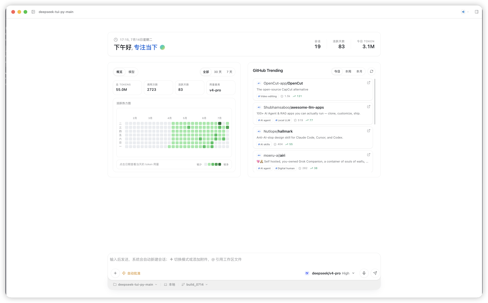

# DeepSeek Workbench

**本地 AI 编程工作台。** 聊天、改代码、看用量、跑自动化——一个 Electron 窗口搞定。

<p align="center">
  
</p>

<p align="center">
  <em>下午好，专注当下 —— 会话、活跃天数、今日 Token，一眼尽收</em>
</p>

---

## 为什么是它

多数 AI 助手只给你一个对话框。Workbench 给你的是**一整块桌面工作台**：

| 你想要的 | 它怎么给 |
|---------|---------|
| 改仓库里的代码 | Agent 读写本地工作区；文件默认应用内打开，Diff / 审批一眼过 |
| 知道自己烧了多少 Token | 用量概览 + GitHub 式活跃热力图，点日期看当天 |
| 跟上开源风向 | 主屏右侧 GitHub Trending，今日 / 本周 / 本月 |
| 可信任的执行 | 写文件、跑命令、联网都可审批，策略可记本会话 |
| 扩展能力 | 应用市场统一管理 MCP、Skills、Plugins；定时任务可投递飞书 |

底层是完整的 Python Agent Runtime（70+ 工具、子代理、策略沙箱）；上面是打磨过的桌面 GUI——不是网页套壳。

> 也喜欢终端？同仓库还带 `deepseek-tui` 文本界面，见文末。

---

## 三分钟启动

**环境**：Python 3.10+（推荐 3.12）、Node.js 20、DeepSeek API Key。

Python 核心运行时的最低声明版本为 3.10；内置浏览器依赖仅在 Python 3.11+
安装，使用浏览器建议直接选择 3.12。桌面 CUA 的平台入口目前接受
Apple Silicon macOS 和 X11 Linux；Windows 不支持该入口。
应用级观察等能力还依赖具体平台；核心运行时可安装不代表全部桌面功能可用。

```bash
git clone https://github.com/fjw1049/deepseek-tui-py.git
cd deepseek-tui-py

# 1. Python 运行时
uv venv .venv --python 3.12
uv sync --extra dev

# 2. 配置 Key（任选）
export DEEPSEEK_API_KEY=sk-your-key-here
# 或：mkdir -p .deepseek && cp config.example.toml .deepseek/config.toml  # 填入 api_key

# 3. 安装 GUI 并启动（首次会下载 Electron，约 3–6 分钟）
cd packages/workbench && npm ci && cd ../..
unset ELECTRON_RUN_AS_NODE   # 在 Cursor 里开发时建议执行
./scripts/dev-workbench.sh
```

启动后请用 **Electron 窗口**聊天。`http://127.0.0.1:7878` 是后台 Runtime API，不是界面。

---

## 主界面一览

从上图你能直接看到：

- **问候与状态条**：日期时间 + 会话数 / 活跃天数 / 今日 Token
- **用量概览**：总 Token、调用次数、最高使用模型，以及可点击的活跃热力图
- **GitHub Trending**：今日 / 本周 / 本月热门仓库，刷灵感不切窗口
- **智能体输入框**：`+` 切换 Agent / Plan / Ask / Goal 或加附件，`@` 引用工作区文件；模型与推理强度就在手边

侧栏：新建会话（⌘N）、搜索（⌘K）、项目视图（⌘J）、应用市场、定时任务、消息频道。首页可切简洁 / 普通布局。

打开会话后还有：流式回复与推理过程、工具调用轨迹、待办与子代理；右侧编辑器 / 变更 / 终端 / 预览（也可切 IDE 布局，编辑器优先）；桌面宠物（可关）。

---

## 功能清单

- **多会话 Agent 聊天** — 流式输出、推理过程、工具卡片、待办与子代理
- **四种模式** — Agent 执行；Plan 先规划再动手；Ask 只回答不改文件；Goal 多轮推进直到完成或阻塞
- **本地工作区** — 绑定项目目录，Agent 直接读写你的代码
- **工具审批** — 写文件 / 跑命令 / 联网可允许、拒绝，或本会话记住
- **内置编辑器与 Diff** — Material 文件图标，点击文件应用内打开；变更列表双击进编辑器。也可切 IDE 布局
- **项目视图** — 按项目看草稿 / 进行中 / 已完成，⌘J 打开
- **⌘K 搜索** — 项目、会话与常用操作，建议 + 最近
- **用量与热力图** — 个人 Token 账本，点日期下钻
- **联网搜索** — AnySearch + Tavily 合并结果，可抓网页
- **浏览器登录复用** — 可从所选本机 Chrome 用户按网站勾选导入 Cookie，无需先打开网站；邮箱、支付、银行、云控制台等敏感网站默认不选，勾选后需再次确认；重新同步时所选网站与 Chrome 保持一致（Chrome 中退出的这里也退出，取消勾选会移除该网站从 Chrome 带来的登录）；显示导入条数和网站数；没有或无法读取时继续浏览。应用内的新 Cookie 自动保存并在对话间复用，退出登录不会自动导入旧 Cookie。更多菜单中的「管理网站登录状态」可手动重新同步、取消记住来源或清除保存的数据。
- **应用市场** — MCP、Skills、Plugins 同一页发现与安装；技能 / 插件说明在可拖宽的右侧抽屉
- **自动化任务** — 定时 / 触发式 Agent，结果可投递飞书或邮件
- **设置** — 通用、外观、快捷键、模型、搜索、钩子、权限、数据、归档、引导

输入框示例：`@src/main.py 解释这段` · `@yahoo-finance 查英伟达股价`

浏览器 Cookie 同步只读取你选择的本机 Chrome 用户，不导入密码、书签和浏览历史。
macOS 可能请求钥匙串授权；系统拒绝访问、浏览器加密不兼容或数据库不可读时，
会显示导入失败，不会自动重试，你仍可直接在应用网页里登录。外部 Chrome 的分区 Cookie 当前跳过并提示，
不把同步成功当成网站已登录。已有页面同步后由你决定是否刷新，避免丢失未提交内容。
Cookie 保存在独立的本地私有目录中，普通对话导出不会包含它们；取消记住来源不等于退出登录；访问网站不会再次读取 Chrome。
在会话设置中明确关闭网站数据保留的对话仍使用临时模式。

---

## 常见问题

| 现象 | 处理 |
|------|------|
| 启动报错 `Cannot read properties of undefined` | `unset ELECTRON_RUN_AS_NODE` 后再跑 `./scripts/dev-workbench.sh` |
| 浏览器打开 7878 只有 JSON | 正常——请用 **Electron 窗口** |
| 首次启动很慢 | 第一次 `npm ci` 要下 Electron（~150MB） |
| 连不上 Runtime | 检查 API Key；确认 `.deepseek/config.toml` 或环境变量 |

更细排错见 [`packages/workbench/README.md`](packages/workbench/README.md)。

---

## 配置

运行时数据默认在 `~/.deepseek/`（也可用仓库内 `.deepseek/` 作项目覆盖）：

```toml
# .deepseek/config.toml
provider = "deepseek"
model = "deepseek-v4-pro"

[providers.deepseek]
api_key = "sk-your-key-here"

# 可选：联网搜索（任一 Key 即可）
# anysearch_api_key = ""
# tavily_api_key = ""

[features]
tasks = true
automations = true
mcp = true
plugins = true
```

也可用 `DEEPSEEK_API_KEY`。完整项见 [`config.example.toml`](config.example.toml)。  
MCP 默认：`~/.deepseek/mcp.json`；CLI：`deepseek-tui mcp list|add|enable|focus|…`。

ask/plan 默认不开放外部 MCP 工具。可在用户 `config.toml` 顶层显式指定已经核对过的只读工具完整名称（精确匹配，不支持通配符）：

```toml
mcp_read_only_tools = ["mcp_my_docs_search", "mcp_my_docs_read"]
```

名单属于用户授权，不从服务的 `readOnlyHint` 或插件声明自动生成，项目目录中的配置也不能覆盖此名单。启用前需确认工具实际只读；修改配置后重启 Runtime。名单允许 ask/plan 的只读接入，并在所有模式下免除这些工具的重复审批；移出名单后恢复对应模式的可用性和审批策略。工具列表接口的 `model_name` 是可复制的完整名称；对应服务成功完成工具发现后，仍不存在的名单项才会提示核对；延迟发现、发现失败或尚未验证的缓存不会被当成拼写错误。

工具范围由轮次 API 的 `tool_profile` 字段指定（`full`、`cron`、`automation_composer`），普通聊天文本不会切换工具范围。旧任务的前缀仍可用于历史数据迁移。

`task_output(block=true, timeout_ms=...)` 支持有界等待任务、子代理和进程；取消等待或超时不取消独立任务。正在执行的 durable task 不能阻塞等待另一个未完成的 durable task，避免占住执行 worker；主会话仍可阻塞等待。

自动化投递结果不明时暂停自动重发，在自动化中心查看原消息并确认收到或明确重投。发送前保存正文和目标身份；明确拒收后重试会采用修正后的投递配置，保留原正文。结果不明时保留原目标：企业微信快照只保存目标指纹，当前凭据已变更时需恢复原目标后才能重投，避免误发到新接收方。恢复同一失败任务时，旧的待确认发送单独保留，新结果独立投递。

`note(action="read")` 显式读取最近的笔记（最多 64 KiB），`note(content="...")` 保持原追加语义；ask/plan 只允许读取。笔记路径遵循用户 `notes_path` / `DEEPSEEK_NOTES_PATH`，不会自动注入每个项目。按名加载 skill 后，其目录仅获得读取权限，敏感文件和越界符号链接仍受限制。

项目记忆可通过聊天使用：“记住这个项目使用 pnpm”“查找之前记住的测试要求”“更新这条记忆”“忘记这条记忆”。Agent 使用 `memory_read` 检索/读取，使用 `memory_write` 保存/更新/删除；ask/plan 仅开放读取。记录保存到 `$DEEPSEEK_HOME/memories/`（默认 `~/.deepseek/memories/`），同一本机 Git 仓库的子目录和 linked worktree 共享，独立 clone 不共享；非 Git 项目按工作目录隔离。

每条记忆包含来源、适用条件和版本号，更新/删除须先读取当前版本。来源表示保存操作所在会话，不代表内容已经验证；历史记忆不能替代当前请求、代码和测试结果。

有效记忆在预算内时完整提供，超预算时只提示记录总数及 `memory_read` 的分页入口，不用关键词、停用词或固定相关性分数筛掉内容。模型通过省略 query 浏览记录、跟随 `next_offset` 读取后续页面并判断适用性。`query` 仅作显式字面子串过滤，不是语义搜索；没有字面匹配时仍可不带 query 浏览。返回完整条目，页码按实际返回的条目数推进，字符预算截断不会跳过记录。`search_skills` 同样支持省略 query 和按 `next_offset` 浏览完整的可调用技能目录，不做相关性打分。

`memory_write` 可指定 `branch`、带时区的 ISO8601 `expires_at`、`files`（最多 10 个相对路径，记录文件指纹）和 `topic`。分支不匹配、文件变化/丢失或过期时停止自动召回，每次注入前重新校验，同次检查共享分支和文件指纹结果。同内容但不同类别、topic、分支、期限或文件条件的记录不会被静默当作重复。内容更正默认保留已有条件，显式传入 `files` 才刷新指纹；同一 active topic 要读取后更新，自由文本适用条件由模型判断。

不再后台提炼候选，只有用户明确要求时才由 Agent 保存。旧配置中的 `capture_candidates`、`idle_seconds`、`max_candidates_per_pass` 被忽略，不再启动后台工作。已有候选可用 `memory_read(status="candidate")` 查看，用 `accept` 确认或 `forget` 删除；接受前仍核验旧来源有效性。

```toml
# 用户级 ~/.deepseek/config.toml；项目配置不能覆盖
[memory]
enabled = true
auto_recall = true
max_recall_chars = 4000
```

自动召回正文最多 4,000 字符，并检查上下文 token 余量；不足时跳过。正文带独立来源标记，不进入系统提示词、用户请求账本、压缩器或持久会话历史。单条正文最多 2,000 字符，最多 1,000 条 active/candidate。显式记忆独立于聊天删除/回滚；忘记会清除正文和来源。`enabled=false` 关闭记忆工具和自动召回，`auto_recall=false` 只关闭自动召回，修改配置后重启 Runtime。常见凭据检查不是完整秘密识别器。

离线验证：`uv run pytest tests/test_project_memory.py tests/test_memory_lifecycle.py tests/test_memory_review_regressions.py tests/test_memory_generalization.py -q`。真实产品验证使用 `scripts/verify_memory_generalization.py`，必须显式填写公司 provider/model；默认并发 2、每例两次，使用隔离目录和脱敏重建的标注审核任务，覆盖跨会话保存、超预算分页、跨语言、当前指令覆盖、失效条件和技能发现。机制测试和有限案例均不能证明未知任务普遍有效。

可选的 `NetworkPolicyDecider` 尚未接入应用配置，标准运行时保持 `network_policy=None`。已有网络审批桥供显式注入策略的集成使用；本轮只修复该路径的超时计数共享，没有默认启用网络审批。

---

## 终端模式（可选）

```bash
uv run deepseek-tui                    # 交互 TUI
uv run deepseek-tui -p "你好"          # 单次问答
uv run deepseek-tui doctor             # 健康检查
```

只起 API：

```bash
uv run deepseek-tui serve --http --host 127.0.0.1 --port 7878 \
  --config .deepseek/config.toml --insecure
```

---

## 开发与测试

Python 依赖以 `pyproject.toml` 和 `uv.lock` 为准。兼容 pip 的 `requirements.lock`
由 `make requirements-lock` 导出（含 dev 依赖、平台条件和包哈希），
`make check-lock` 检查漂移；不要用本机 `pip freeze` 覆盖它。
使用 pip 锁文件安装后，以 `uv pip install --no-deps -e .` 安装当前项目，避免重新解析版本。

```bash
uv sync --extra dev
uv run pytest tests/contract -q
uv run pytest -q -m "not live and not e2e"
cd packages/workbench && npm run typecheck && npm test
./scripts/smoke-workbench-chat.sh      # 需 Runtime 已在 7878
```

---

## 仓库结构

```
deepseek-tui-py/
├── packages/workbench/     # Electron 桌面 GUI（React + Vite）
├── src/deepseek_tui/       # Python Runtime / TUI / CLI / 引擎 / 工具 / MCP …
├── scripts/dev-workbench.sh
├── contracts/              # OpenAPI + SSE Schema
├── config.example.toml
└── docs/assets/            # README 截图等
```

基于 [DeepSeek-TUI](https://github.com/deepseek-ai/DeepSeek-TUI)（Rust）的 Python 复刻，含完整 Agent 能力栈。

---

## 许可证

MIT License
