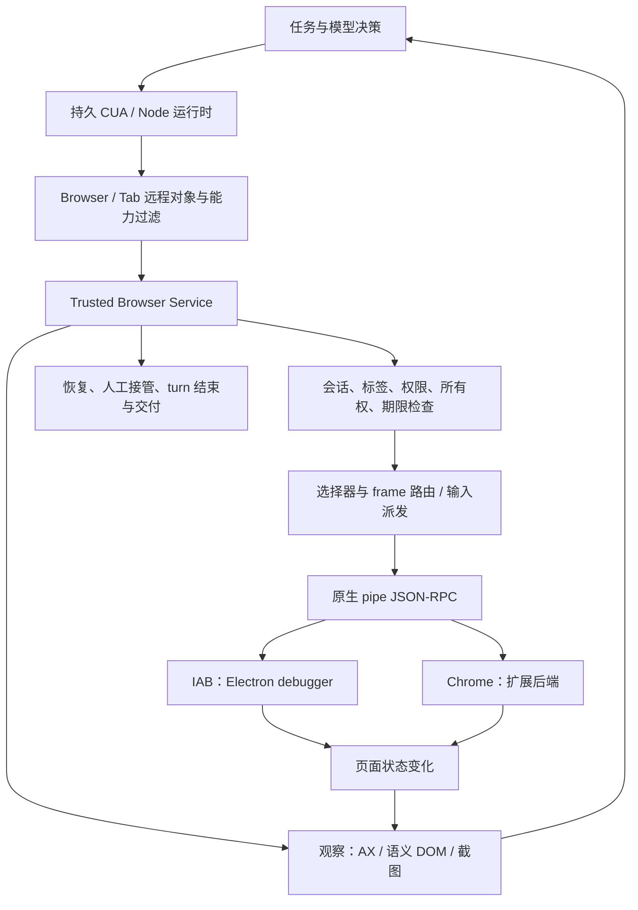

# Codex Browser Use 逆向审核与复现报告

核查日期：2026-10-11。目标：本机 Codex 桌面版 `26.1007.21159`，build `20052`，应用标识 `com.openai.codex`。本机安装包文件名为 `ChatGPT.app`，身份以 `Info.plist` 为准。

## 结论

Codex 的浏览器能力来自一条有状态的执行链：模型选择下一步 → 持久运行时绑定浏览器和标签 → 结构化观察 → 语义或 AX 定位 → 权限与所有权检查 → 有限等待和输入派发 → 再观察结果 → 恢复或交付。浏览器后端不是直接把一句自然语言转成一次点击。

你当前项目已经具备观察身份、失效 ref 拒绝、动作收据、接管暂停恢复、开放 Shadow DOM、同源 iframe 和条件等待。最值得先修的是两个已复现的接口问题：**观察在进入模型上下文时被通用裁剪破坏；滚动派发丢失目标位置，横向滚动还混入纵向滚动。** 第三项优先审查是观察 ref 表处于网页可访问的 main world。这项有静态代码依据，尚未做恶意页面实验。

本次完成了分发 JavaScript、Electron 主进程与实际 IAB 浏览器的交叉核查，并提供独立 Chrome 演示。没有获得远端模型、云端策略服务或 Chrome 扩展内部的完整实现。因此，下文交付的是已核验的浏览器执行链和可运行的机制复现；未知部分逐项保留。

## 交付物与证据等级

| 文件 | 用途 |
| --- | --- |
| [replica/README.md](replica/README.md) | 独立演示的安装、运行及 JSON 协议 |
| [replica/browser-use.mjs](replica/browser-use.mjs) | 原创最小执行器，使用固定版本 Playwright 和临时 Chrome profile |
| [demo.html](demo.html)、[frame.html](frame.html) | 可控验收页；表单、异步结果、歧义、遮挡、跨源 frame、开放 shadow |
| [evidence/codex-live-observations.json](evidence/codex-live-observations.json) | 本次真实 Codex IAB 操作及失败记录 |
| [evidence/transport-review.json](evidence/transport-review.json) | 17 项传输、权限、主进程和生命周期审查，附精确源位置 |
| [evidence/shipped-source-index.json](evidence/shipped-source-index.json) | 分发文件及 AST 函数范围的 SHA-256、行号和字节位置 |
| [evidence/asar-provenance.json](evidence/asar-provenance.json) | app.asar 整包与所选主进程条目的摘要及身份 |
| [evidence/project-gap-review.json](evidence/project-gap-review.json) | 当前工作区已有能力、差距、验收条件与测试命令 |
| [evidence/project-gap-probe.py](evidence/project-gap-probe.py) | 观察裁剪和滚动问题的可重复探针 |

证据等级在正文中区分：**实测**为真实浏览器返回；**静态确认**为本机分发代码中的明确实现；**隔离验证**为合成输入或 mocked RPC/CDP 边界；**建议**为独立复现的设计选择；**未知**不作肯定推断。静态存在的分支不等于当前后端启用了该能力。

## REA 安装与健康检查

已安装官方 npm 包 `rea-agents@6.4.0`。下载使用官方 registry，校验 SHA-512 后安装，安装时禁用了依赖生命周期脚本。选择受支持的 Node `24.19.0`，避免本机默认 Node 25 与 REA 支持范围不符。

| 项目 | 已验证状态 |
| --- | --- |
| 命令入口 | `/Users/fjw/.local/bin/rea` |
| 包目录 | `/Users/fjw/.local/share/rea/node_modules/rea-agents` |
| Skill | `/Users/fjw/.agents/skills/reverse-engineer-anything/SKILL.md` |
| MCP 注册 | `/Users/fjw/.codex/config.toml` 新增 `[mcp_servers.rea]`，使用固定 Node 24 路径 |
| 原配置备份 | `/Users/fjw/.codex/config.toml.rea.backup` |
| `doctor` | healthy，注册与运行时一致 |
| 真实 MCP 握手 | 170/170 tools，6/6 prompts；实际 stdio 服务启动和目标无关查询成功 |

配置修改前后经结构化比对，REA 之外的原配置保持一致。当前聊天的工具目录不会热加载新 MCP，重新连接或重启 Codex 后可在新会话使用；REA 命令现在即可运行。

```sh
/Users/fjw/.local/bin/rea doctor --client codex --json
/Users/fjw/.local/bin/rea mcp doctor --json
```

安装依据为 [REA 仓库](https://github.com/morluto/rea)与[官方安装说明](https://github.com/morluto/rea/blob/main/docs/installation.md)。本次实际安装结果保存于 [doctor.json](evidence/doctor.json)、[mcp-doctor.json](evidence/mcp-doctor.json) 和精简 setup 记录；没有依赖 README 宣称来替代健康检查。

## 完整执行链：哪些层负责什么



图中的 Chrome 后端只核验了桌面服务侧接口，扩展内部没有实际运行证据。自然语言规划、模型参数、远端策略审核不在本地 JavaScript 的可读范围内。

### 1. 运行时、后端发现与绑定

**静态确认，T01–T07。** CUA 包装层负责浏览器选择、tab 引用解析和方法绑定；Browser/Tab 是带 `browser_id`、`tab_id` 的远程对象。客户端从后台能力和 support overrides 得到禁用成员集合，代理同时过滤读取、枚举和成员存在性。不能看到 class 中有某方法就认定当前用户能调用。

当前安装插件配置明确绑定 `@oai/browser-desktop/service`，其 exports 指向 `browser-service.mjs`。CUA 包装层引用的嵌套客户端是另一份构建；两份客户端的 96 个命令字面量集合一致，12 项隔离合同检查通过。另有旧 service 文件和主进程旧启动分支，但没有把它们误当作此次服务同时执行的证据。

服务默认发现 `/tmp/codex-browser-use` 的本地后端。IAB 按 Codex session 匹配；扩展按 profile 与 extension instance 识别。没有明确选择时优先 IAB；按 URL 选择时先匹配已有标签，再做后端回退。URL 匹配有 exact、origin/path、hostname 等优先级，不是任意抓取第一个相似标签。

tab 引用会核验来源、浏览器实例、当前 URL/title 和唯一性。已管理标签与用户标签分别走 `get` 和 `claim`。持久变量只保留对象绑定，不代表旧页面观察永远有效。

### 2. 观察：AX、语义 DOM 与截图

**静态确认＋实测，S 索引、IAB 记录。** AX 观察输出带索引的可访问性树，后续可以返回增量变化。实现调用带 revision 的 WASM 模块；确实存在 revision 创建和先前文本输入，但本次没有反编译 WASM 内部，不能声称知道其全部索引分配算法。

语义 DOM snapshot 从注入的可访问性结构生成，再递归加入可见 frame。展示阶段去除 ref/cursor 标记并展开部分 generic、listitem、group，保留 role、name、状态等语义。它与可点击 AX 索引不是同一个命名空间。frame 扩展有有限预算，读取失败的 frame 可能省略，不能把一次快照当全站完整 DOM。

本次 IAB 真正读取了不同 origin 的 iframe 内容和开放 Shadow DOM，也通过截图核对布局。iframe 跨源能力来自后端/CDP 路由，不能依赖顶层网页脚本的 `contentDocument` 访问权限。

三类观察各有用途：语义树用于理解目标与范围；新鲜 AX 索引用于精确输入；截图用于空间关系与异常复核。大网页应该读取局部范围或增量变化，避免每次堆入整页文本。

### 3. 定位、输入准备与有限等待

**静态确认＋实测，S 索引。** 语义定位使用 role/name、文本、范围和 frame 组合。选择器在操作阶段重新解析：多匹配通常报歧义，但只有一个可见候选时有明确的 visible fallback。本次“两个重复按钮”被拒绝；“隐藏按钮＋同名可见按钮”选择了唯一可见项。

点击准备检查可见和 enabled 等状态，计算位置并检查几何稳定性；填入准备还检查 editable，并处理可编辑目标。重试发生在有限 deadline 内。严格歧义、受限制文档等终止错误直接抛出，不无限循环。

源码中存在指针命中与 frame 边界校验，但本次顶层遮挡实验仍出现“返回成功、目标无变化”。因此不能直接套用标准 Playwright 的完整 actionability 保证来描述 Codex 自定义执行层。标准 Playwright 的定位和 actionability 行为可参见[定位文档](https://playwright.dev/docs/locators)与[动作检查文档](https://playwright.dev/docs/actionability)；独立演示用该公开实现补足遮挡检查。

wait 接受目标状态/文本等条件并使用有限时间预算。点击返回只说明该层执行返回；页面异步保存、网络请求和业务结果仍需后续条件验证。本次保存按钮点击后，第一次 AX 观察仍显示“尚未保存”，稍后条件等待才确认结果，且保存计数保持 1。

### 4. RPC、原生主进程与 CDP

**静态确认，T04–T06、T13–T15。** 有两段调用：客户端通过持久 Node 运行时的 trusted RPC 调服务；服务通过本地 pipe 与 native backend 通信。后者采用 JSON-RPC 2.0，递增请求 id，pending 表关联响应，通知承载 CDP 与页面事件。传输帧是 4 字节长度＋UTF-8 JSON，按主机字节序读写，支持分片，断连会拒绝挂起请求。

主进程为多个 socket 添加内部 client 前缀，响应只回到原请求方，事件通知广播。socket 接入存在 macOS peer authorizer 分支，不能仅凭本地 pipe 路径断言任何本地进程都可控制浏览器。授权原生 addon 内部身份算法尚未分析。

IAB 主进程核验 session route、tab 归属、当前 pageKey/webContents 和导航 policy，随后经 `webContents.debugger.sendCommand` 派发 CDP。部分 Target 命令被模拟或限制，Input 命令也有明确支持集合。这是 Electron 内嵌页面的执行链，不能反推 Chrome 扩展的内部实现。

### 5. 权限、只读观察与受保护状态

**静态确认，T10、T12；有限实测。** 导航按目标 URL 检查，当前页操作按 committed URL 检查；history、上传/下载、raw CDP 和 WebMCP 有各自权限边界。权限可按 turn、conversation 或更长范围缓存，后台能力开放后仍存在逐次检查。

`evaluate` 使用隔离上下文及受限的只读接口。实际尝试 `document.body.setAttribute` 被拒绝；这只验证该写入路径受限，不能当作完整沙箱安全证明。

受保护状态处理不是把页面上“login”字符串简单分类：服务在 before/after/error recheck 等阶段检查保护状态，生成结构化 recovery 信息，限制可能包含受保护数据的返回。客户端只针对相应 typed recovery error 做协议转换，普通异常仍保留错误路径。没有读取或输出真实凭证值。

手动 handoff、Browser.user、raw CDP 等能力依赖后端和设置。恢复建议提到 handoff 不等于所有浏览器都开放同一接管方法。官方也区分内置浏览器环境与使用已有 Chrome profile 的扩展：[Browser](https://learn.chatgpt.com/docs/browser)、[Chrome extension](https://learn.chatgpt.com/docs/chrome-extension)。

### 6. 恢复、超时与 turn 结束

**静态确认，T08、T11、T16–T17。** 服务绑定 session/turn，记录 acquired/claimed 标签。debugger attach 合并并发请求；detach 清理 frame、文档与事件缓存。明确的“未 attach”错误最多触发一次重新 attach。不能把这段窄恢复机制推广成所有变更动作均可重放。

预算是分层的：后端发现 5 秒、URL 标签读取 1 秒、访问握手 10 秒、turn 清理 hook 4 秒；locator 使用单独期限。IAB 主进程 CDP 默认上限 20 秒，页面 ready 默认 15 秒，调用方传入预算可以缩短。超时竞争本身不证明页面副作用取消；主进程通常清理 debugger lease，仍可能有已发送的操作完成。

IAB 新建 agent tab 默认 temporary。turn 结束：普通临时 tab 关闭；本 turn 的 handoff 保留并移除 mark；deliverable 或持久 tab 释放回宿主。清理还涉及 clipboard、cursor、blob download、debugger lease 和能力状态。标签是否存活与所有权释放是两个独立问题。

对于自己的工具，建议把 execution 与 effect 分开建模：执行前明确拒绝；派发返回；派发后不确定；业务效果已验证/未验证。观察失败时保留此前执行状态，重新观察，避免重复提交。

## 本次真实 Codex IAB 验收

所有操作都发生在本地可控页面，页面仅改变内存，刷新即重置。下表的失败表示预期没有成立，保留为实现异常。

| 预期 | 实测结果 | 解释 |
| --- | --- | --- |
| 等待保存结果，计数为 1 | 通过 | 输入和保存后按条件确认，不重复提交 |
| 拒绝两个同名按钮 | 通过 | strict mode/multiple match 错误 |
| 拒绝被顶层 overlay 遮挡的按钮 | **失败** | 语义 click 返回成功；随后目标仍“尚未点击” |
| 唯一可见候选可操作 | 通过 | 隐藏同名项不导致错误选择 |
| 移除 overlay 后完成点击 | 通过 | 后续状态确认“遮挡目标已点击” |
| 跨源 iframe 填写并语义点击 | **部分成立，整项失败** | 填写成功，点击报顶层 output 拦截指针 |
| 开放 Shadow DOM 按钮 | 通过 | 后续状态确认 |
| fresh AX 索引恢复 iframe 点击 | 通过 | 新读取索引点击后确认 frame 保存结果 |
| 只读 evaluate 阻止该 DOM 写入 | 通过 | `setAttribute` 不暴露为可调用方法 |
| 异步文本出现条件等待 | 通过 | 有限等待确认结果 |

合计 **8 项预期通过、2 项预期失败**。恢复成功没有抵消原失败。遮挡测试原错误文案“意外点击了被遮挡目标”指的是意外成功返回，不能据此声称目标收到了点击。iframe 错误与坐标转换有关联迹象，但没有证明根因；报告不把它写成已定位的 frame 算法缺陷。见[原始结果与解释](evidence/codex-live-observations.json)和[最终页面截图](evidence/codex-live-result.png)。

## 当前项目：保留已有能力，先修真实断点

只读审查当前工作区代码，而非历史版本。没有修改现有业务代码或覆盖已有未提交改动。已有能力及源位置完整列在 [project-gap-review.json](evidence/project-gap-review.json)。

| 编号 / 优先级 | 证据与影响 | 建议与验收 |
| --- | --- | --- |
| G1 / P1 | **隔离验证：**观察同时写入 `content` 字符串和完整对象；通用 spillover/context 裁剪破坏结构。120 控件＋8000 字符正文：53886→10106 字符，中间 ref 丢失；250 控件＋16000 正文：145706→33197，连 observation_id 都丢失。调用真实投影函数，尚未证明真实模型任务失败。 | 去掉重复序列化；在通用裁剪前结构化投影 receipt、observation_id、tab/document/generation、选中范围的完整控件；分页或截正文。验收模型轮次确实收到中间控件与对应 ID，不能只检查服务端原始 JSON。 |
| G2 / P1 | **隔离验证：**服务确认目标后仅传 scroll direction/amount；Octop 固定在 `(400,300)` 派发。right=300 得到 `deltaX=300, deltaY=-300`。 | 项目适配层使用验证后的坐标派发滚轮，两轴互斥。用真实 Chrome 检查嵌套列表只滚目标，水平滚动不改变纵向位置。 |
| G3 / P1 | **静态风险：**观察表、ref/name/visible 函数和 revision 位于 `window.__deepseekObservation` 等 main-world 全局，页面可以接触同名状态。未做恶意页实测。 | 受控 isolated world＋服务端 document/frame/backend node 绑定。用覆盖同名全局的页面检查失效、遮挡与目标校验仍成立。 |
| G4 / P2 | 开放 shadow / 同源 frame 已支持；跨源 frame 仅 unreadable，元素 box 没有坐标空间或 frame 路径。 | 按真实任务需要加入 frame context/session 路由；至少标注 frame-local/top-level 坐标，避免截图坐标误用。 |
| G5 / P2 | 有动作收据和文本等待；缺少安全的精确字段/checked/属性效果断言。过滤草稿与密码是已有保护。 | expected-value 比较只返回 matches；保持密码/OTP与未授权草稿不输出。覆盖受控输入拒收、格式化和 checkbox 状态。 |
| G6 / P2 | 平铺 role/name/ref，范围查询主要顶层 CSS；120/250 控件上限没有继续读取接口。 | 加父行/区域/frame scope 与范围续读；验证重复“编辑”按钮能够指定正确记录。 |
| G7 / P2 | 每个动作后整页 full observation 有成本。 | G1 修复后再按验证需要观察局部/差量，避免压缩进一步破坏信息。 |
| G8 / P2 | 动作权限 scope 绑定频繁变化的 revision，可能造成重复请求。 | 核验真实产品流程后按任务、资源与动作授权；接管变化仍应重新检查所有权。 |

核心来源：`service.py:881,952` 的观察响应，`tooling.py:465–466` 的投影顺序，`context.py:268` 的裁剪，`service.py:845–846` 的滚动，`observation.py:38,106,136,216` 的 main-world 状态。精确绝对路径、行号和验收条件在 JSON 报告中，便于直接跳转。

本次运行了现有观察、主模型循环与协助测试：**20 passed**。这些测试验证原有能力，不覆盖上述两个探针缺陷；不能以它们通过推断模型入境结构与滚动正确。探针使用合成观察以及 mocked 派发边界，其输出保存于 [project-gap-probe-result.json](evidence/project-gap-probe-result.json)。

```sh
PYTHONDONTWRITEBYTECODE=1 .venv/bin/python docs/audits/2026-10-11/codex-browser-use/evidence/project-gap-probe.py --repo /Users/fjw/Desktop/deepseek-tui-py-main
```

## 独立复现的范围

演示是原创代码，直接通过公开 Playwright 操作独立临时 Chrome profile；不依赖 Codex 私有浏览器服务，不导入本机登录会话。包含持久 session/tab、语义 scope/frame、观察 token、generation 接管隔离、动作前检查、有限效果等待和动作后观察，支持持续 stdin JSON 调用。

这里复现的是执行机制。没有自然语言模型、跨任务规划器、真实人工 UI 接管、原生签名授权、云策略服务、AX WASM revision 算法或 Chrome 扩展。执行器以 localhost 页面为验收范围，也没有实现当前项目 G1 的模型上下文结构化投影或 G2 的滚动修复。演示验证成功不能代替这些生产修复的验收。

演示采用标准 Playwright 的遮挡检查和 frame 坐标处理，所以两个 Codex IAB 异常作为单独对照保留，没有故意复制异常。输入 JSON 内的 observation 是前一次真实 observe/act 返回对象，不能自己构造旧 token。运行步骤、协议例子和实测结果见 [replica/README.md](replica/README.md)。

真实 headless Chrome 验收 **18/18 通过**，覆盖接管/导航发生于预检查期间的拒绝、跨源 frame、Shadow DOM、遮挡、tab 绑定、观察失败后不重放，以及效果超时与动作完成分开记录。完整 trace 在 [replica/results/report.json](replica/results/report.json)；[验证后截图](replica/results/verified.png)和[观察失败恢复后截图](replica/results/after.png)保留了页面效果与保存计数。这个通过数只属于独立演示。

## 证据审计与未覆盖部分

REA 原始分析以本地惰性文本为输入，没有执行提取出的应用 bundle。两个 Evidence ID 保留在交付的摘要中：

| 分析对象 | Evidence ID | 覆盖结论 |
| --- | --- | --- |
| CUA wrapper 56 个文件 | `ev_05c7406ba6c075535b0fe8e1a39cb1c767ba0a28a30148a4feb88623b2b4fb21` | 56 文件解析成功、23182 AST 节点；语义关系仍有 unknown/partial |
| desktop browser 2 个 bundle | `ev_776b14d11b566b16165497471a6505392f0e384e20276bb6f391b1f70fed4f07` | 2 文件解析成功、342230 AST 节点；语义 worker 约 1GiB 堆耗尽，图 partial/truncated |

没有把解析成功写成全调用图恢复。之后使用精确 AST 函数范围、主进程入口追踪、mock 合同和真实 IAB 结果补证。源码索引记录 UTF-16 位置和 UTF-8 字节位置，防止压缩源码或 Unicode 导致偏移误读。交付摘要与函数摘要，不打包 Codex 分发源码或内嵌指导文案；完整 REA 记录的本地路径与摘要见 [rea-canonical-records.json](evidence/rea-canonical-records.json)。

仍未知或未验证：云端审核决策与网络 egress 策略；模型规划机制；Chrome 扩展内部执行/接管；原生 peer authorizer 内部算法；AX WASM 完整实现；关闭 Shadow DOM 的一般支持；所有页面、浏览器版本和企业配置下的能力矩阵；生产网站可靠性。此次真实后端只有 IAB；Chrome 实测属于独立复现执行器，二者在证据中分开记录。

验收重点不是“像 Codex 一样点击”，而是每一步都有可追溯的页面身份、明确目标、有限预算、独立效果验证与恢复边界。当前最优先的生产工作仍是修复 G1、G2，并核验 G3。
