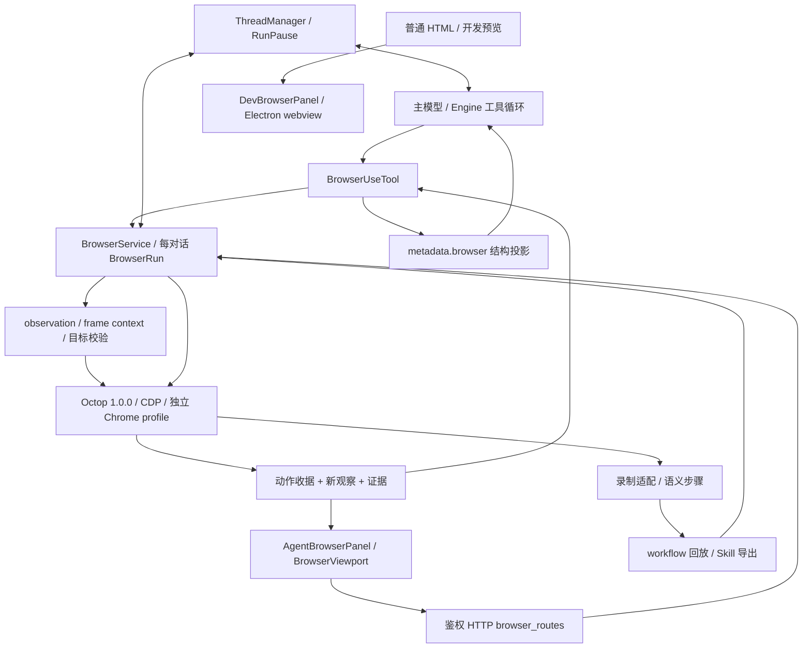

# 现有浏览器架构审核与标准优化方案

核查日期：2026-10-12。对象：当前工作区的浏览器执行、模型上下文、工作台、人工接管、录制、回放与 Skill 链路。

## 核心判断

建议保留现在的总体架构：**主模型负责理解任务和决定下一步；BrowserService 负责可信执行；Workbench 负责展示和人工交接；录制与 Skill 提供可复用参考。** 这条路线可以继续做通用浏览器工具。

当前最需要加强的是三个约定：**观察与目标身份可信、不同模块描述同一目标一致、执行结果在所有入口中保持一致。** 它们比继续增加动作数量更直接影响泛化。普通网页、虚拟列表、Shadow DOM 和异步表单已经暴露了具体断点。

10 月 11 日的旧结论不能直接沿用：观察进入主模型前的结构化投影已加入；目标滚动、横纵轴混用已修；字段状态验证、直接子 frame/OOPIF 和分页均已有实现；审批 scope 已改为会话目录＋控制 generation。下面只把仍成立的问题列为待纠正。

本轮交付是审查和实施方案。现有业务代码保持原样。审查期间另有工作更新 `recording.py/js`、`frames.py` 和 `workflows.py`，我们针对录制变更补验并分别保留新旧快照；没有把旧失败冒充当前缺陷。源码身份见 [source-snapshot.json](evidence/source-snapshot.json)，各实验还记录自己的时间、版本和范围。

## 1. 已贯通的现有架构



| 职责 | 当前实现与关键约定 | 审核判断 |
| --- | --- | --- |
| 模型工具循环 | `Engine` 执行 `browser_use`；动态注入运行时能力和提示词；工具串行；暂停 generation 淘汰旧模型输出和未派发工具 | 保留主模型决策。不要另加一个网页分类模型来接管整个流程 |
| 会话与执行 | ThreadManager 持有 BrowserService；BrowserRun 按 thread 隔离 profile/端口，维护 owner、generation、revision、锁、标签、观察和证据 | 保留统一入口；把 CDP 和文档上下文知识集中在内部 |
| 观察与定位 | 最新 observation_id、document、control generation；ref、selector、截图坐标；frame/shadow scope；可见/禁用/遮挡检查 | 已有正确基础，但 registry 信任和业务记录上下文仍有真实缺陷 |
| 模型入境 | 完整结果保存于 `metadata.browser`；通用 spillover 后由 browser 专用投影输出完整 JSON 和续读信息 | 旧 G1 主入口已修；还需补无观察和大 scope 分支的预算约束 |
| 图片能力 | 按模型能力附图；文本模型可通过视觉 helper 获取带来源标签的观察；原始 transcript 不被偷偷替换 | 保留。新增图像与 observation/尺寸的显式关联 |
| 人工接管 | ThreadManager 暂停原 turn；BrowserService 改控制代次并等待在途动作；恢复前观察，再给原模型注入新上下文 | 保留原任务与真实执行事实；已派发动作不能保证撤回 |
| 自动化界面 | AgentBrowserPanel 通过 `/view` 展示同一 Octop 会话，BrowserViewport 经 `/input` 发送人工输入 | 修复结果传播与场景失效约定，保持 IME、队列和交接行为 |
| 普通预览 | BrowserWorkspace 当前保留 DevBrowserPanel，独立 Electron webview，不要求 Python 会话 | 与自动化有不同职责；页面和登录状态不可默认视为同一份 |
| 录制与复用 | 新 WorkbenchRecordSession/ScopedSemanticProcessor → StepsDocument → 当前会话回放；Skill 摘要校验安装 | 加强 capture→compile→replay 的统一目标规范和整体预检 |

已检查上述相连模块以及定向测试，不把未审查的远端模型行为、所有生产网站和全仓其他功能写成已验证能力。当前没有 `CONTEXT.md`、领域词汇表或 ADR；建议后续用一份短架构决策记录固定这些职责和约定。

## 2. 必须保留、值得吸收的设计

| 保留或借鉴点 | 如何落实到当前架构 |
| --- | --- |
| 浏览器对象、标签与任务显式绑定 | 保留 thread/session/tab/document/generation；frame 和图像也用同一身份链 |
| 观察→行动→验证的闭环 | 保留动作后新观察与收据；补跨入口传播和异步结果检查，不要求每次整页重读 |
| 严格拒绝歧义与旧目标 | 保留唯一性与失效检查；增加记录 scope。重新定位必须仍能证明是同一目标 |
| 有限等待和窄范围恢复 | 等待具体条件并共享 deadline；断连后的变更动作先查结果，避免自动重放 |
| 能力按实际后端暴露 | 在现有 `status/environment/schema` 上补细粒度能力；不可调用的 frame/录制路径提前解释 |
| 接管属于原任务状态转移 | 继续使用 RunPause 和 control generation；恢复不等于业务已完成，也不需要创建新聊天 |
| 浏览器底层复杂度对模型隐藏 | 模型理解目标、范围、预期效果即可；CDP session、OOPIF、隔离上下文由执行模块处理 |
| 证据诚实区分派发和效果 | `executed`、`unknown`、`confirmed` 各自独立；截图失败和业务失败分别表达 |

前次 Codex 逆向可借鉴会话绑定、语义范围、能力过滤和生命周期设计；其真实 IAB 也出现过遮挡点击无效、frame 点击异常。应通过本项目的行为验收决定吸收哪些机制，不以模仿某个工具作为完成标准。

## 3. 审查发现与最终状态

证据分为：真实 Chrome 自建 localhost 实验；mock 调用链表征；合成函数输入；静态设计风险。全部实验使用专用测试数据，没有调用真实外部模型或读取用户账号。

| 编号 / 级别 | 当前事实 | 为什么影响通用性 | 证据 |
| --- | --- | --- | --- |
| F1 / P1 / Strong | 页面可以改写顶层 `window.__deepseekObservation`：原 Chosen=e0 被改为 Other，同一 observation_id/ref 点击实际命中 Other | 网页可改状态不能充当目标身份的验证源；隔离 frame 与顶层保护不一致 | 真实 Chrome，[target-identity-results.json](evidence/target-identity-results.json)，`tampering`；`observation.py:140,179,298` |
| F2 / P1 / Strong | 正常 SPA 复用同一个 Details 按钮节点，父记录 A→B，旧 ref 仍操作 B | 节点相同、按钮名称相同，也可能属于不同业务记录 | 同一真实实验的 `recycled_row`；`observation.py:101,351` |
| F3 / 审查期间已纠正 | 22:39 复验发现默认 button 类型不一致；22:44 快照已统一属性读取方式，随后两个真实 Shadow 回放均通过 | 保留统一目标规范的建议与真实回归测试，当前不再列为未修 P1 | [最新复验 XML](evidence/plan-review-recording.xml)：2 passed；录制脚本 SHA `be4565cc305c8c071b125770ca59b1fed4c3f1dbd54b8e8f09df0de5c0a6a558` |
| F4 / P1 / Strong | 回放第 2 步的 9000 字参数直到运行时才拒绝，前面的 Save 已执行 1 次 | 可以提前发现的静态错误造成部分副作用，用户误以为整个回放没有开始 | 真实 Chrome，[replay-probe-results.json](evidence/replay-probe-results.json)；`workflows.py:80,142`、`service.py:123` |
| F5 / P1 / Strong | `/action` 成功后 `/view` 失败，UI 返回操作失败；HTTP 异常入口把 unknown 收据降成 detail 字符串，工具入口却保留结构 | 用户和不同调用者无法区分已执行、未知与仅画面不可读，容易重复提交 | 2 项 mock 表征之一＋注入 route probe，[ui-review.json](evidence/ui-review.json)；`BrowserWorkspace.tsx:147`、`browser_routes.py:60` |
| F6 / P2 / Strong | 回放 input_value_equals/title_contains 只读一次。350ms 后满足的字段在 0ms 被判失败 | 异步表单和客户端格式化产生虚假失败；固定 200ms 间隔无法解决 | 真实 Chrome 回放 probe；`workflows.py:240` |
| F7 / P2 / Strong | 6000 字符预算下，无 observation 的 status 样例输出 23991，合法深 shadow scope 输出 16295 | JSON 完整不等于预算成立；新特殊投影绕过通用裁剪 | 合成当前函数实验，[projection-results.json](evidence/projection-results.json)；`context.py:14,112` |
| F8 / P2 / Worth exploring | submit 的 value 标签、隐藏 aria-labelledby 的名称未被当前手写算法表达；原生 AX 能识别 | “Continue”按钮等可见语义丢失；录制、观察和模型理解不一致 | 真实 Chrome＋原生 AX 对照，target identity 结果中的 `native_ax_comparison` |
| F9 / P2 / Worth exploring | UI 队列只绑定控制 generation。同 generation 下 disabled→enabled 后仍会发送旧文本 | 标签/文档/输入场景变化与控制所有权变化不是同一事件 | 第二项 mock 表征；跨文档误输入尚未真实复现；`BrowserViewport.tsx:18`、`service.py:512` |

F1/F2 是当前可复现的身份保证失效，F4/F5 是跨模块约定失效。它们应先于性能优化、上传下载和增加新后端。F3 已通过后续复验，记录为本次发现后得到纠正的回归。

录制变化的准确状态：旧实现的 Shadow 采集和停止 flush 失败已得到纠正；新实现立即停止、当前 tab 录制通过，Shadow 路径与脱敏通过。随后默认 button 的属性规范也得到纠正，两个真实 Shadow 完整回放在最后复验中通过。新增直接子 frame 回放有代码，但任意深 frame 链尚不是已验证的通用能力。

## 4. 标准目标设计

这里的 Module 指一个有清晰职责的模块，Interface 包含调用顺序、身份和错误约定；Seam 是可以替换具体实现的位置。目标是增加 Depth，把容易分散的知识集中起来，从而获得 Locality 和 Leverage。采用现有模块名，不为文件数量而拆分。

### A. 统一可信观察与 TargetDescriptor

**涉及：** observation、frames、新 recording、workflows、service。

**当前：**顶层 main world ref 表；frame 有隔离 context；采集/回放分别计算 role/name/type（已纠正默认 button 类型）；ref 校验只看按钮本身。

**之后：**一个 Observation Module 负责文档上下文、ref registry 和规范化目标；录制与回放复用同一 TargetDescriptor Implementation。

建议保留既有 observation 字段，逐步补充以下信息：

```text
ObservationIdentity = thread/session + tab + frame/document + control_generation
TargetDescriptor = role + accessible_name + control_type + semantic_scope
TargetBinding = observation_id + ref + exact_node + target_context_fingerprint
```

1. 顶层、同源 frame、OOPIF 使用受控 execution context；服务端绑定 frame/document/节点。所有目标校验都走同一上下文，不从网页可替换的全局读取 registry。
2. 为 row/card/dialog/region 等 scope 保留可见的记录上下文，执行前核验目标相关 fingerprint。A→B 节点复用应拒绝；无关时钟、广告或动画变化不应让所有 ref 永久失效。
3. 统一 button/input 默认类型、ARIA 名称、disabled/editable 与 scope 的规范。保留原始 tag/type 作为事实，使用另一个 canonical_control_type 比较，避免“没写属性”与浏览器默认值相互矛盾。
4. 先修明确漏项，再评估用原生 AX 提供语义；DOM 提供精确节点和几何。AX 与 DOM 必须有映射，不能直接用扁平 AX 替代全部定位逻辑。
5. semantic ref 优先；截图坐标必须绑定 observation、viewport、frame、缩放关系。闭合 shadow、复杂变换等不足能力应明确拒绝或协助。

**验收：**页面同名全局覆盖不能重定向 ref；A→B 复用拒绝且零误点；同记录无关变化仍可执行；默认/显式 button 类型、input submit、隐藏引用名称和重复行明确匹配；真实录制→编译→回放完整通过。

### B. 统一 ActionReceipt，分开动作与显示

**涉及：** BrowserService、BrowserUseTool、browser_routes、AgentBrowserPanel、BrowserViewport、workflow。

建议扩展既有 receipt，而非另造一种平行结果：

```text
action_id / operation_id
execution: not_dispatched | executed | unknown
effect: unchecked | confirmed | not_confirmed
observation: available | unavailable | stale
evidence: saved | unavailable
error: code + phase + retry_kind + reason
```

字段名可按当前规范保持兼容；关键是所有调用者使用相同含义。`success` 仅作兼容字段，不再承担所有状态。

- HTTP 错误保留结构化 receipt；工具与 UI 读取相同结构。
- UI 拿到动作结果后立即保存 execution；随后 `/view` 失败显示“操作已发出，画面暂不可读”。恢复按钮只重试 view/observe。
- timeout/disconnect 的未知变更不得自动重放；查 action_id 与新页面结果后才决定下一步。operation_id 只防本地重复派发，不能承诺远端提交恰好一次。
- rejected 的含义是实际改变型动作未派发；准备阶段的滚动、focus 等若可能发生，应单独解释。
- 接管、恢复、回放、UI 同样保留已执行步骤，不以外层异常覆盖已知结果。

**验收：**`/action` 执行 1 次后 `/view` 503，UI 不把动作变成未执行；unknown 在 HTTP/Tool/UI 之间不丢；观察恢复不增加保存计数；刷新和重复响应以 action_id 对账。

### C. 回放先编译，执行时再验证目标

**涉及：** workflows、recording、skills、BrowserAction。

在改 owner/generation、启动后台 task 和任何页面变更之前，把所有参数替换为内存中的完整动作，按同一 schema 做整体静态预检：长度、key、URL、selector/scope、支持的 step/断言。临时编译结果不写入含秘密值的持久文件。

静态预检与运行时观察分工明确：无法提前知道的页面目标仍在每步执行前 fresh resolve；未知结果仍不能重放。回放中已完成步骤与未派发步骤分别留档。

录制 stop 的顺序固定为 flush pending input → drain binding events → 脱敏 → semantic compile → 保存；新实现已改善这些环节，应保留真实回归。Skill 应保存任务意图、参数、scope 和预期效果，将录制 selector 作为候选证据，变化后仍验证同一目标；不得扩大授权或凭模糊相似度点击另一个记录。

**验收：**第 2 步 9000 字、无效 key/scope 或不支持断言均在第 1 次 Save 前拒绝；合法 Unicode 边界值可运行；真实父页、已有/动态 shadow 和已声明 frame 能力完整闭环通过；mask-all 的原始事件、步骤、Skill 不含测试私密文本。

### D. 条件检查共享 deadline 和 scope

**涉及：** service 等待/字段确认、workflow `_verify`。

复用一个有限条件检查 Implementation：URL、文本、存在性、标题、值是否匹配、checked/selected。每个条件绑定当前 tab/frame/shadow、control generation 和 operation；所有 await 消耗同一 deadline，不在每个内部步骤重新获得完整超时。

先检查 actionability，再派发，再等效果。效果未确认与 execution=unknown 分开。字段检查优先回传布尔匹配，不暴露密码、OTP 或未授权草稿。业务成功条件要针对本次操作，不能仅匹配页面上原来就有的“成功”提示。

**验收：**350ms 更新在预算内通过；永不满足到期限失败；接管/导航停止原条件检查；旧成功文本不能证明本次保存；到期后不派发新变更。

标准 actionability 可参考 [Playwright 官方文档](https://playwright.dev/docs/actionability)，语义范围可参考 [Locators](https://playwright.dev/docs/locators)。它们提供行为参照，不表示本项目调用底层 CDP 就自动获得全部保证。

### E. 所有 browser 输出均遵守预算与分页约定

**涉及：** browser/context、engine/context、tooling、manager 恢复上下文。

延续已修的 metadata.browser 专用投影，对成功、拒绝、未知、status、无 observation 等分支统一分配预算。优先保留身份、receipt、失败原因、当前目标和可用续读入口；正文/history/tabs 按剩余预算输出。

不可截短的 selector、ref、scope 和 value 不按字符串截成另一含义；大 scope 使用服务端短 handle，或明确返回预算无法表达，不能静默超出。字符上限与实际模型 token 预算分别计量。

分页 cursor 绑定 document＋scope＋snapshot/revision。列表插入/删除导致位置变化时，应重新读取或按稳定 key 继续；每次新观察仍淘汰旧 refs，不能把多个观察的 ref 混在一次动作中。先使用局部 scope 和按需扩大，只有测量证明成本后再建设全量增量索引。

**验收：**6000/12000/36000 字符预算下全部分支有明确上限，JSON 有效，身份不丢；合法 16 层长 shadow scope 可拒绝或短 handle 表达；动态分页不静默漏项；多语言 token 压力有真实计量。

### F. UI 输入与视觉证据绑定场景

**涉及：** BrowserViewport、AgentBrowserPanel、`/view`、`/input`、client/media。

控制 generation 保留；另加 tab/document、viewport epoch、队列 epoch 和 view 序号。hidden、disabled、换 tab、导航、resize 和恢复后淘汰旧积压输入；同 generation 的旧响应不能覆盖新画面。键盘/鼠标成对状态在异常和交接时正确释放。

视觉 manifest 应声明 asset_id、observation/document/frame、screenshot scope、原始图像尺寸、传输尺寸和 CSS viewport 变换。helper 输出归属图像、facts 和不确定性；仅在需要坐标时提供变换。延续 native/helper/unknown 的能力区分与失败后不丢原图的规则。

**验收：**排队文字不能跨页；old view 不能回盖新 view；中文 IME 一次输入；cut/copy 保护保持；crop/full_page/缩略图/resize 不允许旧坐标点击。跨页队列目前是 mock＋静态风险，修复验收需要真实 Chrome 联调。

## 5. 泛化需要补的产品约定

### 任务授权与实现方法分开

当前 `approval_scope` 已不含 revision，应保留这一改进。但审批缓存仍对全部参数哈希，最新 observation_id/ref 会改变 key；click/fill 等调用逐个审批时，很难复用同一任务已获授权。

建议引入结构化 TaskConstraints 与受限 TaskGrant：任务、允许 origin/资源、动作类别、期限、控制代次和撤销规则。**目标的新鲜性继续逐次验证；授权复用只限用户已经允许的具体任务。** 新资源、扩大数据/访问、不同影响的变更仍重新确认。

提示词里“换方法/来源一律询问”应根据 task constraints 决定：用户锁定网站、流程或账户时遵守；泛化任务内同义定位、局部读取、正常等待和已有授权范围内的恢复可继续。验证或权限障碍不能以切换工具规避。这是产品决策，先用授权矩阵测试，再改变默认策略。

### 保留两种浏览器用途，暴露能力而非假装统一

普通 HTML/开发预览与 Agent 自动化继续各自承担职责。明确 session/profile/page 的来源；从预览转自动化时，不能暗示自动带入同一登录状态和未保存草稿。

在 status 上提供能力声明：模型工具动作、观察层级、frame 深度、OOPIF、shadow、截图坐标、录制、回放、视频、上传下载和系统弹窗。配置改变后更新能力 revision；不支持的流程在开始前拒绝。

暂时只有一个主要自动化 Adapter（Octop＋CDP），没有必要建设全功能多浏览器框架。可以先集中少量私有 Octop/CDP 调用，使将来版本变化有 Locality；当第二个真实后端接入时，再扩展 Seam。

### 性能按阶段测量后再优化

当前 view 每次完成后等待约 120ms（人工）/300ms（agent），读页面状态、tabs 和截图时持有同一 run.lock。这是有依据的成本关注，尚无本轮性能基线，不能直接声称卡顿根因已定位。

先采集输入排队、CDP 派发、capture、observe、projection、模型耗时和 payload/token。再考虑 tabs 慢变缓存、重复帧复用、可见性降频、输入优先和有界 move/wheel 合并；离散 click/key、IME、release 不丢。补 wheel page 单位换算。不要先加流式视频或多线程来掩盖共享锁的行为问题。

## 6. 推荐实施顺序与完成定义

每阶段只交付可独立验证的一组变更，不同时重写执行器、模型循环和前端。

| 阶段 | 改动 | 必须通过的完成定义 |
| --- | --- | --- |
| 1：目标可信 | F1 隔离 registry；F2 scope/context 校验 | registry 重绑定、A→B 复用全部零误点；shadow/frame/原有目标检查不退化 |
| 2：结果一致 | F5 receipt 跨 HTTP/Tool/UI；场景输入 epoch | 动作完成＋画面失败仍保留执行；unknown 不丢；读恢复不重放；旧输入/旧 view 拒绝 |
| 3：录制回放闭环 | 延续 F3 修复，统一 TargetDescriptor；F4 compile preflight；F6 统一条件 | 已通过的真实 Shadow 完整回放保持；后置参数错误零提前变更；异步断言正确；脱敏和 flush 回归保持 |
| 4：上下文与语义 | F7 全分支预算；F8 role/name；稳定分页、视觉 manifest | 边界预算成立；submit/隐藏名称准确；动态续读不静默错位；图像与坐标一致 |
| 5：策略与性能 | TaskConstraints/TaskGrant；能力声明；性能与泛化基准 | 授权矩阵无扩大授权；真实任务成功率、误操作、协助次数和成本有可复查基线 |

发布前还要处理下面三个媒体测试失败：不能简单归为环境问题，也不能直接解释为浏览器业务失败。分别确认 bundle schema、配置快照隔离、SubAgent 当前对象契约，再修测试或实现并重跑。

不建议优先投入：新增第二规划模型、放松唯一性后按相似度点击、整套替换 Octop、多浏览器抽象框架、无条件全页截图、固定 sleep、自动提交重试。它们没有解决已确认的断点。

## 7. 通用性与泛化的验收矩阵

验收覆盖同一个 Interface 的真实行为，不只测试 helper 的内部输出。

| 维度 | 最小必要变体 | 硬性不变量 |
| --- | --- | --- |
| 页面结构 | 普通 DOM、已有/动态 open shadow、同源 frame、跨源/OOPIF；深层路径按声明支持 | 不能跨 scope 猜另一个节点 |
| 语义与记录 | submit/default button、icon/多语言 label、隐藏引用名、重复行、虚拟列表复用 | 所请求记录与所操作记录相同；歧义拒绝 |
| 动态性 | 挂载/禁用后启用、overlay、动画、异步字段格式化、导航与 frame detach | 有限等待；身份变化拒绝；无关变化不过度拒绝 |
| 接管与输入 | 接管发生在等待/预检/派发之后；旧队列、换 tab、resize、IME、cut | 淘汰未派发动作；保留已派发事实；成对输入释放 |
| 故障 | 派发前断连、派发后 timeout、观察失败、截图失败、HTTP 响应丢失 | 未知不变未执行；恢复仅查证，不自动重复变更 |
| 上下文 | 大 status、250 控件、长合法 scope、动态分页、CJK 文本、模型预算压力 | JSON 与身份完整；上限成立；续读可操作 |
| 录制复用 | 真实 record→stop→redact→compile→replay→business check→Skill | 不能用手工 StepsDocument 通过代替真实录制闭环 |
| 模型泛化 | 文本模型、native vision、helper、未知能力；同意图多模板和提示表达 | 先验证模型真的收到结构/图像；不能以固定 demo 代替自然语言任务 |

先建离线 localhost 行为集，随后在用户授权的隔离环境做真实模型任务集。保留与调参隔离的模板/语言变体，分别报告确定性执行能力和模型规划能力，不合成一个模糊成功率。

建议发布门槛：上述安全拒绝与重复提交不变量必须 100% 通过；现有相关测试零未解释失败；新旧实现同一任务集无明显回归。任务完成率、p95 延迟、token 与人工打断目标应由实际基线制定，本轮没有测得生产成功率或承诺一个百分比。

## 8. 本轮验证结果与边界

| 检查组 | 本轮结果 | 解释 |
| --- | --- | --- |
| 初始真实 Chrome＋模块/共享输入/contract | 129 passed、3 failed、1 skipped | 修改前快照；3 个失败是旧录制，唯一 skip 为 FFmpeg 编码 |
| 新录制相关复验 | 2 passed、2 failed | flush/当前 tab 通过；两个 Shadow 完整回放转为默认 button 类型问题 |
| 默认 button 修正后的最终复验 | 2 passed、53 deselected | 两个真实 Shadow 完整回放通过；仅重跑受变更影响的用例，未冒充最新全组通过 |
| 观察/上下文/主模型循环/协助/能力 | 42 passed | 当前相关测试通过；真实身份探针仍发现 F1/F2 |
| 多模态与视觉提交 | 27 passed、3 failed | 三个失败为未解决验证阻断，详见下面 |
| 原有前端 3 文件 | 26 passed | 覆盖现有交接、输入和预览行为 |
| 新 UI mock 表征 | 2 passed | 表征成功代表确认当前缺陷，不代表修复通过 |
| localhost/合成探针 | F1/F2/F4/F6/F7/F8 有复现 | F7 为合成输入预算；F9 为 mock/静态，等级不混用 |

分组存在覆盖重叠和不同快照，不能直接累加成“全部通过数”。本次没有真实外部模型/账号任务集、性能测试、上传下载或所有深层 frame 的证明。

三个媒体验证阻断：

1. `test_conversation_bundle_restores_original_images`：fixture 写裸 Message，但 importer 要求 ThreadRecord。明确当前 schema 后验证合法记录＋图片往返。
2. `test_switch_route_updates_new_subagent_runtime_only`：fixture 要求对象 identity，但实现深拷贝。明确配置 snapshot isolation 后同时验证值一致和后续变更隔离。
3. `test_subagent_qualified_route_preserves_identity_and_closes_owned_client`：fixture 缺 provider。按真实 SubAgent 契约验证路由和 owned client 关闭；如仍要求旧对象兼容，补实现。

完整命令、失败 nodeid 和源码位置见 [observe-ledger.json](evidence/observe-ledger.json)、[control-review.json](evidence/control-review.json)、[ui-review.json](evidence/ui-review.json)。它们是此方案的可复核依据。

## 9. 结论与首个改动

首个改动应落在**可信 Observation Module**：统一文档执行上下文并阻止 ref 注册表被页面改写，同时补目标的记录 scope。第二组统一收据，第三组统一录制/观察/回放 TargetDescriptor 与完整预检。

这样可以继续保留现有工具和 UI，逐步把“这个演示能运行”提升为“不同页面、不同记录、不同模型和故障条件下仍遵守同一行为约定”。
