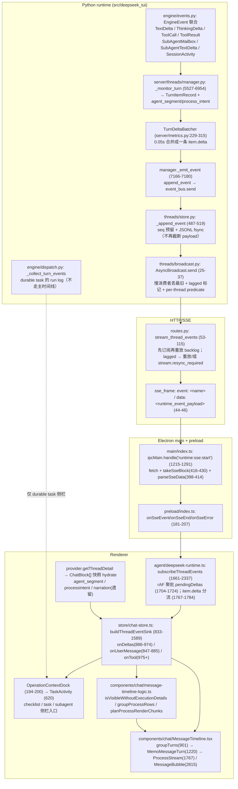

# 主会话（聊天主界面）消息展示链路端到端追踪

- 仓库：`/Users/fjw/Desktop/deepseek-tui-py-main`
- 分支 / 起点：`build_1016` @ `2fedc164b302cd9edf62cb825a41d3fc3a271c88`（`git status --porcelain` 为空，工作树干净）
- 调查时间：2026-10-15 23:56 CST
- 性质：**只读分析**。唯一写入即本文件，未修改任何产品源码 / 测试 / 配置 / 锁文件。
- 证据标注：**【读码】**=本轮在当前工作树直接读源码确认（file:line 均为本轮重新打开核对）；**【实测】**=本轮实际运行命令/测试；**【推断】**=由已确认事实推导，未端到端验证。

---

## 1. 结论摘要

1. **主会话消息展示 = 「引擎事件 → JSONL/SSE → 客户端两层 delta 批处理 → zustand 归约 → 纯函数过滤 → React 组件」的线性管线**，没有虚拟化、没有客户端排序（渲染顺序 = `blocks` 数组顺序）。**【读码】**
2. 相对上一份基线报告（`6cad7119`）**最大的一处行为反转**：折叠态可见性规则被重写。`isVisibleWithoutExecutionDetails` 从「保留有文本的 assistant 过程块 + 带 narration 的 reasoning」改成「assistant/reasoning 一律不保留」，过程文字的保留改由 `ProcessStream` 内部一个 **仅 processing 期间生效**的白名单承担。后果是 **turn 完成后历史进度文字全部折叠**（这是刻意的，有测试锁定），但副作用是 **运行中过程详情也默认折叠**（`workExpanded` 默认值从 `isProcessing` 改成 `false`）。**【读码】+【实测】**
3. **主会话的 checklist 计划卡在「运行中」完全不可见**：`InlineTodoBlock` 唯一挂载点被 `!isProcessing` 门住，而 process rail 里同 turn 的 todo 工具行被 `shouldHideTodoToolBlock` 全部过滤。这既有测试锁定、也直接违反 `scratch/main-conversation-display-requirements.md` 的 A 案例验收（「执行过程展开和收起都能看到同一计划卡」）。**【读码】+【实测】**（缺陷 D1）
4. **subagent / task 的入口已从主会话时间线移除**，统一走右侧 `OperationContextDock → TaskActivity`；主会话即使展开执行过程也不会再出现子代理卡片。**【读码】**
5. 新增一条**只在后端产生、前端没有任何消费端**的 SSE 事件 `stream.resync_required`，用于「事件日志已被 compact、缺口无法重放」的场景。渲染进程仍会把 `lastSeq` 推到缺口之后并原样重连，缺口内的 delta 永久丢失（直到 reload 快照）。**【读码】**（缺陷 D2）
6. 上一轮报告的 **1 号风险（`item.delta` 超长 payload 被截断导致文本静默丢失）已不再成立**：写盘路径不再做截断（`truncate_event_payload` 变成无调用点的死函数），只在存储 compaction 时整条丢弃 noisy delta。**【读码】**
7. 上一轮报告的 **`sink 闭包不带 threadId` 风险也已不成立**：`buildThreadEventSink(set, get, threadId)` 现在显式带 threadId，且每个回调外面套了一层 `disposed || signal?.aborted || activeThreadId !== threadId` 守卫；同时 store 已工厂化（`createChatSessionStore`），分屏的每个 pane 有自己的 session store。**【读码】**
8. 新增一轮「活动状态」展示：`liveActivity`（thinking/responding）→ `resolveTurnActivity` → `TurnActivity`（`data-turn-activity`），把「等待/思考/回答/浏览器/工具/需要用户/子代理」投影成一行状态，独立于折叠区。**【读码】+【实测】**

---

## 2. 端到端数据流

---

## 3. 关键模块与 file:line

### 3.1 引擎侧：事件产生与展示语义标记

| 位置 | 说明 |
|---|---|
| `src/deepseek_tui/engine/events.py:30-42` | `TextDeltaEvent` / `ThinkingDeltaEvent` / `ToolCallEvent` |
| `src/deepseek_tui/engine/events.py:45-47` | 本轮新增的 `ModelRequestInterruptedEvent`（takeover 丢弃模型请求时闭合流式片段） |
| `src/deepseek_tui/engine/events.py:119-132` | `SubAgentMailboxEvent` / `SubAgentTextDeltaEvent`（子代理展示入口） |
| `src/deepseek_tui/engine/events.py:135-141` | `SessionActivityEvent`（后台 subagent/task 计数快照） |
| `src/deepseek_tui/engine/events.py:231-256` | `EngineEvent` 联合类型（事件类型全集） |
| `src/deepseek_tui/engine/dispatch.py:619-637` | `_collect_turn_events`：durable task 的 run log（`("text"|"tool"|"tool_error", summary, detail)`），**不进主会话时间线** |
| `src/deepseek_tui/engine/dispatch.py:663-684` | `_flush_live_text`：task 实时文本 ≤2 次/秒写 task record |
| `src/deepseek_tui/engine/dispatch.py:915-932` | `_record_tool_event` → `TaskManager.record_tool_timeline`（任务侧栏时间线） |
| `src/deepseek_tui/server/threads/manager.py:5527-6954` | `_monitor_turn`：引擎事件 → `TurnItemRecord` + runtime event |
| `manager.py:6118-6153` | `TextDeltaEvent` → 落 `AGENT_MESSAGE`/`IN_PROGRESS` item，`metadata.agent_segment = mid_turn_preface`，发 `item.started`，再 `delta_batcher.append` |
| `manager.py:6155-6183` | `ThinkingDeltaEvent` → 落 `AGENT_REASONING` item + `item.started` + append |
| `manager.py:6185-6229` | `ToolCallEvent`：先 `flush_delta_batch()`，finalize 未闭合 reasoning/message，落工具 item，`item.started` 带 `payload.tool = {id,name,input}` |
| `manager.py:6245-6364` | `ToolResultEvent`：工具 item 收尾；`todo_tool_metadata_from_result`（`6348-6355`）把 checklist 快照并进 `item.metadata.task_updates`；`task_tool_metadata_from_result`（`6356-6363`）并进 `metadata.tasks` |
| `manager.py:5790-5815` | `finalize_open_reasoning`：把累积文本写进 `item.detail/summary` 并 `item.completed` |
| `manager.py:5817-5840` | `finalize_open_message(agent_segment=…)`：打 `agent_segment` 元数据并 `item.completed` |
| `manager.py:5985-6053` | 带外 narration：先落空文本 `process_intent` frame，异步调模型后**改写同一 item** 并重发 `item.completed`，`process_intent.source='narration_service'` |
| `manager.py:6958-6996` | `_compute_phase_bridge`：注意——现在只是「求 narration 文本的模型调用」的封装，**不再写 phase_bridge 元数据** |
| `manager.py:6071-6074` | `flush_delta_batch()`：`delta_batcher.flush()` + `store.flush_event_checkpoint()` |
| `manager.py:5362-5393` | `_persist_subagent_mailbox`：把邮箱信封落成 `kind=STATUS` item，发 `subagent.mailbox` |
| `manager.py:791-847` | `append_automation_result/notice`：后台任务结果回到会话的入口（`metadata.source='automation_result'`） |
| `manager.py:7166-7180` | `_emit_event`：**先** `store.append_event`（分配 seq 并落 JSONL）**再** `event_bus.send(record)` |
| `src/deepseek_tui/server/phase_bridge.py:50-51` | `PHASE_BRIDGE_METADATA_KEY` / `PHASE_BRIDGE_AFTER_REASONING_KEY` 仍是**只定义、无写入点**的死常量（全仓 grep 仅命中定义处） |
| `src/deepseek_tui/tools/todo.py:17-22` | checklist 工具契约：结果落在 `ToolResult.metadata['task_updates']['checklist']` |

### 3.2 传输层（服务端 → Electron → 渲染进程）

| 位置 | 说明 |
|---|---|
| `src/deepseek_tui/server/threads/store.py:487-519` | `_append_event`：线程写锁内分配 seq、**先** `write_json_atomic(state)` 预留、再 append 一行 + `flush` + `fsync`；崩断行自动补 `\n`。**本轮没有 payload 截断** |
| `store.py:524-540` / `542-554` | `iter_events` 逐行 parse、坏行 warning 跳过；`event_pages` 每页 256 |
| `store.py:270-298` | `compact_events(drop_noisy=True)`：只在**存储清理**时整条丢弃 noisy delta 事件（不截断） |
| `src/deepseek_tui/server/data_inventory.py:40-51` | 常量：noisy 名单 + `EVENT_DELTA_PAYLOAD_MAX_CHARS = 2048` |
| `data_inventory.py:85-91` | `is_noisy_event_name`（`item.delta` 等） |
| `data_inventory.py:94-106` | `truncate_event_payload` —— **本轮无任何调用点**（仅定义 + `__all__` 导出），旧报告 §5.1 的截断路径已不存在 |
| `data_inventory.py:264` | 唯一调用 `compact_events(thread.id, drop_noisy=True)` 的地方 |
| `src/deepseek_tui/server/metrics.py:225` | `FLUSH_INTERVAL_S = 0.05` |
| `metrics.py:246-260` | `append`：按 `(item_id, kind)` 累加，首个 delta 起 0.05s 定时 flush |
| `metrics.py:278-315` | `flush`：并发调用时取消在途 flush 任务；emit 抛错时**把未确认文本重新放回缓冲区**（`307-313`），不再静默丢文本 |
| `metrics.py:303-306` | 单条 payload 形状：`{"delta": <合并整段>, "kind": kind}` |
| `src/deepseek_tui/server/threads/broadcast.py:12-15` | `BroadcastQueue` 新增 `lagged` / `first_dropped` / `predicate` 字段 |
| `broadcast.py:25-37` | `send`：按 predicate 过滤；队列满时丢最旧并标记 `lagged` |
| `src/deepseek_tui/server/routes.py:32-41` | `runtime_event_payload`：`{seq,timestamp,thread_id,turn_id,item_id,event,payload}`（顶层 `event` 冗余字段） |
| `routes.py:44-46` | `sse_frame`：`event: <name>\ndata: <json>\n\n` |
| `routes.py:53-115` | `stream_thread_events`：先订阅（带 `predicate` + 自动重放）再重放 backlog；`heartbeat_seconds=15` 发 `: keepalive`；`queue.lagged` 时按 `first_dropped` 重放，**无法恢复时发 `stream.resync_required` 并 close** |
| `routes.py:118-134` | `_replay_events`：分页重放；遇到带 `_truncated` 的 legacy noisy 记录 → `_ReplayUnavailable` → 转 `stream.resync_required(reason=legacy_truncated_payload)` |
| `routes.py:673-685` | HTTP 入口校验 `since_seq >= 0`；`StreamingResponse(media_type="text/event-stream")` 在 `685` |
| `packages/workbench/src/main/index.ts:398-414` | `parseSseData`：只取 `data:` 行后 `JSON.parse`（**忽略 `event:` 行**，靠 payload 里的冗余 `event`） |
| `main/index.ts:416-430` | `takeSseBlock`：按 `\n\n` / `\r\n\r\n` 切帧 |
| `main/index.ts:1215-1291` | `runtime:sse:start`：`ensureRuntime` → `AbortController` → `fetch(/v1/threads/{id}/events?since_seq=…)` → 逐帧 `safeWebContentsSend(wc,'runtime:sse-event',{streamId,data})`（`1267`）；结束发 `runtime:sse-end`（`1289`） |
| `packages/workbench/src/preload/index.ts:181-207` | `startSse/stopSse` + `onSseEvent/onSseEnd/onSseError`（返回退订函数） |
| `packages/workbench/src/renderer/src/agent/deepseek-runtime.ts:1661-2337` | `subscribeThreadEvents`：while 循环 + 指数退避重连（`2308-2330`，连续 6 次失败上报） |
| `deepseek-runtime.ts:1704-1724` | 第一层 rAF 聚批：`pendingDeltas` + `scheduleDeltaFlush`/`flushPendingDeltas` |
| `deepseek-runtime.ts:1746-1786` | `onSseEvent`：`nextSinceSeq=max(...)`（`1756-1758`）；**非 `item.delta` 事件调用 `sink.onSeq`**（`1759-1763`）；任何非 delta 事件先 `flushPendingDeltas()`（`1786`） |
| `deepseek-runtime.ts:1767-1784` | `item.delta`：`subagent_message` → `onSubagentTextDelta`；`agent_message`/`agent_reasoning` → 入批；**其它 kind 静默丢弃**（`1783`） |
| `deepseek-runtime.ts:1788-1949` | `item.started` / `item.completed|failed` 映射（用户消息、工具、user_input、final_answer、live segment） |
| `deepseek-runtime.ts:1952-1997` | `turn.diff.updated` → `onTurnDiffUpdated` |
| `deepseek-runtime.ts:1999-…` | `turn.completed` → `onTurnComplete` |
| `deepseek-runtime.ts:1126-1132`、`1202-1213` | 快照 hydrate：reasoning 的 `narration` 只从 phase_bridge item 取（见 §5 死代码） |
| `deepseek-runtime.ts:1262-1270` | 快照 hydrate：`status`/`context_compaction` item → `system` 块，过滤 plugin mount 与子代理 handoff chrome |

### 3.3 渲染进程状态归约（`store/chat-store.ts`）

| 位置 | 说明 |
|---|---|
| `chat-store.ts:220` | `createChatSessionStore(options)` —— store 已工厂化，**每个分屏 pane 一个 session store**（`chat-session-isolation.test.ts` 锁定） |
| `chat-store.ts:190-217` | `sessionOwners` + `registerChatSessionOwner`：pane store 与 app-level shell store 的镜像同步 |
| `chat-store.ts:833-837` | `buildThreadEventSink(set, get, threadId)`（**带 threadId**） |
| `chat-store.ts:838` | `const signal = sseAbort?.signal`（闭包捕获本 session 的 abort signal） |
| `chat-store.ts:1581-1588` | 遍历 sink 所有回调包一层守卫：`disposed \|\| signal?.aborted \|\| get().activeThreadId !== threadId \|\| (appView && sessionOwners.has(threadId))` |
| `chat-store.ts:840-846` | `onSeq`：更新 `lastSeq`，清「流恢复中」错误 |
| `chat-store.ts:847-885` | `onUserMessage`：先 `flushLiveBlocks`，对账乐观块，`upsertUserBlock` 兜底，置 `busy/currentTurnId/currentTurnUserId/turnStartedAtByUserId` |
| `chat-store.ts:886-974` | `onDeltas`（核心）：reasoning → `liveReasoning` + `liveActivity='thinking'` + 记账首/末时间；`agent_message` → 先固化 reasoning 再 `liveAssistant` + `liveActivity='responding'`（`923-959`）；批内取最大 seq（`894-901`）；`busy` 为 false 但有 `currentTurnId` 时自动恢复 busy（`907-909`） |
| `chat-store.ts:975-…` | `onTool`：命中 itemId 原位更新并浅合并 meta；`running` 时把 `liveActivity` 置 null（`998`） |
| `chat-store.ts:1343-1402` | `onSubagentMailbox`：邮箱信封 → subagent 卡片（`liveText` 由 `1404-1418` 的 `onSubagentTextDelta` 累积） |
| `chat-store.ts:1419-1443` | `onLiveSegmentComplete`：`agent_reasoning` → `appendLiveReasoningBlock(s.blocks, s.liveReasoning, itemId, createdAt)`（**用 live 累积文本，不用事件里的 durable `text`**）；`agent_message` → `completeAssistantProgress` |
| `chat-store.ts:1444-1453` | `onFinalAnswer` → `upsertFinalAnswerBlock`，清 live 三字段 |
| `chat-store.ts:1454-1487` | `onPhaseNarration`（当前无生产端，见 §5） |
| `chat-store.ts:1488-1507` | `onTurnDiffUpdated`：按 `revision` 单调更新 turn diff 账本 |
| `chat-store.ts:1508-1555` | `onTurnComplete`：`flushLiveBlocks` → 清 `currentTurnId` → 保留 `lastCompletedTurnId` → `expireTurnApprovals` + `finalizeOrphanSubagentBlocks` → 通知 → `reloadActiveThreadBlocks` → `refreshThreads` → `drainQueuedMessages` |
| `chat-store.ts:466-485` | `flushLiveBlocks`：把 `liveReasoning` 落成 **新 id `r-${now}`** 的 reasoning 块（`474`），清 `liveAssistant` |
| `chat-store.ts:381-409` | `appendLiveReasoningBlock`：**支持 `itemId`**（命中同 id reasoning 块则 upsert，并保留已有 `narration`） |
| `chat-store.ts:110-139` | `appendLiveAssistantBlock`：支持 `itemId`/`agentSegment`/`processIntent`；空文本但有 `processIntent` 也落块 |
| `chat-store.ts:141-156` | `completeAssistantProgress`：`processIntent.source ∈ {runtime,none,narration_service}` 或已存在同 id 块 → upsert-only（不消耗更新的 live 回复） |
| `chat-store.ts:487-539` | `reloadActiveThreadBlocks`：只在 `activeThreadId` 未变时整体替换 `blocks` 与 `lastSeq`（`517-535`，**不校验 lastSeq**） |
| `chat-store.ts:2385-2541` | `selectThread`：abort 旧 SSE → 可能 adopt pane owner → `getThreadDetail` 快照 → 判 busy → 重置全部计时账本 → 挂 sink 并以 `latestSeq` 重开订阅 |
| `chat-store.ts:2642`、`2824-2866` | 乐观用户块 `u-${now}`；HTTP 返回后 `reconcileOptimisticUserBlock` 迁移 id，并迁移 4 张计时账本（缺键则短路，自愈） |
| `chat-store.ts:3361-3477`、`3479-…` | `rewindAndResend` / `rewindToMessage`：先服务端截断再本地 `truncateStateAtUserBlock`（`340-379`） |
| `chat-store.ts:3960-3970` | `defaultSession = createChatSessionStore({appView:true})`；`ChatStoreContext`；`useChatStore = Object.assign(useScopedChatStore, defaultSession.store)`（pane 内按 context 取 store） |
| `store/chat-store-runtime-helpers.ts:272-292` | `upsertUserBlock`：按 id upsert，未命中**尾部追加** |
| `chat-store-runtime-helpers.ts:294-312` | `reconcileOptimisticUserBlock` |
| `chat-store-runtime-helpers.ts:333-360` | `upsertFinalAnswerBlock`：先删同 id 的 reasoning 临时块，再 upsert/尾部追加 assistant 块 |
| `store/chat-store-types.ts:101` | `liveActivity: 'thinking' \| 'responding' \| null` |

### 3.4 组件层与 UI 规则

| 位置 | 说明 |
|---|---|
| `components/Workbench.tsx:2100-2121` | 主界面唯一 `MessageTimeline` 挂载点（portal 到 `timelineHost`），传 `scrollMemory={peekChatPaneSession(activeThreadId)?.scroll}` |
| `components/chat/ChatSplitWorkspace.tsx:47-56` | 分屏 pane 的第二个挂载点（pane 内 `useChatStore` 走 context） |
| `MessageTimeline.tsx:96` | 模块级 `registerToolRenderers()` |
| `MessageTimeline.tsx:169-171` | `TURN_PAGE_SIZE=18` / `AUTO_COLLAPSE_THRESHOLD=24` / `TOP_LOAD_TRIGGER_PX=120` |
| `MessageTimeline.tsx:308-317` | `groupTurns`（memo）→ `hiddenTurnCount` → `visibleTurns` |
| `MessageTimeline.tsx:319-330` | `loadEarlierTurns`（`pendingPrependRef` 记录 scrollHeight/scrollTop） |
| `MessageTimeline.tsx:332-375` | scroll 监听：`stickToBottomRef`（距底 <96px）+ 触顶加载；`wheel/touchmove/keydown` → `markUserScroll`（`347-353`）立刻释放 tail-anchor hold 与 stick |
| `MessageTimeline.tsx:377-383` | `useTailAnchorScroll({containerRef, sentUserId: currentTurnUserId, threadId, stickToBottomRef, userScrolledAtRef})` |
| `MessageTimeline.tsx:385-393` | `pinTimelineToBottom`：hold / 非贴底 / 350ms 冷却内 → 直接 return |
| `MessageTimeline.tsx:398-408` | `releaseStickOnExpandClick`：pointerdown 命中 `button/[aria-expanded]/summary` 时释放 stick + tail-anchor |
| `MessageTimeline.tsx:413-427` | 对 `.ds-timeline-stack` 的 ResizeObserver 同帧钉底 + `[blocks, live, liveReasoning]` layoutEffect |
| `MessageTimeline.tsx:429-448` | 线程切换按 `scrollMemory` 恢复；`currentTurnUserId` 变化时把 stick 关掉（把滚动权交给 tail-anchor） |
| `MessageTimeline.tsx:450-514` | `scrollToBlockId`：rAF ease-out 280ms，超一屏先传送；隐藏 turn 则先扩 `visibleTurnCount` |
| `MessageTimeline.tsx:526-528` | **不再随 `busy` 展开全部 turn**（仅按阈值重置为 18） |
| `MessageTimeline.tsx:530-550` | prepend 后 rAF 补偿 `scrollTop`；首屏填不满继续加载 |
| `MessageTimeline.tsx:719-771` | `visibleTurns.map`：`isLive`/`liveStartedAt`/`durationMs`/`reasoningDurationMs`/`processing`（`740`）；`activity=resolveTurnActivity(...)`（`746-749`） |
| `MessageTimeline.tsx:811-824` | `.ds-tail-anchor-spacer` 与 composer clearance spacer |
| `MessageTimeline.tsx:901-931` | `groupTurns`：**无排序线性分组**；`system` 块成为独立 turn；内部子代理 handoff 文案被丢弃（`912-914`） |
| `MessageTimeline.tsx:933-953` | `blockHasPendingRuntimeWork` / `blockNeedsAttention` |
| `MessageTimeline.tsx:955-965` | `isProcessBlock`：reasoning/tool/approval/elevation/user_input/subagent/system |
| `MessageTimeline.tsx:992-1218` | `MessageTurn` |
| `MessageTimeline.tsx:1028-1031` | `liveThink/liveContent = splitThink(live)`；`liveProcessText`；**`workExpanded = workExpandedOverride ?? false`** |
| `MessageTimeline.tsx:1036-1102` | 分轨：`splitThink` 剥 `<think>` 成 `${id}-think` reasoning 块（`1043-1046`）；`placeAssistantContentBlock` 决定正文/过程（`1049-1054`）；`live-reasoning` 块（`1069-1071`） |
| `MessageTimeline.tsx:1146-1148` | **`todoSession && !isProcessing` → `InlineTodoBlock`**（主会话唯一计划卡挂载点） |
| `MessageTimeline.tsx:1149-1173` | `WorkMetaRow` + `ProcessStream(showExecutionDetails=workExpanded)` |
| `MessageTimeline.tsx:1188-1206` | 正文 assistant 块 + `live-assistant` 气泡 |
| `MessageTimeline.tsx:1211` | `TurnActivity`（活动状态行） |
| `MessageTimeline.tsx:1220-1235` | `MemoMessageTurn` 逐字段浅比较（流式期间历史 turn 不重渲染的关键） |
| `MessageTimeline.tsx:1473-1560` | `WorkMetaRow`：`working/workedFor/processSteps` 文案 + 思考耗时后缀 + 展开按钮 |
| `MessageTimeline.tsx:1562-1564` | `shouldHideTodoToolBlock`：`todoSession.todoBlockIds` 内的 todo 工具块全部隐藏 |
| `MessageTimeline.tsx:1568-1583` | `visibleExecutionBlocks(blocks, todoSession, hasSubagents, interactiveToolIds)` |
| `MessageTimeline.tsx:1606-1675` | `ToolBatchPanel`（默认折叠、展开后用 `ToolCard` 渲染每个成员） |
| `MessageTimeline.tsx:1723-1747` | `MidTurnPrefaceLine` → `.ds-process-narration`，超长（>1200）可展开 |
| `MessageTimeline.tsx:1767-1845` | `ProcessStream` |
| `MessageTimeline.tsx:1785-1787` | `interactiveToolIds` = 有 pending approval/elevation 的工具行 |
| `MessageTimeline.tsx:1790-1792` | `standaloneIds = interactiveToolIds ∪ {首个 reasoning}` |
| `MessageTimeline.tsx:1795-1804` | 折叠态可见白名单（**仅 processing 期间**） |
| `MessageTimeline.tsx:1805-1807` | `groupProcessRows(visible, standaloneIds)` → `planProcessRenderChunks(rows, standaloneIds)` → `trailingThinkingIndicatorId(rows, processing && !!scope)` |
| `MessageTimeline.tsx:1819-1826` | `ProcessStreamEntry` 传 `openingReasoning = showExecutionDetails && 首个 reasoning` |
| `MessageTimeline.tsx:1847-1882` | `SettledWorkSummaryRow`（`.ds-work-summary`，折叠批次的二次收纳） |
| `MessageTimeline.tsx:1884-1949` | `ProcessStreamEntry` 分派表 |
| `MessageTimeline.tsx:1956-2011` | `ReasoningEntry`：有 narration → 只渲染 narration；否则折叠原始 reasoning |
| `MessageTimeline.tsx:2815-…` | `MessageBubble` |
| `components/chat/TurnActivity.tsx:8-29` | `resolveTurnActivity`：pending 审批/提权/输入 → `User`；`liveActivity` → `Thinking/Responding`；末块是 waiting status → `Subagent`；有 browser_use running → `Browser`；其余 running → `Tool`；否则 `Waiting` |
| `TurnActivity.tsx:31-39` | 渲染 `data-turn-activity`（`role=status`, `aria-live=polite`） |
| `components/chat/tool/renderers/index.ts:13-63` | 工具渲染器注册表：write_file/edit_file/apply_patch→`FileEditRenderer`；exec_shell*→`ShellRenderer`；read_file/fetch_url/web_search→`ReadRenderer`；list_dir/grep*/search_files/file_search→`ListRenderer`；agent*/spawn_agent/delegate_to_agent→`SubagentRenderer` |
| `components/chat/tool/registry.ts:27-36` | 解析优先级：精确 `toolName` → `shortName` → `prefix__`（`registerDynamicPrefix` **无生产调用点**，MCP 工具走默认外壳） |
| `components/chat/tool/tool-card.tsx:61-114` | `ToolCard`：`findPendingToolGate`（`70`）、`resolveToolRenderer`（`100`）、默认折叠（`88-91`，展开态按 `tool:${toolCallId}` 持久化） |
| `lib/tool-gate.ts:12-40` | `toolGateIds`（`block.id` ∪ `meta.tool_call_id`）→ `findPendingToolGate` → `hasPendingToolGate` |
| `lib/extract-todos-from-blocks.ts:204-256` | `buildTodoSessionForTurn`：anchor 取首个 write 或首个 todo 块；错误块跳过（`211`）；`isComplete` = 全部 completed/cancelled |
| `lib/extract-todos-from-blocks.ts:295-305` | `extractTodosFromBlocks`（dock 用，取最后一个有效快照） |
| `components/chat/OperationContextDock.tsx:620` | 侧栏 `TaskActivity`（task + subagent 入口） |
| `components/chat/OperationContextDock.tsx:194-200` | dock 的 todo/task/subagent 投影（每次 `blocks` 引用变化全量重扫） |
| `components/chat/OperationContextDock.tsx:523`、`553` | dock 内 checklist 列表渲染 |

---

## 4. 过滤 / 可见性规则表（当前工作树）

| # | 规则 | 实现位置 | 语义 | 校验 |
|---|---|---|---|---|
| R1 | 执行过程默认折叠 | `MessageTimeline.tsx:1030-1031` | `workExpanded = override ?? false`（**旧基线是 `?? isProcessing`**） | 【读码】+`MessageTimeline.ui.test.ts:277`、`activities.test.ts:61` 【实测】 |
| R2 | 折叠态可见块（不 processing 时） | `message-timeline-logic.ts:228-232` | assistant→false；reasoning→false；tool→仅 `running`；其余 true | 【实测】`MessageTimeline.test.ts:568-580` 断言结果恰为 `['running']` |
| R3 | 折叠态可见块（processing 时） | `MessageTimeline.tsx:1795-1804` | 在上式基础上额外放行：`interactiveToolIds`、`processing && (tool ∥ 有文本的 assistant ∥ 有 narration 的 reasoning)` | 【读码】+`activities.test.ts:110-139`（运行中进度文字有序可见）【实测】 |
| R4 | 待审批工具永不折叠且必须可见 | `MessageTimeline.tsx:1785-1787`、`1791`、`1796-1797` | `hasPendingToolGate` 命中 → `interactiveToolIds` → 绕过 `isVisibleWithoutExecutionDetails` 且不进 `work_summary` | 【实测】`activities.test.ts:141-152` |
| R5 | todo 工具行全部隐藏 | `MessageTimeline.tsx:1562-1564`、`1576` | `todoSession.todoBlockIds` 内（含 anchor）的工具块在 process rail 一律不可见 | 【读码】+`extract-todos-from-blocks.test.ts` 【实测】 |
| R6 | 计划卡只在 turn 结束后出现 | `MessageTimeline.tsx:1146-1148` | `todoSession && !isProcessing` | 【实测】`activities.test.ts:54-77`（busy 时展开仍为 null，`busy=false` 后出现） |
| R7 | subagent 块永不进时间线 | `MessageTimeline.tsx:1578` | `block.kind === 'subagent'` → 过滤 | 【实测】`activities.test.ts:79-96`、`98-108` |
| R8 | 子代理编排工具行在有 subagent 时隐藏 | `MessageTimeline.tsx:1580` + `message-timeline-logic.ts:29-43` | `agent/agent_resume/spawn_agent/wait/...` | 【实测】`activities.test.ts:79-96` |
| R9 | task 工具行隐藏（保留失败） | `MessageTimeline.tsx:1579` | 有 `extractTasksFromBlocks` 结果且 `status !== 'error'` → 过滤 | 【实测】`activities.test.ts:165-180` |
| R10 | 只读探针折叠成批 | `message-timeline-logic.ts:149-159`、`166-192` | 相邻且可折的 tool 块并成 `tool_batch`；`file_change`/todo/子代理编排永远 solo；`interactiveToolIds` 不参与折叠 | 【实测】`MessageTimeline.test.ts:287-416` |
| R11 | 批次二次收纳 | `message-timeline-logic.ts:239-292` | 相邻可收纳行 ≥2 且单位数 ≥`MIN_COLLAPSIBLE_WORK_UNITS=2` → `work_summary`（一行「执行活动 N 项」） | 【实测】`MessageTimeline.test.ts:484-522`、`ui.test.ts:72-74` |
| R12 | 首个思考标题只在展开时保留 | `MessageTimeline.tsx:1792`、`1824`、`1975-1979` | `openingReasoning = showExecutionDetails && id === firstReasoning.id` | 【实测】`ui.test.ts:129-151` |
| R13 | thinking 指示符唯一 | `message-timeline-logic.ts:73-91` | 只在最后一个「后面没有更多工作」的 thinking/preface 行 | 【实测】`MessageTimeline.test.ts:418-471` |
| R14 | rationale 正文/过程路由纯靠元数据 | `message-timeline-logic.ts:93-107` | 仅 `agentSegment === 'final_answer'` 进正文 | 【实测】`MessageTimeline.test.ts:135-173` |
| R15 | 未闭合 markdown 只在 live 气泡 | `message-timeline-logic.ts:208-210` | `shouldParseIncompleteAssistantMarkdown(isLiveAnswer)` | 【实测】`MessageTimeline.test.ts:105-110` |
| R16 | 只读探针批边界 = 非可折块 | `message-timeline-logic.ts:180-190` | 非可折块 flush 当前 buffer | 【实测】`MessageTimeline.test.ts:392-406` |
| R17 | 空白 intent frame 无视觉行 | `message-timeline-logic.ts:182` | `assistant` 且 `text.trim()===''` → `continue` | 【读码】+`ui.test.ts:83-126`（延迟 narration 只插入一次）【实测】 |
| R18 | 分页可见 turn 仅尾部 N 个 | `MessageTimeline.tsx:313-317`、`526-528` | 超过 24 turn → 只留 18；**不再随 busy 全展开** | 【实测】`MessageTimeline.history.test.ts:22-27` |
| R19 | 时间线分组不排序 | `MessageTimeline.tsx:901-931` | 渲染顺序 = `blocks` 数组顺序 | 【读码】+`ui.test.ts:49`（进度→工具批→narration 顺序）【实测】 |

### 滚动 / tail anchor 规则

| # | 规则 | 位置 |
|---|---|---|
| S1 | 发送后把用户气泡钉在顶部（inset 16px） | `use-tail-anchor-scroll.ts:62-69`、`119`；`message-timeline-logic.ts:310-317` |
| S2 | spacer 高度 = `max(0, viewportH - 16 - userH - contentAfterUser)` | `message-timeline-logic.ts:298-308`；渲染于 `MessageTimeline.tsx:811-817` |
| S3 | 释放后 spacer **只减不增**（只有新 send 才能再涨） | `use-tail-anchor-scroll.ts:91-98` 【实测】`MessageTimeline.scroll.test.ts:83-93` |
| S4 | 任何真实滚动手势（wheel/touchmove/keydown）立即释放 hold+stick | `MessageTimeline.tsx:347-353`；`use-tail-anchor-scroll.ts:100-106` 【实测】`scroll.test.ts:95-105` |
| S5 | spacer ≤8px 或用户滚动 → 交接给 stick-to-bottom（`scrollTop = scrollHeight`） | `use-tail-anchor-scroll.ts:112-117`；`message-timeline-logic.ts:319-327` |
| S6 | stick-to-bottom 在 hold / 非贴底 / 350ms 冷却内不生效 | `MessageTimeline.tsx:385-393` |
| S7 | 展开按钮点击释放 stick，避免 ResizeObserver 把刚展开的行顶出视口 | `MessageTimeline.tsx:398-408` |
| S8 | 跨布局/重挂载恢复阅读位置（`scrollMemory`） | `MessageTimeline.tsx:429-441` 【实测】`scroll.test.ts:107-126` |
| S9 | 跳转到历史块：rAF ease-out 280ms，远距先传送一屏 | `MessageTimeline.tsx:450-514` |
| S10 | QueryTrail 高亮测量节流 250ms，滚动热路径不触发 React 重渲染 | `MessageTimeline.tsx:576-658` |

---

## 5. 相对旧报告的变化（基线 `6cad7119` → `2fedc164`）

`6cad7119` 是 `2fedc164` 的**祖先**（`git merge-base --is-ancestor` 通过），中间有 111 个提交（first-parent 89 个，含 12 个 merge）。因此旧报告不是「过期文件」，而是「同一支线上 89 个 first-parent 提交之前的状态」。

### 5.0 整体规模

`git diff --numstat 6cad7119..2fedc164`（本轮实测）：

| 文件 | 新增/删除 | 行数 6cad7119 → now |
|---|---|---|
| `components/chat/MessageTimeline.tsx` | +163 / −423 | 3162 → 2902 |
| `store/chat-store.ts` | +333 / −124 | 3761 → 3970 |
| `agent/deepseek-runtime.ts` | +40 / −10 | 2307 → 2337 |
| `components/chat/message-timeline-logic.ts` | +2 / −3 | 328 → 327 |
| `store/chat-store-runtime-helpers.ts` | +2 / −2 | 485 → 485 |
| `components/chat/use-tail-anchor-scroll.ts` | 无变化 | 132 → 132 |
| `main/index.ts` | +65 / −45 | 1361 → 1381 |
| `preload/index.ts` | +19 / −4 | 214 → 229 |
| `contracts/sse-event.schema.json` | **无变化** | — |
| `server/threads/manager.py` | +698 / −115 | — |
| `server/threads/store.py` | +308 / −? | — |
| `engine/events.py` | +8 / −0 | — |

（全仓 847 文件变更，但多数与本链路无关：browser / share / codex 导入 / plan mode / 侧栏等。）

### 5.1 旧结论**仍然成立**（行号已更新）

| 旧结论 | 旧行号 | 现行号 | 备注 |
|---|---|---|---|
| `_emit_event` 先 append 再广播 | `manager.py:6583-6597` | `manager.py:7166-7180` | 顺序语义不变 |
| seq + JSONL 落盘 | `store.py:359-375` | `store.py:487-519` | 现在每个事件都 `write_json_atomic(state)` 预留 + `fsync`（更严） |
| 广播丢最旧 | `broadcast.py:18-36` | `broadcast.py:25-37` | 新增 predicate / lagged |
| SSE 先订阅再重放 + keepalive | `routes.py:49-84` | `routes.py:53-115` | 主体不变 |
| `TurnDeltaBatcher` 0.05s 合并 | `metrics.py:229-301` | `metrics.py:225/246-315` | payload 形状不变；新增失败回滚缓冲 |
| 服务端 delta → `item.delta` | `manager.py:4779-4793` | `manager.py:5346-5360` | |
| Text/Thinking/ToolCall 三段产生逻辑 | `manager.py:5541-5613` | `manager.py:6118-6229` | 逐行语义一致 |
| `finalize_open_reasoning/message` | `5213-5278` | `5790-5840` | |
| 客户端 rAF 聚批 | `deepseek-runtime.ts:1679-1699` | `1704-1724` | |
| 非 delta 事件先 flush | `1761` | `1786` | |
| 未知 kind delta 静默丢弃 | `1758` | `1783` | |
| `onDeltas` reasoning→message 分段固化 | `chat-store.ts:838-922` | `886-974` | 逻辑一致 |
| `upsertUserBlock` 未命中尾部追加 | `helpers:272-292` | `helpers:272-292` | **零偏移** |
| `upsertFinalAnswerBlock` | `helpers:333-360` | `helpers:333-360` | **零偏移** |
| `groupTurns` 无排序线性分组 | `MessageTimeline.tsx:881-911` | `901-931` | |
| `isVisibleWithoutExecutionDetails` 位置 | `logic:228-233` | `logic:228-232` | ⚠️ **语义已改**（见 5.2） |
| `groupProcessRows` | `logic:166-192` | `logic:166-192` | **零偏移** |
| tail-anchor 数学 | `logic:299-309/320-328` | `logic:298-308/319-327` | 偏 −1 |
| `MessageTimeline.scroll.test.ts` 两条不变量 | `78-89`/`91-105` | `83-93`/`95-105` | 仍通过 |
| `MemoMessageTurn` 逐字段 memo | `1184-1198` | `1220-1235` | |
| 折叠态首个思考处理 | `2046-2053`/`2073` | `1795-1804`/`1824` | 规则保留，行号大改 |
| phase_bridge / `onPhaseNarration` 无生产端 | — | — | ✅ 仍成立：`PHASE_BRIDGE_METADATA_KEY` 全仓仅 `phase_bridge.py:50-51` 定义、无写入；`isPhaseBridgeItem`（`deepseek-runtime.ts:621-628`）恒 false；`narrationByReasoningId`（`1126-1132`）恒空 |
| `item.completed` / `turn.diff.updated` schema 分支无测试 | — | — | ✅ 仍成立：`tests/contract/test_contract_schemas.py:27-64` 仍只覆盖 approval/user_input/顶层；schema `contracts/sse-event.schema.json:96-179` 未变 |
| `test_presentation_reducer.py` 属 TUI 而非 GUI | — | — | ✅ 仍成立：`TurnPresentationReducer` 仅 `tui/app.py:182` 实例化 |
| 计时账本 key 迁移自愈 | `chat-store.ts:2694-2709` | `2824-2866` | 4 张账本都用「缺键短路」写法 |
| `flushLiveBlocks` 用 `r-${now}` | `chat-store.ts:404` | `chat-store.ts:474` | 见 6.4 |

### 5.2 旧结论**已失效**（因代码变化）

| 旧结论 | 状态 | 依据 |
|---|---|---|
| **§5.1 `item.delta` 超长 payload 被截断 → delta/kind 键消失 → 文本静默丢失（旧报告的「新增发现」）** | ❌ **不再成立** | 写盘路径 `store.py:487-519` 已不做截断；`truncate_event_payload`（`data_inventory.py:94-106`）**零调用点**；noisy 事件只在 `data_inventory.py:264` → `store.py:270-298` 的存储 compaction 时**整条丢弃**。另 `metrics.py:307-313` 现在会在 emit 失败时把未确认文本放回缓冲区 |
| **§5.4 `buildThreadEventSink(set, get)` 不带 threadId，跨线程写脏无纵深防御（旧报告 1 号风险）** | ❌ **已修复/降级为结构性说明** | `chat-store.ts:833-837` 显式带 `threadId`；`1581-1588` 对全部回调包 `disposed \|\| signal?.aborted \|\| activeThreadId !== threadId` 守卫；store 已按 pane 工厂化（`220`、`190-217`） |
| **§3.2-5 「busy 时展开全部 turn」导致上方插入内容把阅读位置推走** | ❌ **已移除** | `MessageTimeline.tsx:526-528` 不再依赖 `busy`；`MessageTimeline.history.test.ts:25-26` 断言 busy 时仍只有 18 个 turn（【实测】通过） |
| **§2.6 「折叠态过滤从 standaloneIds 改为 interactiveToolIds」的具体行号 `2046-2053`** | ⚠️ 结论保留，行号失效 | 现等价代码在 `MessageTimeline.tsx:1795-1804`（`showExecutionDetails ? blocks : …filter`）；`ProcessStream` 从 `2022` 移到 `1767` |
| **旧报告 §1.5/§2.1 的行号（`buildThreadEventSink 787-1522`、`onDeltas 838-922`、`selectThread 2301-2380`…）** | ❌ 全部失效 | 现行号见 §3.3；`selectThread` 从 `2301-2380` 变为 `2385-2541` |
| **旧报告 §1.6「四处布局各自挂载 MessageTimeline（`Workbench.tsx:1656/1768/1832/1909`）」** | ❌ 已重构 | 现为 `Workbench.tsx:2100-2121` 单一 portal + `ChatSplitWorkspace.tsx:47-56` pane 挂载；`ChatSplitWorkspace` 是全新文件（+378） |
| **旧报告 §1.5「`onLiveSegmentComplete` 用 `r-${now}` 落块」** | ⚠️ 部分改 | `chat-store.ts:1419-1428` 现在把 `itemId` 传给 `appendLiveReasoningBlock`，reasoning 块 id 变成真实 item id（可与服务端快照对齐）；但**文本来源仍是 `s.liveReasoning`**，`text` 参数依旧被忽略 |
| **旧报告 §2.5「narration 只在 `process_intent` 上」** | ✅ 结论对，但机制描述需补 | 现在多了一条**运行时自产**路径：`manager.py:5985-6053` 先落空文本 frame，再异步调模型改写同一 item 并重发 `item.completed`，`process_intent.source='narration_service'`，`_compute_phase_bridge`（`6958-6996`）只是这次模型调用的封装 |
| **旧报告把 `phase_bridge` 描述成「整个模块是死代码」** | ⚠️ 需修正措辞 | 模块**函数**在用（`_compute_phase_bridge`），**只有那两个 metadata 常量**是死代码 |

### 5.3 行号偏移量表（旧报告 → 本轮）

| 符号 | 旧（`6cad7119`） | 本（`2fedc164`） | 偏移 |
|---|---|---|---|
| `MessageTimeline.tsx` 总行数 | 3162 | 2902 | −260 |
| `groupTurns` | 881 | 901 | +20 |
| `MessageTurn` | 953 | 992 | +39 |
| `MemoMessageTurn` | 1184 | 1220 | +36 |
| `WorkMetaRow` | 1436 | 1473 | +37 |
| `shouldHideTodoToolBlock` | 1523 | 1562 | +39 |
| `visibleExecutionBlocks` | 1633 | 1568 | **−65** |
| `ProcessStream` | 2022 | 1767 | **−255** |
| `ProcessStreamEntry` | 2136 | 1884 | **−252** |
| `MessageBubble` | 3081 | 2815 | **−266** |
| `useTailAnchorScroll` 调用 | 368-374 | 377-383 | +9 |
| `isVisibleWithoutExecutionDetails` | `logic` 228-233 | `logic` 228-232 | ~0（语义变） |
| `groupProcessRows` | `logic` 166-192 | `logic` 166-192 | 0 |
| `planProcessRenderChunks` | `logic` 259-293 | `logic` 258-292 | −1 |
| `upsertUserBlock` / `upsertFinalAnswerBlock` | `helpers` 272-292 / 333-360 | 同 | 0 / 0 |
| `use-tail-anchor-scroll.ts` 全域 | 132 行不变 | 132 行 | 0 |
| `buildThreadEventSink` | `chat-store` 787-1522 | 833-1589 | +46 |
| `onDeltas` | 838-922 | 886-974 | +48 |
| `onLiveSegmentComplete` | 1364-1383 | 1419-1443 | +55 |
| `onTurnComplete` | 1448-1495 | 1508-1555 | +60 |
| `selectThread` | 2301-2380 | 2385-2541 | +84（且变长） |
| `deepseek-runtime.ts` 全局 | 2307 行 | 2337 行 | +30 |
| `subscribeThreadEvents` | 1636-1641 | 1661-1666 | +25 |
| `main/index.ts` SSE handler | 1196-1291 | 1215-1291 | +19 |

### 5.4 旧报告**未覆盖**的新增展示面

1. `TurnActivity` / `resolveTurnActivity`（`components/chat/TurnActivity.tsx`）——「等待 / 思考 / 回答 / 浏览器 / 工具 / 需要用户 / 子代理」单行状态，独立于折叠区（`MessageTimeline.tsx:1211`）。**【读码】+【实测】** `TurnActivity.test.ts`（2 项）、`ui.test.ts:260-294`。
2. 主会话**完全移除** subagent / task 入口（`MessageTimeline.tsx:1578-1580`），改由 `OperationContextDock → TaskActivity` 承载；与 `main-conversation-display-requirements.md:134-136` 的「后续调整」一致。
3. 分屏 pane（`ChatSplitWorkspace.tsx`）+ per-pane session store（`chat-store.ts:190-241`）+ 跨布局滚动位置恢复（`scrollMemory`）。
4. `stream.resync_required` 协议事件（`routes.py:95-113`，测试 `tests/contract/test_audit_13.py:452-470`）。
5. `ModelRequestInterruptedEvent`（`engine/events.py:45-47`）与 manager 的对应分支（`manager.py:6697-6703`，把未闭合的 reasoning/message 以 `INTERRUPTED` + `interruption_reason=human_takeover` 收尾）。
6. 计时的「思考耗时」后缀（`MessageTimeline.tsx:1519-1522`、`1542-1546`，由 `turnReasoningFirst/LastAtByUserId` 驱动）。
7. 长用户消息折叠（`USER_MESSAGE_MAX_HEIGHT=360`，`MessageTimeline.tsx:2123`；`ui.test.ts:222-258`）。

---

## 6. 已确认缺陷与风险

> 每条给：证据 → 影响 → 复现/验证方式。

### D1（高）**运行中主会话看不到 checklist 计划卡**

- **证据【读码】**：唯一挂载点 `MessageTimeline.tsx:1146-1148` 条件为 `todoSession && !isProcessing`；`isProcessing` 定义在 `740` = `busy && isLatestTurn && selectedThreadId === activeThreadId`。process rail 内同 turn 的 todo 工具行又被 `1562-1564` + `1576` 过滤（含 anchor）。因此 busy 期间：折叠态看不到、**展开态也看不到**。
- **证据【实测】**：`MessageTimeline.activities.test.ts:54-77`（本轮跑通）断言 busy 时 `.ds-inline-todo` 为 null（含点击 `.ds-work-meta-row` 展开后仍为 null），仅在 `render(blocks, false)`（busy=false）后出现。13/13 通过。
- **影响**：与 `scratch/main-conversation-display-requirements.md:91-95`（A 案例验收「首次写入后立即显示一张卡…执行过程展开和收起都能看到同一计划卡」）直接冲突。用户在长任务进行中无法在主界面确认「计划是什么」（只有右侧 dock 的 todo 段落 `OperationContextDock.tsx:523/553` 能看到，且需要 dock 可见）。
- **验证方式**：`cd packages/workbench && npx vitest run src/renderer/src/components/chat/MessageTimeline.activities.test.ts`；或临时把 `1146` 的 `!isProcessing` 去掉，观察该测试第一段断言翻转。
- **建议方向（供父会话决策，本报告不实施）**：把 `InlineTodoBlock` 从 `!isProcessing` 门里拆出，改为按 `todoSession.isComplete` 决定默认展开/折叠（`InlineTodoBlock.tsx:37` 已有 `active` prop，但调用点未传）。

### D2（高）**`stream.resync_required` 有生产端、无消费端 → 缺口内 delta 静默丢失**

- **证据【读码】**：产生于 `src/deepseek_tui/server/routes.py:95-99`（重放无法覆盖 `first_dropped`）与 `109-113`（legacy 截断日志）；断言于 `tests/contract/test_audit_13.py:452-470`（本轮跑通）。渲染进程：`grep -rn "resync_required" packages/ src/ contracts/` 在 TS/JS/JSON 中**零命中**（仅 Python 侧）。
- **加剧机制【读码】**：`deepseek-runtime.ts:1759-1763` 对**任何非 `item.delta` 事件**都执行 `sink.onSeq(row.seq)`（推进 `lastSeq` + 清「流恢复中」错误），`1756-1758` 同时推进 `nextSinceSeq`；服务端发完该帧即 `return`（`routes.py:99`）→ main 发 `runtime:sse-end`（`main/index.ts:1289`）→ 渲染层 `finish({type:'end'})`（`deepseek-runtime.ts:2281-2284`）→ while 循环（`1698`）用**已推进的** `nextSinceSeq` 原样重连，**不触发任何快照重读**。
- **影响**：事件日志被 compaction（`data_inventory.py:264`）或 legacy 截断后，GUI 会「安静地」从缺口之后继续，缺失内容在内存中永久不存在，直到用户切线程 / turn 结束 reload 才补齐。用户视角是「回答里少了一段 / 进度条跳过几步」。
- **验证方式**：`npx vitest` 无覆盖；Python 侧可跑 `pytest tests/contract/test_audit_13.py -q`（已通过，仅证明生产端）。前端需构造一条 `{event:'stream.resync_required'}` 的假 SSE 帧，断言 store 触发 `reloadActiveThreadBlocks` 或等价快照重读——目前会失败。
- **建议方向**：在 `onSseEvent`（`deepseek-runtime.ts:1746`）里为 `stream.resync_required` 增加分支：置 `lastSeq` 为 payload 的 `since_seq` 并回调 sink/上层做快照重载，然后重连。

### D3（中）`onLiveSegmentComplete(agent_reasoning)` 仍忽略服务端 durable 文本

- **证据【读码】**：`deepseek-runtime.ts:1896-1908` 把 `(it.detail ?? it.summary).trim()` 作为 `text` 传入；`chat-store.ts:1419-1428` 只用 `s.liveReasoning`，`text` 形参未被使用。缓解：`itemId` 已传（`1424`），`appendLiveReasoningBlock`（`381-409`）会按真实 item id upsert。
- **影响**：任何「live 累积文本 ≠ durable 文本」的场景（断线重连从中途续读、乐观清空、旧版截断日志）→ 该 reasoning 块在 turn 结束前文本不完整；turn 结束的 `reloadActiveThreadBlocks` 快照才修好。
- **验证方式**：读码即可确认；端到端需构造「live 为空但 `item.completed` 带 detail」的帧。

### D4（中）`onTurnComplete` 的全量 reload 与迟到事件竞争

- **证据【读码】**：`chat-store.ts:487-539` 的写回只防线程切换（`517`），**不校验 `lastSeq`**，整体替换 `blocks`+`lastSeq`；`1508-1555` 的 `onTurnComplete` 未 abort SSE（只有 `selectThread:2404`、`truncateStateAtUserBlock:361` 会 abort）。唯一会造新 id 的通路是 `flushLiveBlocks`（`474` 用 `r-${now}`）。
- **影响**：reload 已把同一段 reasoning 落进快照、而 `liveReasoning` 尚未清空时，迟到事件触发 flush 会追加一条**内容重复、id 不同**的 reasoning 块。
- **状态**：**【推断】**，命中依赖服务端 reload 延迟；本轮未构造最小复现。
- **验证方式**：在测试里 mock `getThreadDetail` 延迟返回，同时在延迟期间派发一个 `item.started`（触发 `flushLiveBlocks`），断言 blocks 中无重复文本。

### D5（中）`workExpanded` 默认值从 `isProcessing` 改为 `false`：运行中也默认折叠，超出需求文档口径

- **证据【读码】**：旧 `MessageTimeline.tsx:988` 为 `workExpandedOverride ?? isProcessing`，现 `1031` 为 `?? false`。
- **证据【实测】**：`MessageTimeline.ui.test.ts:277` 断言 busy 时 `.ds-work-meta-row` `aria-expanded === 'false'`；`activities.test.ts:61` 断言展开点击前计划卡为 null。两文件本轮通过。
- **影响**：需求文档 P0 写的是「运行中默认展开、完成后收起」（`main-conversation-display-requirements.md:107`、`123`），当前实现把「运行中展开」也一并去掉了。若这是有意收敛，需求文档需要同步更新；若不是，这是回归。
- **验证方式**：读 `MessageTimeline.tsx:1030-1031` 与上述两条测试。

### D6（低）死代码

- `buildTodoEventsForTurn`（`lib/extract-todos-from-blocks.ts:258-293`）与 `TodoTurnEvent` 类型：全仓仅 `extract-todos-from-blocks.test.ts` 引用（旧 `MessageTimeline.tsx` 的 `todoEvents` 链路已删）。**【读码】**
- `reasoningNarrationFromBlocks`（`message-timeline-logic.ts:120-127`）与 `reasoningDetailTextFromBlocks`（`109-118`）：仅测试引用。**【读码】**
- `PHASE_BRIDGE_METADATA_KEY` / `PHASE_BRIDGE_AFTER_REASONING_KEY`（`phase_bridge.py:50-51`）：无写入点；连带 `isPhaseBridgeItem`（`deepseek-runtime.ts:621-628`）、快照 `narrationByReasoningId`（`1126-1132`）、`onPhaseNarration`（`chat-store.ts:1454-1487`）都是「兼容旧历史」的遗留路径。**【读码】**
- `registerDynamicPrefix`（`tool/registry.ts:23-25`）无生产调用点 → MCP 工具（`mcp__*`）不会命中专用渲染器，走默认外壳。**【读码】**
- `EVENT_DELTA_PAYLOAD_MAX_CHARS` + `truncate_event_payload`（`data_inventory.py:51/94-106`）：已无调用点（见 5.2）。**【读码】**
- 影响：不是缺陷，但新增/修改时容易误以为这些路径仍生效。清理需父会话决定。

### D7（低，性能）每个 rAF 批都换 `blocks` 引用 → dock 全量重扫

- **证据【读码】**：`chat-store.ts:960-972` 每批按需换 `blocks`/`liveAssistant` 引用；`OperationContextDock.tsx:165-175` 用 `useShallow` 订阅 `blocks`，`194/198/200` 三个 `useMemo` 依赖 `blocks`，逐块扫描 `extractTodosFromBlocks`/`extractTasksFromBlocks`/`extractSubagentsFromBlocks`。timeline 侧由 `MemoMessageTurn`（`1220-1235`）兜住。
- **状态**：**【推断】**，本轮未做 profiling。
- **验证方式**：对 300+ 块的长会话开 React Profiler，观察 streaming 期间 dock 的 render 次数。

### D8（低，契约）`item.completed` / `turn.diff.updated` 的 schema 分支无测试

- **证据【读码】+【实测】**：`contracts/sse-event.schema.json:96-179` 定义了这两个分支；`tests/contract/test_contract_schemas.py:27-64` 只覆盖 approval/user_input + 顶层 required（本轮 4 项通过）。schema 与实现漂移不会被 CI 发现。该文件 `27-29` 的注释说明不用 `jsonschema` 的原因（CI 里 `attrs` 不一定装）。

### D9（低）`upsertUserBlock` / `upsertFinalAnswerBlock` 未命中即尾部追加

- **证据【读码】**：`chat-store-runtime-helpers.ts:282`、`359`；配合 `groupTurns`（`MessageTimeline.tsx:901-931`）的无排序线性分组 → 任何 id 未登记的迟到事件都会把气泡插到会话末尾而非原位。
- **状态**：结构性问题，触发需跨线程竞态 / rewind 后旧事件；现在有 `1581-1588` 的 threadId 守卫与 `truncateStateAtUserBlock`（`340-379`）降低了概率。**【推断】**

---

## 7. 不确定项 / 未完成

1. **未做端到端真机验证**：本轮没有启动 Electron GUI，也没有跑真实模型 turn。所有「运行中看不到计划卡」「活动状态行」的结论来自 happy-dom 挂载 + 源码；真机渲染（CSS 变量 `--ds-ui-scale`、`ds-scroll-surface` 实际高度、真实 token 节奏）未验证。**【推断】**
2. **D2 只做了静态链路推演**，没有构造假 SSE 帧实测；也无法确认生产环境多久会触发 `queue.lagged` / legacy 截断。
3. **D4 未做实测**：需要 mock `getThreadDetail` 延迟 + 并发迟到事件。
4. **D7 无 profiling 数据**。
5. **未验证** `tests/test_live_presentation.py`（`@pytest.mark.live`，需要真实 API key）；本轮只跑了契约/单元测试。
6. **未做**「检出 `6cad7119` 工作树跑当前测试」的对照实验（会改动 `.git` 元数据 / 需要临时 worktree，超出只读约束）。因此 §5.2 中「旧测试断言是 `['progress','milestone','running']`」的对照来自 `git show 6cad7119:…MessageTimeline.test.ts` 的**文本 diff**（本轮实测），不是实际跑旧代码。
7. **未覆盖**：`ChatSplitWorkspace` 分屏 pane 的流隔离细节（`chat-session-isolation.test.ts` 存在但本轮未跑）、`rewind*` 系列的 UI 交互、`SidebarActivity` 侧栏活动行、`composer` 侧（`FloatingComposer` / `ComposerStage`）与时间线的交互。
8. **建议下一步（供父会话决策）**：
   - P0：D1（计划卡运行中不可见）与 D2（`stream.resync_required` 无消费端）。
   - P1：D5（确认 `workExpanded` 默认值是否为有意收敛，并同步需求文档）+ D3。
   - P2：D6 死代码清理。

---

## 8. 本轮复核命令与实测结果

| 命令 | 结果 |
|---|---|
| `git rev-parse HEAD` / `git status --porcelain` | `2fedc164…` / 空（工作树干净） |
| `git merge-base --is-ancestor 6cad7119 2fedc164` | 通过（旧基线是本轮 HEAD 的祖先） |
| `git rev-list --count 6cad7119..2fedc164` | 111（first-parent 89，含 12 merge） |
| `git diff --numstat 6cad7119..2fedc164 -- <链路文件>` | 见 §5.0 |
| `git show 6cad7119:<file> \| wc -l` × 8 | 见 §5.0 行数表 |
| `cd packages/workbench && npx vitest run MessageTimeline{,.ui,.scroll,.activities,.history}.test.ts TurnActivity.test.ts extract-todos-from-blocks.test.ts` | **7 files / 86 tests passed**（1.10s） |
| `.venv/bin/python -m pytest tests/contract/test_events_sse.py tests/contract/test_monitor_turn_agent_segments.py tests/contract/test_contract_schemas.py tests/contract/test_audit_13.py tests/test_turn_latency_and_delta_batch.py tests/contract/test_checklist_write_echoes_state.py tests/contract/test_item_started_payload.py -q` | **67 passed**（1.85s） |
| `grep -rn "truncate_event_payload\|EVENT_DELTA_PAYLOAD_MAX_CHARS" --include=*.py .` | 仅命中定义/导出（`data_inventory.py:94/423`），无调用点 |
| `grep -rn "resync_required" --include=*.ts --include=*.tsx --include=*.js --include=*.json packages/ src/ contracts/` | 0 命中 |
| `grep -rn "PHASE_BRIDGE_METADATA_KEY\|PHASE_BRIDGE_AFTER_REASONING_KEY" --include=*.py .` | 仅 `phase_bridge.py:50-51` |
| `grep -rn "TurnPresentationReducer" --include=*.py src tests` | 生产侧仅 `tui/app.py:42/182` |
| `grep -rn "<MessageTimeline" packages/workbench/src/renderer/src` | `Workbench.tsx:2101`、`ChatSplitWorkspace.tsx:50` |
