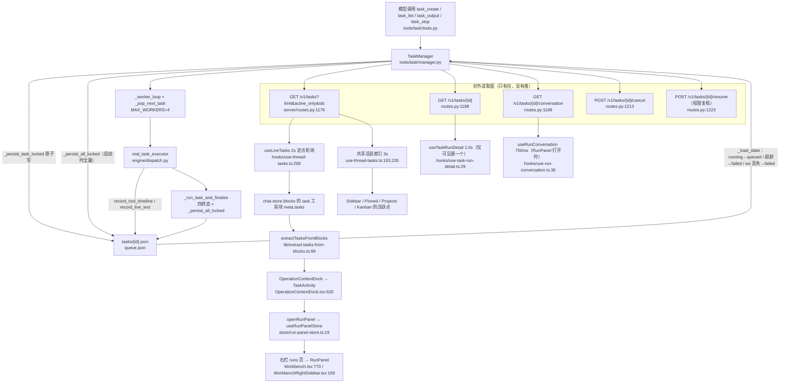
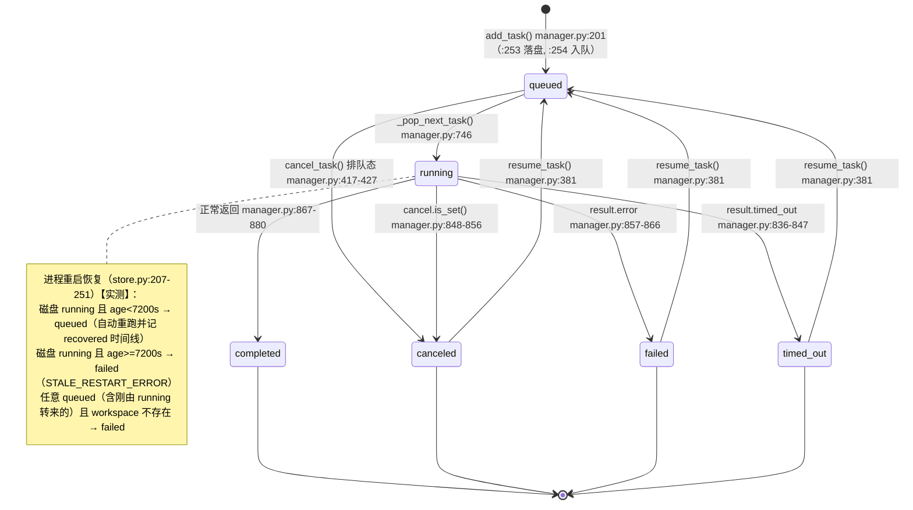
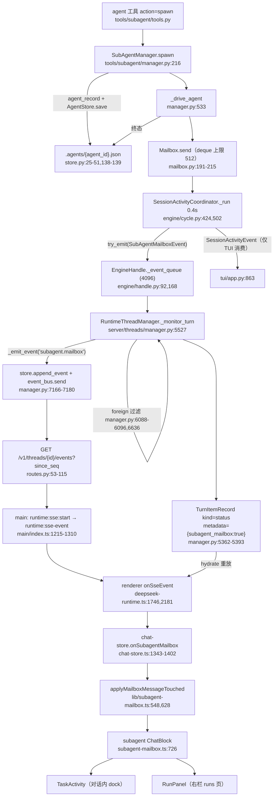
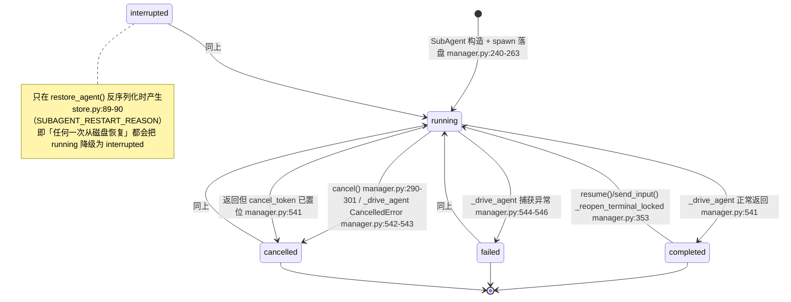

# Durable Task / Subagent 状态更新流程分析报告（build_1016 轮）

> **只读分析**：本轮唯一写入的文件是本报告；未改动任何产品源码、测试、配置或锁文件。
> 基线：`HEAD = 2fedc164`（分支 `build_1016`），`git status --porcelain` 输出 0 行（工作树干净），核对时间 2026-10-15。
> 数据源：所有 `file:line` 均在本轮工作树上重新打开文件核对，非沿用旧报告。
> 证据标注：**【读码】**＝直接读源码确认；**【实测】**＝本轮实际运行命令/测试得到；**【推断】**＝由已确认事实推导、未端到端验证。

---

## 1. 结论摘要

- **Durable Task**【读码】：状态的**唯一权威副本是磁盘 JSON**（`<data_dir>/tasks/{id}.json` + `queue.json` 排序索引），状态机只由 `src/deepseek_tui/tools/task/manager.py` 独占迁移（`queued→running→completed|failed|canceled|timed_out`，终态可 `resume` 回 `queued`）；**没有任何推送通道**（全部 `_emit_event` 事件名里不含 task 相关事件），UI 靠「工具块元数据快照 + 四路 HTTP 轮询（2s 定点 / 1.5s 详情 / 750ms 会话流 / 3s 侧栏活跃索引）」呈现。
- **Subagent**【读码】：权威副本是**per-thread 的 agent 记录目录** `~/.deepseek/agents/registries/<workspace_key>-<hash(thread_id)>.json` 的同名同目录 sidecar `<...>.agents/<agent_id>.json`（本轮已从单文件 registry 迁移为每 agent 一文件 + 墓碑删除）；运行期状态经 `Mailbox`（进程内 deque，非 asyncio.Queue）→ `SessionActivityCoordinator`（引擎生命周期内常驻，0.4s 排空）→ `subagent.mailbox` SSE → Electron IPC → 渲染层归约器 → `subagent` ChatBlock；**但这条通道只服务「本 turn 见过的 agent」，跨 turn/turn 后迟到的终态会被 foreign 过滤丢弃**，UI 卡片最终由孤儿清理强改成 `cancelled`。

---

## 2. 两条链路的数据流

### 2.1 Durable Task 链路



### 2.2 Task 状态机（`TaskStatus`，`tools/task/models.py:45-67`）



不可用状态：没有 `blocked` / `pending` / `interrupted`（`TaskStatus` 只有 6 个成员）。UI 侧的 `pending` 只属于 subagent 词表。

### 2.3 Subagent 链路



### 2.4 Subagent 三套状态机

**（a）后端权威 `SubAgentStatusKind`（`tools/subagent/types.py:401-406`）**



**（b）UI 卡片状态 `SubagentLifecycle`（`lib/subagent-mailbox.ts:6`）**：`pending | running | completed | failed | cancelled`，**没有 `interrupted`**。fanout 卡不存自身状态，由 worker 聚合（`subagent-mailbox.ts:640-651`）：任一 `failed`→`failed`；有 `running/pending`→`running`；全 `completed`→`completed`；全 `cancelled`→`cancelled`；混合终态→`cancelled`。

**（c）terminal 残留行降级**（`subagent-mailbox.ts:830-840`）：卡片已终态时，仍为 `running` 的 step 行按 `completed→info`、`failed/cancelled/interrupted→cancelled` 降级。

---

## 3. 关键模块与 file:line（本轮重新核对）

### 3.1 Task 后端

| 关注点 | 位置 | 说明 |
|---|---|---|
| 状态枚举/常量 | `src/deepseek_tui/tools/task/models.py:45-67`、`:34`、`:40`、`:42` | `MAX_WORKERS=4`、`_MAX_TERMINAL_IN_MEMORY=50`、`STALE_RUNNING_TASK_SECONDS=7200` |
| 入队 + 提交点 | `tools/task/manager.py:201-260` | 记录先落盘再改内存；`queue.json` 只作排序索引（注释 `:251-252`） |
| 列表/单读 | `manager.py:262-291`（`list_tasks` 支持 `since/active_only/task_ids`）、`:293-303`（`get_task`）、`:305-316`（`_catalog`：磁盘为历史索引，内存覆盖） |
| 取消 | `manager.py:406-460` | 排队态直接 `CANCELED`；运行态只记 `cancel_requested` + 置 token，并**有界等待 10s**（`:457`） |
| resume | `manager.py:343-404` | 拒绝 `queued/running`（`:367-370`）、只接受 `is_resumable()`（`:371-374`）、`expected_scope` 权限校验（`:375-379`）、写盘失败按 `fields()` 回滚（`:395-398`） |
| 运行期进度落盘 | `manager.py:624-653`（`record_tool_timeline`）、`:655-664`（`record_live_text`，尾部 20k 截断） |
| worker / 取任务 | `manager.py:692-725`、`:727-784` | `OSError` 时暂停 worker 并重试持久化（`:702-717`） |
| 终态归并 | `manager.py:814-890` | 顺序：`timed_out` → `cancel token` → `error` → `completed`；`completed` 时清 transcript 与 completions 收据（`:882-889`） |
| 内存淘汰 | `manager.py:892-903` | 仅淘汰内存，磁盘保留 |
| 持久化 | `manager.py:905-927` | `_persist_task_locked` 用 `self._persisted` 做脏检查，未变不写 |
| 磁盘恢复 | `tools/task/store.py:185-277` | 见 §2.2 note |
| HTTP 面 | `server/routes.py:1176-1245`；`server/app.py:373-398`（legacy 同路径） | 新：`/tasks/{id}/conversation`（`routes.py:1198-1210`） |
| runtime 包装 | `server/runtime.py:741-833` | `resume_task` 含权限变更复核 + `confirmation_key`（`:815-828`） |
| 工具块元数据 | `server/threads/items.py:492-529`、`:475-489` | `_TASK_TOOL_NAMES`（`:458-469`）**包含 `task_list`** |

### 3.2 Task 前端

| 关注点 | 位置 | 说明 |
|---|---|---|
| 对话内任务集合 | `lib/extract-tasks-from-blocks.ts:29-36`、`:99-108` | `TASK_TOOL_NAMES` **排除 `task_list`**（`:23-28`），只认「最后一次触碰该 id 的 task 工具块」 |
| 状态覆盖轮询（逐 id） | `hooks/use-thread-tasks.ts:239-256`、`:268-318` | `POLL_INTERVAL_MS=2000`（`:11`），请求 `/v1/tasks?ids=...`；全部终态即停表（`:273-275,308`）；活跃时顺带刷 pending user input（`:303-305`） |
| 侧栏活跃索引 | `use-thread-tasks.ts:141-161`、`:163`、`:235-237` | `/v1/tasks?active_only=true`，`ACTIVE_THREADS_POLL_MS=3000`，模块级共享（`:171-225`） |
| 详情轮询 | `hooks/use-task-run-detail.ts:6-38` | 1500ms，仅当前可见 task，`state.id === taskId` 防串扰（`:37`） |
| 会话流轮询 | `hooks/use-run-conversation.ts:18-37` | task 走 `/v1/tasks/{id}/conversation`，agent 走 `/v1/threads/{tid}/agents/{aid}/conversation`，750ms，终态停 |
| resume 权限复核 UI | `lib/resume-task.ts:4-36` | 首次 POST 不带 key；若返回 `resume_confirmation_required` → `window.confirm` 展示权限 diff → 带 `confirmation_key` 重发；再返回则报「权限已变」 |
| resume task | `use-thread-tasks.ts:82-99` | 经 `requestTaskResume(id, activeThreadId)` |
| resume agent | `use-thread-tasks.ts:102-130` | `POST /v1/threads/{tid}/agents/{aid}/resume` |
| 面板选择态 | `store/run-panel-store.ts:13-22` | 只存 `{target, request}`；`request` 自增作为「强制刷新」信号 |
| 右栏面板 | `components/right-sidebar/RunPanel.tsx:21-56`（选项列表）、`:58-195`（详情）、`:95-98`（可恢复判定）、`:99-115`（resume 动作） | 状态优先级 `conversation.status → detail.status → option.status → worker.status → agent.status`（`:80`） |
| 打开右栏 | `components/Workbench.tsx:770-779` | `runRequest` 变化 → `openRightSidebar('runs')`；切线程时移除 runs 页 |
| 右栏路由 | `components/right-sidebar/WorkbenchRightSidebar.tsx:136,156,169` | `hasRunSelection` 才显示 runs 启动项 |
| 对话内入口 | `components/chat/OperationContextDock.tsx:198-200`、`:620` | `TaskActivity` 的 `onOpen` = `openRunPanel` |
| 卡片渲染 | `components/chat/TaskActivity.tsx:17-98` | 单条点击直接开面板；多条展开列表（`:77-95`）；标题/状态文案 `:42-50` |

### 3.3 Subagent 后端

| 关注点 | 位置 | 说明 |
|---|---|---|
| 状态枚举 | `tools/subagent/types.py:401-406`；`_MAX_TERMINAL_AGENTS_IN_MEMORY=30`（`:28`）、`SUBAGENT_RESTART_REASON`（`:33`） |
| 记录序列化/恢复 | `tools/subagent/store.py:25-51`（`agent_record`）、`:54-101`（`restore_agent`，**`:89-90` running→interrupted**） |
| 存储布局 | `tools/subagent/store.py:104-143` | `directory = legacy_path.with_suffix(".agents")`；`load()` 合并 legacy 单文件 + 逐 agent 文件（`:110-136`）；`remove()` 写墓碑 `{"deleted": true}`（`:141-143`） |
| 路径 | `config/paths.py:211-220` | `<registries>/<workspace_key>[-<hash(session_id)>].json`；session_id 由 `engine/orchestrator/core.py:1184`（thread.id）与 `engine/dispatch.py:870`（task.id）传入 |
| spawn/取消/重启 | `tools/subagent/manager.py:216-277`、`:286-311`、`:334-361` | `_reopen_terminal_locked` **会补绑 loop_runtime**（`:348-349`，修掉了旧 R8） |
| 列表可见性 | `manager.py:181-198` | `_is_from_prior_session`（`:514-518`）→ 旧 boot 的 agent 默认被过滤 |
| mailbox 生产者 | `tools/subagent/mailbox.py:17-26`（9 种 kind）、`:173`（512）、`:191-215`（溢出优先丢 disposable，否则置 `_resync`）、`:224-233`（排空时按 snapshot 重放） |
| mailbox 快照 | `manager.py:105-115` | `_mailbox_snapshot` 以 `list_agents()` 合成 started + 终态信封 |
| 终态写入 | `manager.py:533-570` | 终态 → 落盘 → 发信封 → `_notify_parent_completion` → 淘汰内存 |
| 完成注入父会话 | `tools/subagent/completion.py`；`engine/orchestrator/core.py:2515-2618`（消费/去重）、`:2913-2960`（前台 handoff）、`:2529-2590`（后台隐藏 turn） |
| coordinator | `engine/cycle.py:424,427-525` | 0.4s；`_pending_mailbox` 在 `try_emit` 失败时**保留重试**（`:508-514`） |
| 事件通道 | `engine/handle.py:168-180`（`try_emit`）、`:92`（4096）、`:269-271`（`events()` 无限读同一队列） |
| Turn 落库/推送 | `server/threads/manager.py:5362-5393`、`:7166-7180`、`:7117-7121` |
| foreign 过滤 | `manager.py:6088-6096`、`:6636-6637` |
| 收尾三连 | `manager.py:5437-5478`（cancel orphan，`preserve_background` `:5473`）、`:5395-5435`（flush，`skip_ids` `:5431`）、`:5480-5525`（reconcile，`seq=0` `:5525`）；调用点 取消出口 `:6686-6694`、完成出口 `:6808-6817` |
| SSE | `server/routes.py:53-115`（含 `lagged` 补播与 `stream.resync_required` `:95,110`）、`:118-134`（`_replay_events`，`_ReplayUnavailable` `:130-131`） |
| 广播 | `server/threads/broadcast.py:12-37`；容量 `server/threads/models.py:14` = 1024 |
| 活跃判定 | `manager.py:775-789`；路由 `routes.py:1371-1378` |
| resume agent | `manager.py:2854-2876`（并 `discard` 去重集合 `:2875`）；路由 `routes.py:1572-1584` |
| 软恢复提醒 | `manager.py:4883-4920`；`soft_resume.py:15,41-51` |
| rewind 收敛 | `engine/orchestrator/core.py:612-626`（`prepare_session_rewind`）；`manager.py:3418-3429`（`REWIND_CHILD_JOIN_TIMEOUT_S=10.0`，`:151`） |

### 3.4 Subagent IPC 与渲染层

| 关注点 | 位置 | 说明 |
|---|---|---|
| IPC 转发 | `packages/workbench/src/main/index.ts:1215-1310` | 主进程 `fetch` 读 SSE，按块切分后 `safeWebContentsSend(wc,'runtime:sse-event',{streamId,data})`；`:1289` end、`:1296` error、`runtime:sse:stop` `:1312` |
| preload | `packages/workbench/src/preload/index.ts:181-208` | `startSse/stopSse/onSseEvent/onSseEnd/onSseError` |
| SSE 循环 | `agent/deepseek-runtime.ts:1689-1699`（`nextSinceSeq`、退避、`RECONNECT_FAILURE_LIMIT=6`）、`:1746-1765`（数据帧推进 seq）、`:2298`（重连带 since_seq）、`:2329-2334`（每轮 finally stop + 指数退避，上限 5s） |
| 归约入口 | `deepseek-runtime.ts:2181-2191` → `sink.onSubagentMailbox` |
| hydrate 重放 | `deepseek-runtime.ts:697-700`、`:726-744`、`:1250-1261` |
| 归约器 | `lib/subagent-mailbox.ts:6,201-213,332-400,425-495,503-511,548-614,628-638,640-656,688-724,726-770,787-822,830-840` |
| store 落地 | `store/chat-store.ts:1343-1402`（含 `emitPetEvent` 宠物联动 `:1346-1361`、`applySpawnPromptsToSubagentBlocks` 回填 prompt `:1400`）、`:1404-1412`（文本增量） |
| 孤儿清理 | `chat-store-runtime-helpers.ts:214-223`（`hasPendingRuntimeWork`）、`:229-240`（`finalizeOrphanRuntimeBlocks`）；`chat-store.ts:506-508`、`:548-573`（`reconcileStaleBusy`）、`:1508-1533`（turn 完成）、`:2276-2279`、`:2437-2439` |
| 展示：对话内 | `components/chat/OperationContextDock.tsx:620` → `chat/TaskActivity.tsx` | subagent 卡片**不进主对话流程**：`MessageTimeline.tsx:1578` 显式 `return false` 过滤（注释「Subagent status and navigation live in the side activity card」） |
| 展示：`SubagentBubble` | `MessageTimeline.tsx:1942`、`:2874-2876`、`:2739-2795` | 只有 `RunMessageTimeline`（RunPanel 内部）/`MessageBubble` 路径会渲染，主会话 turn 不走这里 |
| 展示：工具行 | `components/chat/tool/renderers/subagent.tsx:74-106` | 只有 Header（Bot 图标 + 动作标签），是降级渲染 |
| 展示：TurnActivity | `components/chat/TurnActivity.tsx:10-40` | 新增的「当前在干什么」状态条；`:21-23` 用正则匹配 `Waiting on N sub-agent(s) to complete...`（服务端发点 `engine/orchestrator/core.py:2926`） |

---

## 4. 状态字段与事件清单

### 4.1 Task 对外字段（`TaskSummary`，`tools/task/models.py:222-236`）

`id / status / prompt_summary / model / mode / created_at / started_at / ended_at / duration_ms / error / result_summary / thread_id / turn_id`。磁盘单任务记录（`TaskRecord` `:168-199`）另有 `live_text / timeline / checklist / gates / attempts / artifacts / github_events / tool_calls / runtime_event_count / result_detail_path`。

### 4.2 Subagent mailbox 信封字段（`_mailbox_message_payload`，`server/threads/manager.py:201-220`）

固定 16 键（不适用者为 `null`）：`kind, agent_id, agent_type, status, tool_name, step, tool_call_id, ok, parent_id, summary, error, model, usage, input_summary, output_summary, prompt`。

### 4.3 事件清单

| 层 | 事件 / 名称 | 载荷 | 通道 |
|---|---|---|---|
| 引擎 | `SubAgentMailboxEvent(seq, message)` | 上述 16 键 | 进程内，`engine/cycle.py:510` |
| 引擎 | `SessionActivityEvent(running_subagents, running_tasks, message)` | 计数 | 进程内；**服务端不消费**（`grep -rn "SessionActivityEvent" src/deepseek_tui/server/` 无命中），仅 TUI `tui/app.py:863` |
| 引擎 | `SubAgentTextDeltaEvent(agent_id, text)` | 文本增量 | 进程内 → 合成 `item.delta`（kind=`subagent_message`，item_id=`subagent_text_<id>`）`manager.py:6623-6633` |
| TurnItem | kind=`status`, status=`completed`, summary=`subagent:{agent_id}`, detail=`json({seq,message})`, metadata=`{subagent_mailbox:true}` | 见 §4.2 | 落库 `manager.py:5378-5389` |
| SSE | `subagent.mailbox` | `{seq, message}` | `manager.py:5391-5393` → `routes.py:44-46` |
| SSE | `stream.resync_required` | `{thread_id, since_seq, reason}` | `routes.py:95-98,110-113`（**前端无消费者**，见 R7） |
| SSE | 其它（`turn.lifecycle / turn.started / item.started / item.delta / item.completed / item.failed / turn.completed / turn.diff.updated / approval.required / user_input.required / turn.steered / turn.interrupt_requested / thread.started`） | — | `manager.py` 内 `_emit_event` 全部调用点 |
| — | **不存在 task 相关的 SSE 事件** | — | 事件名清单见 §3.1 / 实测 `grep _emit_event` |

契约覆盖（本轮核对）：
- `contracts/sse-event.schema.json:44` 只在 `event.examples` 里出现 `subagent.mailbox`；`allOf`（`:54-`）仍**没有** `subagent.mailbox` / `stream.resync_required` / `session.activity` 的 payload 分支。
- `contracts/runtime-api.openapi.yaml:646,669,685` 只文档化了 `/v1/tasks`、`/v1/tasks/{task_id}`、`/v1/tasks/{task_id}/cancel`；**缺** `/v1/tasks/{task_id}/resume`、`/v1/tasks/{task_id}/conversation`、`/v1/threads/{tid}/agents/{aid}/resume`、`/v1/threads/{tid}/active`，也没写 `active_only` / `ids` 查询参数与 `resume_confirmation_required` 分支；task 响应 schema 仍是裸 `type: object`。

---

## 5. 五个必答问题的直接答案

**Q1 权威副本在哪？**
- Task：磁盘 `<data_dir>/tasks/{id}.json`（`data_dir` 默认 `~/.deepseek/tasks/`，`models.py:311-320` → `config/paths.py:114-119`）。内存 `TaskManager._tasks` 是缓存，`_catalog()` 明确「磁盘是历史索引，内存覆盖磁盘」（`manager.py:305-316`）。
- Subagent：磁盘 `<registry>.agents/<agent_id>.json`。`_records`（磁盘原始 dict）与 `_agents`（活对象）在内存中并存，`_persist_state()` 只重写新增的（`manager.py:596-606`）。**注意**：`restore_agent` 会在每次反序列化时把 `running` 改写成 `interrupted`（`store.py:89-90`），所以「磁盘上的 running」永远无法被读回——这是权威副本的一个单向降级规则。
- UI 卡片：`chat-store.blocks` 里 `kind:'subagent'` 的块；它**不是**权威副本，只是最后一条被持久化的信封的投影（`subagent-mailbox.ts:6,548`）。

**Q2 UI 通过什么通道拿到状态？**
- Task：**纯 HTTP 拉取**，4 条独立轮询 + 1 条「工具块快照」合成（表见 §3.2）。没有 SSE、没有 IPC 直推。
- Subagent：**SSE → Electron IPC → 渲染层归约**（唯一实时通道），另有两条「兜底/重放」路径：turn 收尾 reconcile 重发终态信封（`manager.py:5480-5525`），以及线程详情 hydrate 时按 item 重放（`deepseek-runtime.ts:1250-1261`）。

**Q3 轮询/推送间隔与触发条件**
| 通道 | 间隔 | 触发/停止条件 | 位置 |
|---|---|---|---|
| Task 状态覆盖 | 2000ms | 会话内引用的 task 中存在 queued/running 时启动；全终态则停 | `use-thread-tasks.ts:11,273-275,308` |
| 侧栏活跃索引 | 3000ms | 有订阅者即启动（模块级共享）；无订阅者清定时器 | `use-thread-tasks.ts:163,206-221` |
| RunPanel 单 task 详情 | 1500ms | 仅「当前可见那一个」；`detail` 为 null 或终态即停 | `use-task-run-detail.ts:24,29` |
| RunPanel 会话流 | 750ms | 面板打开且状态在 `running/queued/pending`，或 `activeHint` | `use-run-conversation.ts:30,36` |
| Subagent mailbox | 400ms（引擎轮询） | 引擎 `run()` 启动 → 引擎结束停止；`try_emit` 失败时把 envelope 留在 `_pending_mailbox` 重试 | `cycle.py:424,502-525` |
| SSE | 实时 + 15s keepalive | 渲染层 `while (!signal.aborted)`，失败指数退避 750ms→5s，连续 6 次失败上抛错误 | `routes.py:58`、`deepseek-runtime.ts:1690,1696,2333-2334` |
| IPC SSE | 无节流 | 按网络块切帧上送 | `main/index.ts:1252-1274` |

**Q4 失败/取消/超时/重连的状态收敛是否完整？**
- Task：**基本完整**。四终态都在 `_run_task_and_finalize` 一个 `async with self._lock` 内一次性写盘（`manager.py:826-881`）；取消有 10s 有界等待（`:452-459`）；持久化失败会回滚到上一版本（`:395-398`、`:441-444`）。**不完整处**：`shutdown()` 直接 cancel worker（`:144-151`），若 finalize 未及执行，磁盘会停在 `running`，下次启动按 age 走 queued/failed——本 turn 的 `canceled` 语义丢失【推断】。
- Subagent：**有缺口**（详见 §6 R1/R3）。
  - 「本 turn 内」的收敛是三重兜底且顺序固定：cancel orphan → flush mailbox → reconcile（`manager.py:6686-6694`、`:6808-6817`）。
  - 「跨 turn」不收敛：turn 结束时尚未落库的终态信封，会以下一个 turn 的 foreign 身份被丢弃（`manager.py:6088-6096,6636`）。
  - 「重启后」不收敛到 UI：`interrupted` 不在 UI 词表里，且没有任何 HTTP 接口能列出 registry（`grep "/agents" routes.py` 只有 conversation / resume 两条）。
- 重连：SSE 断线用 `nextSinceSeq` 续传并做 backlog 补播（`deepseek-runtime.ts:2298`；`routes.py:66-69`）；当 backlog 已被 `_truncated` 截断时服务端发 `stream.resync_required` 并**主动关闭流**（`routes.py:95-99,110-113`），但前端没有对应分支 —— 见 R7。

**Q5 主会话展示入口与侧栏的关系**
- 主会话里 **subagent 卡片被显式从 work trace 中剔除**（`MessageTimeline.tsx:1578`）；`SubagentBubble`（`:1942`、`:2874`）只在 RunPanel 内部的 `RunMessageTimeline` 路径可达。
- 主会话唯一的 task/subagent 入口是输入框上方的 dock：`OperationContextDock.tsx:198-200` 组装 `extractTasksFromBlocks(blocks)` + `extractSubagentsFromBlocks(blocks)` → `:620` 渲染 `TaskActivity`。
- `TaskActivity` 单条点击 → `openRunPanel`（`store/run-panel-store.ts:19-22`）→ `Workbench.tsx:770-773` 打开右栏并切到 `runs` 页 → `WorkbenchRightSidebar.tsx:169` 渲染 `RunPanel`。
- 因此三者是**同一份 `blocks` 派生的三个视图**：dock（摘要）→ RunPanel（详情，唯一有 resume 按钮）→ 侧栏 Chat/Pinned/Projects/Kanban（只用一个 3s 轮询的活跃 id 索引打点，`use-thread-tasks.ts:235-237`）。
- 关系上的不对等：dock 的 task 成员来自「会话内 task 工具块」，侧栏的活跃点来自「全局 `/v1/tasks?active_only=true` 的 `thread_id` 归属」。二者可能不一致（见 R5）。

---

## 6. 已确认缺陷 / 风险

> R 编号沿用旧报告以便对照；新增项标「新增」。

### R1【仍成立，但机理已缓解】事件通道饱和时的丢弃
`try_emit` 在 `EngineHandle._event_queue`（上限 4096，`handle.py:92,168-180`）满时返回 False。**新变化**：coordinator 不再静默丢，而是把信封留在 `_pending_mailbox` 并阻塞后续排空（`cycle.py:508-514`），压力被推回 Mailbox；Mailbox 溢出时优先淘汰 `progress/tool_call_*`，若无可淘汰项才丢最旧并置 `_resync`，下次排空按 manager 快照重放（`mailbox.py:200-215,224-233`）。
- **残留缺口**：`snapshot_provider` = `manager._mailbox_snapshot`（`manager.py:105-115`）内部用 `list_agents()`，而 `list_agents` 会过滤掉 `session_boot_id` 不匹配的 agent（`manager.py:181-195,514-518`）→ **重放无法覆盖跨重启恢复的 agent**。
- 影响：极端饱和 + 跨重启场景下卡片仍可能失同步。验证方式：`box.lagged` 与 `Mailbox.needs_resync()` 可单测；端到端需要压测。

### R2【仍成立，未新增覆盖】mailbox 信封乱序的展示畸形
「completed 先到、started 后到」会多出一行、并把已完成行 `ok` 覆盖回 `null`（`subagent-mailbox.ts:215-253` 的 `findToolStepIndex`/`toolStepId` 语义）。**本轮未改这个文件**（`git diff --stat 6cad7119..HEAD -- .../lib/subagent-mailbox.ts` 无输出），风险与旧报告一致。验证方式：给 `subagent-mailbox.test.ts` 补反向用例。

### R3【仍成立，且本轮新增了「后台子代理存活」的正式测试，反而固化了该缺口】
- 机制（不变）：`_monitor_turn` 在 turn 开始时把 manager 已知 agent 全量标为 foreign（`manager.py:6088-6096`），此后 mailbox 事件直接 `continue`（`:6636-6637`）、flush 跳过（`:5431-5432`）。
- **新变化**：turn 完成出口新增 `preserve_background=True`（`manager.py:6808-6811`），后台子代理**不再被 turn 收尾取消**。新测试 `tests/contract/test_subagent_mailbox_sse.py:266-329`（`test_background_subagent_survives_normal_turn_close`）断言：turn 关闭后后台 agent 仍 `RUNNING`，之后可以正常 `COMPLETED`。
- **缺口**：该测试只断言 manager 内存状态，没有断言 UI 收到终态。真实链路里，后台 agent 的 `completed` 信封在 turn 结束后才产生 → `handle._event_queue` 里无人消费 → 下一个 turn（含后台完成触发的隐藏 turn，`core.py:2529-2590`）的 monitor 把它当 foreign 丢掉 → 卡片停在 `running` → 直到 `finalizeOrphanSubagentBlocks` 把它强改为 `cancelled`（`subagent-mailbox.ts:787-822`，调用点 `chat-store.ts:1530`）。
  → 最终表现：**后端 `completed`、UI 显示 `cancelled`**。这是【读码 + 单测机制确证】+【推断 UI 后果】。
- 验证方式：需要一条端到端用例——spawn `background=True`、turn 收尾、再驱动一个 turn，然后断言 `subagent.mailbox` 的 `completed` 没有独立于 turn 落库。

### R4【仍成立】双轮询窗口不一致
同一 task 同时被 2s 的 `/v1/tasks?ids=`（`use-thread-tasks.ts:241`）与 1.5s 的 `/v1/tasks/{id}`（`use-task-run-detail.ts:21`）覆盖；RunPanel 标题与列表状态取自不同源（`RunPanel.tsx:79-80`），极端下有 ≤2s 的不一致窗口。`useTaskRunDetail` 的 `state.id === taskId` 回读校验（`:37`）避免串扰。

### R5【仍成立】Task 列表身份 vs 侧栏活跃身份不同源
dock 的成员 = 会话内 task 工具块（`extract-tasks-from-blocks.ts:23-36,99-108`，**显式排除 `task_list`**）；侧栏打点 = 全局 `active_only` 索引按 `task.thread_id` 归属（`use-thread-tasks.ts:141-161`）。`thread_id` 只在 task 创建时写入（`manager.py:238`），历史任务没有该字段 → 只有 `taskIds` 能兜住。
**本轮新增的不一致**：后端 `_TASK_TOOL_NAMES` **包含 `task_list`**（`server/threads/items.py:458-469`），于是 `task_list` 的整份进程级任务列表（可达数十条陈旧 failed 记录）会被写进该工具块的 `metadata["tasks"]`；前端因为自己的 `TASK_TOOL_NAMES` 排除了它而忽略（`extract-tasks-from-blocks.ts:23-36`）。**结论：行为上被前端兜住了，但后端把大列表塞进 item metadata 是纯冗余开销**（`items.py:511-521` 归一化后仍全量保留）。

### R6【仍成立】`seq=0` 合成信封
reconcile 重发终态用 `seq=0`（`manager.py:5525`），前端 `nextStepId` 对 `seq<=0` 走「最大数字后缀 +1」（`subagent-mailbox.ts:201-213`）。无 seq 的 `progress` 只能靠文本归一化去重。

### R7【新增】`stream.resync_required` 服务端发、前端无人接
- 服务端：`routes.py:95-99` 与 `:110-113` 在 backlog 截断时发该帧并 `return`（关闭流）。
- 全仓 `grep -rn "resync_required" packages/workbench/src/` **无命中**（只有服务端两处）。渲染层的事件 switch 没有该分支 → 落到 default，随后 `runtime:sse-end` → `finish({type:'end'})` → while 循环重连，`consecutiveFailures` 因收到过数据帧而被重置为 0（`deepseek-runtime.ts:1748-1749`），`nextSinceSeq` 仍是同一个值。
- 影响【推断】：对一条被截断的旧线程，客户端可能进入「重连 → 立刻再 resync_required → 再重连」的循环，每次间隔 ≥750ms，且永远不会向用户报错（因为没有达到 `RECONNECT_FAILURE_LIMIT`）。
- 验证方式：`tests/contract/test_events_sse.py` 方向可补一条「legacy 截断 → resync_required → 客户端行为」的用例；或直接看 `_replay_events` 的 `_ReplayUnavailable` 触发条件（`routes.py:128-131`，需要 `payload._truncated` 且事件名是 noisy）。

### R8【已修复——旧报告最重要的一条】重启后 resume 必定失败
旧报告的复现是「`_load_state` 重建 agent 未补 `loop_runtime` → `real_subagent_executor` 首行抛 `Sub-agent loop runtime is missing`」。本轮 `_reopen_terminal_locked` 增加了回填（`manager.py:346-349`：`if agent.loop_runtime is None and self._loop_runtime is not None: agent.loop_runtime = self._loop_runtime.with_spawn_depth(...)`），并新增测试 `tests/test_subagent_restart_resume.py:57-111`（`resume` / `send_input` × `was_running` 两个参数，断言重启后能从 checkpoint 继续并再次 `completed`）。
**【实测】** `tests/test_subagent_restart_resume.py` 本轮全绿（见 §8）。**结论：R8 已失效，跨重启 true-resume 在当前代码下成立。**

### R9【仍成立】软恢复提醒列不出跨重启的子代理
`_build_soft_resume_reminder_text` 用 `sub_mgr.list_agents()`（`manager.py:4893-4896`），`list_agents → list_filtered(include_archived=False)` 会跳过 `_is_from_prior_session` 的 agent（`manager.py:189-191,514-518`）；registry 恢复的 agent 保留旧 `session_boot_id`（`store.py:80`）→ 重启后它们对提醒不可见。tasks 部分不受影响（同函数 `:4906-4913`）。**读码确认**。

### R10【新变化】存储布局改了：并发/隔离改善，但权威副本路径变了
`~/.deepseek/agents/registries/<workspace_key>.json` 现在只是 legacy 入口；实际记录在 `<workspace_key>[-<hash(session_id)>].json.agents/<agent_id>.json`（`store.py:104-107`），并且 Workbench 每个 thread、每个 durable task 都用带自己 id 的 registry（`core.py:1184` 传 `thread.id`，`dispatch.py:870` 传 `task.id`）。`remove()` 改成写墓碑（`store.py:141-143`）而不是删文件。
- **正面**：不同线程/任务不再互相覆盖 registry，也不会在并发 engine 间 clobber。
- **代价**：任何依赖「一个 workspace 一个 registry 文件」的外部工具/脚本会读不到数据；且 tombstone 会永久累积。`config/paths.py:211-220` 的 docstring 仍写着 「One file per workspace」，与实现已不一致。

### R11【新增】每条 mailbox 信封都要重写一次 turn 记录与事件日志
`_persist_subagent_mailbox` 每条信封做 1 次 `store.save_item` + 1 次 `_attach_item_to_turn`（后者是 `load_turn` + `save_turn`，`manager.py:7117-7121`）+ 1 次 `store.append_event`。而 monitor 对 **每一条** envelope 都调用它（`manager.py:6639-6641`），包含 `progress` / `tool_call_started` / `tool_call_completed`。一个多工具子代理会产生数百条。
- 影响【推断】：turn 记录体积（`item_ids` 线性增长）与磁盘 IO 随子代理工具调用数平方级增长；对长跑任务有性能风险。
- 对照：Task 侧做了节流（`record_live_text` 由调用方节流、`_persist_task_locked` 有脏检查），Subagent 侧没有等价节流。
- 验证方式：可写一个只读计数脚本统计一个 turn 内的 `status` item 数；或在 `store.save_item` 上打点。

### R12【新增】右栏 `RunActivity` 组件已成孤儿
`components/right-sidebar/RunActivity.tsx` 导出的 `RunActivity`（`:18-63`）及其依赖的 `groupRunActivity / runActionCount / runActionTargets / compactRunTarget`（`lib/run-activity.ts:10-54`）只被 `run-activity.test.ts` 引用；全渲染树只用到同文件的 `RunStateIcon`（`RunPanel.tsx:17`、`RunSwitcher.tsx:7`）。RunPanel 已改用 `RunMessageTimeline`（`RunPanel.tsx:172-178`）。
- 影响：任务书把 `RunActivity.tsx` 列为「UI 状态与展示」的一环，实际它已不在渲染路径上——后续改动不要以它为准；测试绿并不能证明面板行为。
- 验证方式：`grep -rn "RunActivity" packages/workbench/src --include=*.tsx`（本轮已做，无渲染点）。

### R13【仍成立】状态词表不对齐
后端 5 态含 `interrupted`（`types.py:404`），UI `SubagentLifecycle`（`subagent-mailbox.ts:6`）与 `DockSubagentStatus`（`extract-subagents-from-blocks.ts:4`）都没有它。它只被 `terminalResidualStatus`（`subagent-mailbox.ts:830-840`）与 `RunPanel.tsx:97`（可恢复判定里含 `'interrupted'`）认知。
**问题**：`RunPanel.tsx:97` 的这条分支在当前数据流下几乎不可达——`status` 来源是 `SubagentLifecycle`（`RunPanel.tsx:80`），不可能等于 `'interrupted'`。它可能是为 `conversation.status` 预留的，属于死分支【推断】。同时 `runStatusKey` 把 `interrupted` 映射成「已取消」文案（`lib/run-activity.ts:65`）。
**注意**：本轮 `restore_agent` 把 running→interrupted 的转换提前到「任何反序列化」（`store.py:89-90`），所以 `interrupted` 的产生面变大了，而 UI 仍不可见。

### R14【仍成立，措辞不一致】`resume_subagent` docstring 与实现不符
`server/threads/manager.py:2857-2862` 声称 RuntimeError 会覆盖「already running / completed」，但 `SubAgentManager.resume` 只拒 RUNNING（`tools/subagent/manager.py:403-404`），其自身 docstring 明确「A completed report does not block this」（`:398-399`）。以代码为准。

### R15【仍成立】契约缺口
见 §4.3：新增的 `resume_confirmation_required`、`active_only`/`ids`、`/conversation`、`/active`、`stream.resync_required` 全都没有写进 `contracts/`。`openapi` 里 task 列表的 `items` 仍是 `type: object`。

---

## 7. 相对旧基线（6cad7119 第 2 轮复核版）的逐条变化

工作树干净、分支已从 `6cad7119` 前进到 `2fedc164`（跨 111 个提交，`git diff --stat 6cad7119..HEAD` 共 847 文件）。以下只列与本任务两条链路相关的部分。

### 7.1 结论仍成立（机制未变）

| 旧结论 | 现状 | 证据 |
|---|---|---|
| Task 无推送通道，靠轮询 | **成立**，且轮询路数变多了（新增会话流 750ms） | `grep _emit_event` 无 task 事件；`use-run-conversation.ts:19-20,36` |
| Task 权威副本 = 磁盘 JSON | **成立** | `manager.py:305-316`；`store.py:185-277` |
| Task 状态机 6 态、四终态集中在 finalize | **成立**，行号整体偏移 | `manager.py:814-890`（旧 `:709-749`） |
| 重启恢复三分支（young→queued / stale→failed / ws 丢失→failed） | **成立**，且【实测】复现 | `store.py:207-251`；§8 内联脚本输出 |
| `SubagentLifecycle` 无 `interrupted`，UI 词表不对齐 | **成立，且 `interrupted` 产生面变大** | `subagent-mailbox.ts:6`；`store.py:89-90` |
| reconcile 用 `seq=0` 重发终态 | **成立** | `manager.py:5525`；`subagent-mailbox.ts:201-213` |
| turn 收尾三连（cancel orphan / flush / reconcile） | **成立**，且完成出口新增 `preserve_background=True` | `manager.py:6686-6694`、`:6808-6817` |
| foreign 过滤丢弃上一 turn 的信封 | **成立**，注释与结构未变 | `manager.py:6088-6096`、`:6636-6637` |
| `SessionActivityEvent` 不被服务端消费 | **成立** | `grep -rn "SessionActivityEvent" src/deepseek_tui/server/` 仍无命中 |
| 契约缺口（sse-event 无 mailbox payload 分支；openapi 缺 resume 等） | **成立且扩大** | `contracts/sse-event.schema.json:44,54-`；`runtime-api.openapi.yaml:646-` |
| 主会话不渲染 subagent 卡片 | **成立**（本轮找到显式过滤点） | `MessageTimeline.tsx:1578` |

### 7.2 结论已失效 / 被修掉

| 旧结论 | 现状 | 证据 |
|---|---|---|
| **R8：进程重启后 resume/send_input 必定失败**（旧报告最重要的一条） | **已修复**。`_reopen_terminal_locked` 补绑 `loop_runtime` | `manager.py:346-349`；`tests/test_subagent_restart_resume.py:57-111`；【实测】该文件本轮通过 |
| 「state 权威副本 = `~/.deepseek/agents/registries/<workspace>.json` 单文件」 | **已失效**：改为 per-agent 文件 + 墓碑，且路径含 session 维度 | `store.py:104-107,110-143`；`config/paths.py:211-220`；`core.py:1184`、`dispatch.py:870` |
| 「`try_emit` 队满即静默丢弃（协调器直接丢）」 | **已失效**：coordinator 改为保留重试；丢压力转移给 Mailbox 的「优先丢 disposable + resync」 | `cycle.py:508-514`；`mailbox.py:200-215,224-233` |
| 「mailbox 队满丢最旧一条」 | **已失效**：先丢最旧的 disposable（progress/tool_call_*），无 disposable 才丢队首并置 resync | `mailbox.py:200-215` |
| 「`running→interrupted` 只在 `_load_state()` 发生（`manager.py:566-570`）」 | **已失效**：迁到 `restore_agent`，任何一次反序列化都会降级 | `store.py:89-90`；`manager.py:608-623` 现在只是 load 循环 |
| 「`/v1/tasks` 未透传 `since`；UI 靠会话内 task 工具块规避历史任务」 | **部分失效**：新增 `active_only` 与 `ids` 两个参数（仍没有 `since`），UI 改用 `ids=` 定点查询 | `routes.py:1180-1184`；`use-thread-tasks.ts:143,241` |
| 「resume task 是无条件重排队」 | **已失效**：新增权限复核 + `confirmation_key`，权限收窄时返回 `resume_confirmation_required` | `runtime.py:775-828`；`routes.py:1232-1233`；`lib/resume-task.ts:4-36` |
| 「后端 `_TASK_TOOL_NAMES` 与前端一致地排除 `task_list`」 | **需更正**：后端 `server/threads/items.py:458-469` **包含** `task_list`；前端 `extract-tasks-from-blocks.ts:23-36` 排除。（该后端集合其实在 6cad7119 就已包含 `task_list`，旧报告把它与前端集合混为一谈） | 两处 file:line |

### 7.3 行号偏移对照（旧 → 新）

| 目标 | 旧报告行号 | 本轮行号 |
|---|---|---|
| Task 入队 | `tools/task/manager.py:201` | `:201`（未变） |
| Task 取任务置 RUNNING | `:628` | `:746` |
| Task 四终态 | `:709-749` | `:836-880` |
| Task resume | `:290-320` | `:343-404` |
| Task cancel | `:330`/`:342-350` | `:417-427`/`:428-437` |
| `_persist_all_locked` | `:765-775` | `:905-909` |
| `store._load_state` | `store.py:175-219` | `store.py:185-277`（新增 invalid-record 跳过 `:196-201` 与 schema 校验 `:202-206`） |
| subagent spawn 落盘 | `manager.py:229` | `:263` |
| subagent cancel | `:250-265` | `:286-311` |
| `_reopen_terminal_locked` | `:267-277` | `:334-361`（**新增 loop_runtime 回填 `:346-349`**） |
| `_drive_agent` 三终态 | `:435-478` | `:533-570` |
| `_load_state`（running→interrupted） | `:566-570` | 逻辑迁至 `store.py:89-90` |
| `_trim_cache` | `:483-495` | `:576-586` |
| `known_agent_ids` | `:378-386` | `:482-490` |
| mailbox 上限/丢最旧 | `mailbox.py:172,198-206` | `:173,200-215`（语义已变） |
| coordinator 轮询 | `cycle.py:404,479-497` | `:424,476-525` |
| `_persist_subagent_mailbox` | `manager.py:4795-4826` | `:5362-5393` |
| flush / orphan / reconcile | `:4828-4868`/`:4870-4907`/`:4909-4954` | `:5395-5435`/`:5437-5478`/`:5480-5525` |
| foreign 过滤 | `:5506-5519`/`:6051-6053` | `:6088-6096`/`:6636-6637` |
| 收尾三连调用点 | `:6102-6110`/`:6212-6219` | `:6686-6694`/`:6808-6817` |
| IPC SSE | `main/index.ts:1196-1301` | `:1215-1310`（逻辑未变） |
| preload SSE | `preload/index.ts:171-197` | `:181-208` |
| `onSubagentMailbox` | `chat-store.ts:1288-1345` | `:1343-1402` |
| `reconcileStaleBusy` | `chat-store.ts:478-499` | `:548-573` |
| turn 完成收敛 | `chat-store.ts:1470` | `:1508-1533` |
| UI 归约器 / 孤儿清理 / 词汇表 | `subagent-mailbox.ts:548-614,787-822,6,830-840` | **完全一致**（该文件本轮零改动） |
| `extract-tasks-from-blocks.ts` | `:23-36,99-108` | **完全一致**（零改动） |
| `extract-subagents-from-blocks.ts` | `:4,102-120` | `:4,102-120`（零改动） |
| `run-subagent-flow.ts` | 未给 | `:14,70`（零改动） |
| Task HTTP 路由 | `routes.py:1115-1150` | `:1176-1245`（+ conversation 路由） |
| TaskActivity | `TaskActivity.tsx:30-54,56-103`；dock `:592` | `TaskActivity.tsx:21-50,52-97`；dock `:620` |
| RunPanel | `RunPanel.tsx:75,88-107,156-164` | `:80,95-115,160-168`（resume 判定重写） |
| 侧栏活跃标记 | `SidebarChatsSection.tsx:54` | `:68` |

### 7.4 旧报告未覆盖、本轮补齐的点
1. 存储布局从单 registry 迁到 per-agent 文件 + per-session 路径（R10）。
2. Mailbox 溢出策略从「丢最旧」升级为「丢 disposable + resync 重放」（R1/R2）。
3. `stream.resync_required` 服务端已发、前端无消费者（R7）。
4. `useRunConversation` 带来的第四条轮询（750ms）+ 两个新的 conversation HTTP 路由。
5. Task resume 的权限复核（`confirmation_key`）。
6. rewind 时对前台子代理的有界 join（`prepare_session_rewind` + 10s，`core.py:612-626`、`manager.py:3418-3429`）与完成出口的 `preserve_background=True`。
7. `_persist_subagent_mailbox` 每条信封重写 turn 记录（R11）与 `RunActivity` 组件已孤儿化（R12）。
8. `SubagentBubble` 在主会话被显式过滤（`MessageTimeline.tsx:1578`），旧报告只说「没有独立面板组件」。

---

## 8. 本轮执行的命令（可复现）

```bash
# 0) 基线
git rev-parse --short HEAD                 # 2fedc164
git status --porcelain | wc -l             # 0
git log --oneline 6cad7119..HEAD | wc -l   # 111
git diff --stat 6cad7119..HEAD | tail -1   # 847 files changed

# 1) 后端：Subagent / Task 状态与收敛
.venv/bin/python -m pytest \
  tests/test_subagent_restart_resume.py tests/contract/test_subagent_mailbox_sse.py \
  tests/contract/test_task_delivery.py tests/test_subagent_interrupt.py \
  tests/test_handoff_ledger_live.py -q
#   -> 24 passed in 1.37s

.venv/bin/python -m pytest \
  tests/test_subagent_audit_fixes.py tests/test_task_queue_recovery.py \
  tests/test_durable_resume.py tests/test_durable_resume_trigger_api.py \
  tests/test_task_list_filters.py -q
#   -> 32 passed in 0.84s

.venv/bin/python -m pytest \
  tests/contract/test_subagent_mailbox_sse.py tests/contract/test_task_delivery.py \
  tests/contract/test_rewind_thread.py tests/test_subagent_audit_fixes.py \
  tests/test_task_queue_recovery.py tests/test_subagent_restart_resume.py \
  tests/test_soft_resume_reminder.py tests/test_send_input_resumes_terminal_agent.py \
  tests/test_task_resume_permissions.py -q
#   -> 82 passed in 4.77s

# 2) 渲染层
cd packages/workbench && npx vitest run \
  src/renderer/src/lib/subagent-mailbox.test.ts \
  src/renderer/src/components/chat/TaskActivity.test.ts \
  src/renderer/src/lib/run-activity.test.ts \
  src/renderer/src/components/right-sidebar/RunPanel.test.ts \
  src/renderer/src/lib/extract-subagents-from-blocks.test.ts
#   -> 5 files, 40 tests passed

# 3) 内联脚本（stdin，不落文件）：Task 重启恢复四分支
.venv/bin/python - <<'PY'  # _load_state 直接调用
# task_fresh(running,60s)                -> queued   (in_queue=True)
# task_recovered_missing_ws(running,60s) -> failed   err=workspace not found: /nonexistent/abc
# task_stale(running,7260s)              -> failed   err=Task interrupted (stale after restart)
# task_ws(queued,ws 不存在)              -> failed   err=workspace not found: /nonexistent/xyz
PY

# 4) 只读检索（用于定位/排除）
grep -rhn "_emit_event(" -A 1 src/deepseek_tui/server/threads/manager.py | grep -o '"[a-z][a-z_.]*"' | sort -u
#   -> 无任何 task 相关事件名
grep -rn "resync_required" packages/workbench/src/ src/deepseek_tui/ --include=*.ts --include=*.tsx --include=*.py
#   -> 仅 src/deepseek_tui/server/routes.py:95,110
grep -rn "RunActivity" packages/workbench/src --include=*.ts --include=*.tsx
#   -> 只有 RunStateIcon 的 import（RunPanel.tsx:17 / RunSwitcher.tsx:7）
git diff --stat 6cad7119..HEAD -- \
  packages/workbench/src/renderer/src/lib/subagent-mailbox.ts \
  .../lib/run-subagent-flow.ts .../lib/extract-subagents-from-blocks.ts
#   -> 空（三个归约/提取文件本轮零改动）
```

**本轮写入的唯一文件**：`scratch/subagent-status-report.build_1016.md`（本报告）。未做任何源码/测试/配置改动。

---

## 9. 不确定项与证据边界

1. **R3 的 UI 后果为【推断】**：本轮的 `test_background_subagent_survives_normal_turn_close`（`tests/contract/test_subagent_mailbox_sse.py:266-329`）只覆盖到 manager 内存状态，没有覆盖「终态信封在 turn 后被 foreign 丢弃 → 卡片变 cancelled」。断裂处需要一条把 monitor + chat-store 串起来的用例才能确证。
2. **R7 的「重连死循环」为【推断】**：本轮未构造 legacy 截断事件日志，也没跑 GUI。要确证需要构造 `payload._truncated` + noisy 事件名的旧日志，再观察渲染层循环。
3. **R11 的规模影响未量化**：没有统计真实会话里单 turn 的 `subagent_mailbox` item 数，也没有测量 `save_item + load_turn + save_turn + append_event` 的实测耗时。
4. **R13 中 `RunPanel.tsx:97` 的 `'interrupted'` 分支是否可达未验证**：从类型上看不可达；如果 `useRunConversation` 返回的 `conversation.status` 可能取到后端词表，则可达。本轮没有跑到那条分支。
5. **Task `shutdown()` 中途取消是否让磁盘停在 `running` 未实测**：`manager.py:144-151` 直接 cancel worker，finalize 是否来得及取决于调度；本轮未构造该时序。若停在 running，下次启动按 age 走 queued/failed。
6. **`_mailbox_snapshot` 重放不会覆盖跨重启 agent**：读码确认（走 `list_agents()`），但没有端到端构造「重启 + 溢出 + 重放」的组合场景。
7. **未验证项**：多窗口并发 SSE 同一 thread；`handoff_timeout_secs`（默认 600，`tools/subagent/manager.py:61`）超时后的注入形态；`_trim_cache` 淘汰后对已淘汰 agent 调 `cancel`/`get_result` 的行为（`_require_agent` 会从 `_records` 恢复，但恢复瞬间即被降级为 `interrupted`——`store.py:89-90`）；`rewind` 的 10s 超时分支。
8. **行号时效性告警**：`packages/workbench/src/renderer/src/store/chat-store.ts`（本轮 +457 行）、`src/deepseek_tui/server/threads/manager.py`（+813 行）是本轮偏移最大的两个文件，后续任何改动都应重新定位而非沿用本报告行号。
